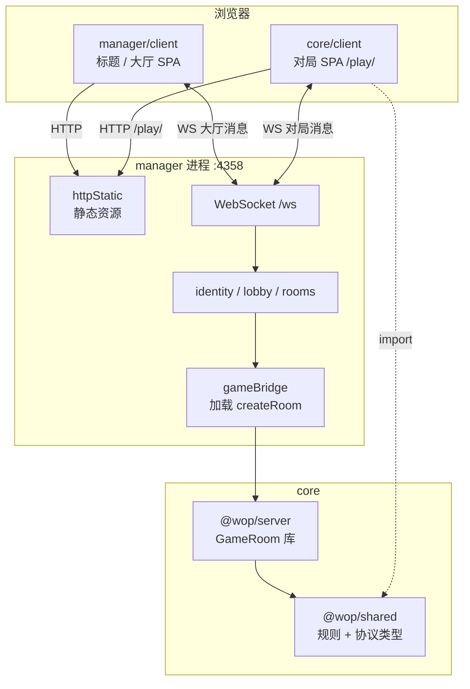
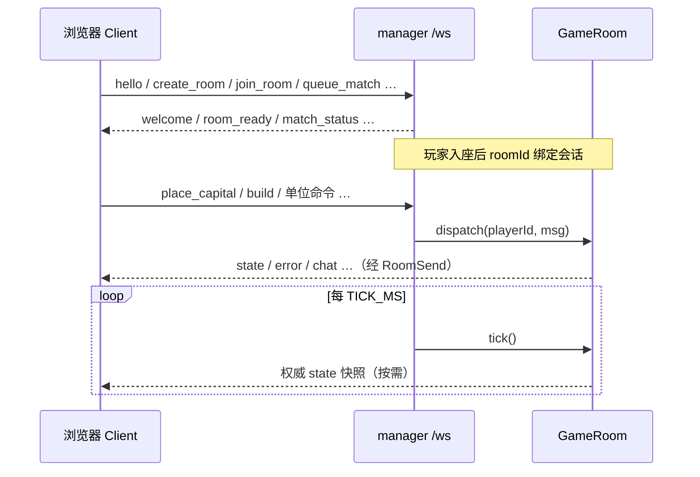

# 00 — 项目总览

WarOnPaper（产品名「纸上谈兵 4」）是一个 **Node.js + TypeScript** 的实时对局游戏仓库。权威仿真在服务端房间内运行；浏览器通过 WebSocket 收快照、发指令；共享包提供双方共用的规则与协议类型。

## 1. 仓库形态

根目录**不是**单一 npm workspace，而是两个可独立 `npm install` 的树：

| 根 | 角色 |
|----|------|
| `core/` | npm workspaces：`shared` + `server` + `client`（游戏核心） |
| `manager/` | 产品入口：标题/大厅 UI、身份、匹配、多房间、静态托管，并动态加载 `core/server` 的 `GameRoom` |

根目录脚本把二者串起来：

- `start.cmd` / `start.sh` → `manager/start.js`（缺构建则先构建再监听）
- `build.cmd` → 依次构建 core 全套 + manager 服务端 + manager 标题客户端

产品展示版本在根目录 `version.json`（字段 `version`），由两个 Vite 客户端通过 `@version.json` 别名读取。

## 2. 包与职责



### `@wop/shared`（`core/shared`）

- 纯 TypeScript 逻辑库：无 DOM、无 WebSocket。
- 导出 tick 常量（`TICK_HZ = 15`，`TICK_MS`）、地图尺寸、`GameStateSnapshot`、`ClientToServer` / `ServerToClient`，以及建筑 / 单位 / 地形 / 视野等函数与类型。
- 构建产物：`core/shared/dist/`；server 依赖已构建的包；client 开发时 Vite 别名直指 `shared/src/index.ts`。

### `@wop/server`（`core/server`）

- **库入口**：`package.json` 的 `main` / `exports` → `dist/room.js`（`createRoom` / `GameRoom`）。
- **调试入口**：`src/index.ts` 单独起一个 WebSocket 单房间（默认端口 `8787`）。生产路径**不要**加载 `dist/index.js`。
- `room.ts` 持有权威状态；`units.ts` 封装单位命令与 tick 推进；规则实现调用 `@wop/shared`。

### `@wop/client`（`core/client`）

- Vite + React 19 对局 SPA。
- `useGameSocket` 连接同主机 `/ws`（可用 `VITE_WS_URL` 覆盖）。
- 服务端快照是 E/O、建筑、单位等的唯一真相源；本地用 shared 做地形复现、造价/路径预览与交互。

### `@wop/manager`（`manager`）

- HTTP：标题 SPA（`manager/client/dist`）、对局 SPA（`/play/` → `core/client/dist`）、共享资源（`core/assets`）。
- WebSocket `/ws`：大厅消息本地处理；对局消息转发到对应 `GameRoom.dispatch`。
- `gameBridge.ts` 动态 `import` `core/server/dist/room.js` 的 `createRoom`。
- `RoomRegistry` 按 `GAME_TICK_MS`（与 shared 的 15 Hz 一致）对所有房间调用 `tick()`。
- 身份持久化：`manager/data/identities.json`（gitignore）。

### `@wop/manager-client`（`manager/client`）

- 独立 Vite 项目（不在 `core` workspace 内）。
- 标题屏：创建/加入房间、匹配队列；成功后导航到 `/play/`。

## 3. 运行时数据流

### 3.1 启动与静态路径

1. 用户访问 `http://localhost:4358/` → `manager/client/dist`（标题）。
2. 进入对局 → `http://localhost:4358/play/` → `core/client/dist`。
3. `/assets/*`、图标等：优先各 SPA 的 Vite `dist/assets`，再回落到 `core/assets`。
4. `/health`、`/healthz` → `{ ok: true, service: "wop-manager" }`。

### 3.2 WebSocket 消息分流



- **大厅类**（`manager/src/protocol.ts` 的 `LobbyClientMessage`）：在 manager 内处理身份、建房、加入、匹配、离房。
- **对局类**：不透明转发到 `GameRoom`；协议类型定义在 `@wop/shared`。
- 客户端本地缓存：`wop:playerId`、`wop:playerName`、`wop:lastRoomId`（对局 client）；manager 标题侧有独立 `storage.ts`。

### 3.3 权威与客户端职责

| 数据 | 权威位置 | 客户端 |
|------|----------|--------|
| `you.energy` / `you.organization` | GameRoom | 只展示；预览造价可本地算，不改余额 |
| 建筑 / 联络线 / 单位 / 污染 | GameRoom | 渲染快照 |
| 地形几何 | 房间 `terrainSeed` + shared 生成器 | 用同 seed 本地复现 |
| 视野过滤后的世界 | server 用 shared vision 过滤后下发 | 按 `role` 显示 |

## 4. 构建与开发流

### 4.1 产品路径（推荐）

```text
build.cmd
  → core: npm run build   # shared → server → client
  → manager: build:server
  → manager/client: build

start.cmd / start.sh / node manager/start.js
  → 缺 dep 则 npm install
  → 缺 dist 则自动 build（或 WOP_BUILD=1 强制）
  → node manager/dist/index.js   # PORT 默认 4358
```

### 4.2 核心开发（`core/`）

```bash
cd core
npm install
npm run dev          # concurrently：server + client
# 或
npm run dev:server   # tsx watch → 调试 WS :8787
npm run dev:client   # Vite :5173，代理 /ws → :4358
```

说明：

- 仅跑 `core` 的 debug server 时，可把客户端 `VITE_WS_URL=ws://localhost:8787` 指过去。
- 完整大厅体验需要先起 manager（:4358）；`core/client` 的 Vite 默认把 `/ws` 代理到 manager。

### 4.3 Manager 开发

```bash
cd manager && npm run dev          # tsx watch src/index.ts
cd manager/client && npm run dev   # Vite :5174，代理 /ws、/play、/assets → :4358
```

## 5. 关键配置文件一览

| 文件 | 要点 |
|------|------|
| `/version.json` | `{ "version": "…" }` 产品版本字符串 |
| `/build.cmd`、`/start.cmd`、`/start.sh` | 跨包构建与启动 |
| `core/package.json` | workspaces：`shared` / `server` / `client`；`dev` / `build` |
| `core/*/package.json` | 各包脚本与依赖（见 [02](./02-config-and-tooling.md)） |
| `core/*/tsconfig.json` | shared：出声明到 `dist`；server：NodeNext；client：`noEmit` + Vite |
| `core/client/vite.config.ts` | `@wop/shared` 源码别名、`publicDir`→`../assets`、代理 `/ws` |
| `manager/package.json` | 服务端构建 / 启动；依赖 `ws` |
| `manager/client/vite.config.ts` | `@version.json`、端口 5174、代理 `/ws` `/play` `/assets` |
| `.gitignore` | `node_modules`、`dist`、`manager/data/`、`.env*` 等 |

## 6. 地图与匹配（与架构相关的约定）

来自 `core/shared/src/map.ts` 与 `manager/src/lobby.ts`：

| `MapSizeId` | 格子 | 用途 |
|-------------|------|------|
| `89x59` | 89×59 格（90×60 线） | 小图；匹配人数 2–3 |
| `119x79` | 119×79 格（120×80 线） | 大图；匹配人数 4–5 |

匹配队列目标人数为 2–5；匹配成房时 `allowRespawn=false`。自定义建房可由客户端指定 `mapSize`、`maxPlayers`（2–10）、`allowRespawn`、可选 `seed`。

## 7. 相关文档

- [01-repository-structure.md](./01-repository-structure.md) — 目录说明  
- [02-config-and-tooling.md](./02-config-and-tooling.md) — 脚本与环境变量细节  
- [shared/README.md](./shared/README.md) / [server/README.md](./server/README.md) / [client/README.md](./client/README.md) / [manager/README.md](./manager/README.md) — 包内深入索引  
- Manager 细节入口：[manager/architecture.md](./manager/architecture.md)、[manager/lobby-ws.md](./manager/lobby-ws.md)、[manager/game-bridge.md](./manager/game-bridge.md)
