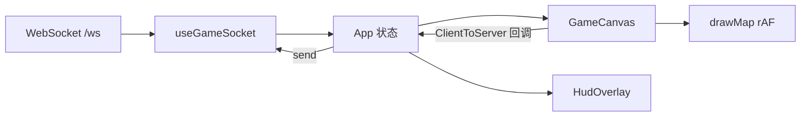

# WarOnPaper 客户端文档

本文档覆盖 `core/client` 的架构、画布渲染、UI、状态与网络协议。源码入口为 Vite + React 19 SPA，运行时权威状态来自服务器 WebSocket 快照；本地只做地形复现、交互预览与绘制。

## 文档索引

| 文档 | 内容 |
|------|------|
| [architecture.md](./architecture.md) | 包结构、分层、数据流、与 `@wop/shared` 的关系 |
| [game-canvas.md](./game-canvas.md) | `GameCanvas.tsx` 按模块：相机、选中、输入、建造/联络线、调动、开火 |
| [canvas-rendering.md](./canvas-rendering.md) | `drawMap` / 小地图 / 雾效 / 图标与地形色 |
| [ui-components.md](./ui-components.md) | HUD、点选菜单、建造树、检视面板、聊天等 |
| [state-and-hooks.md](./state-and-hooks.md) | `App` 状态、`initGame`、地形同步、调试日志 |
| [networking.md](./networking.md) | `useGameSocket`、消息类型、本地缓存、重连 |
| [tick-packets.md](../shared/tick-packets.md) | 每 tick 收到的 `state` 快照字段与视野裁剪 |

## 快速定位源码

```
core/client/
├── index.html
├── vite.config.ts          # alias @wop/shared、代理 /ws → manager
├── publicDir → core/assets # 图标与 UI 图（经 Vite 静态服务）
└── src/
    ├── main.tsx            # React 挂载
    ├── App.tsx             # 状态枢纽 + 命令转发
    ├── styles.css
    ├── canvas/             # GameCanvas + drawMap / minimap / icons
    ├── components/         # DOM HUD / 面板
    ├── net/                # WebSocket hook + log
    ├── game/initGame.ts    # 地形 seed 复现
    ├── ui/buildingUiIcon.ts
    └── debug/playerActionLog.ts
```

不纳入文档细节：`dist/`、`node_modules/`、二进制图标树本身（仅说明用途与路径规则）。

## 一句话架构



服务器是 `energy` / `organization` / 建筑与单位的唯一真相源；客户端用共享库做路径/造价预览与本地拒绝提示，不擅自改余额。
