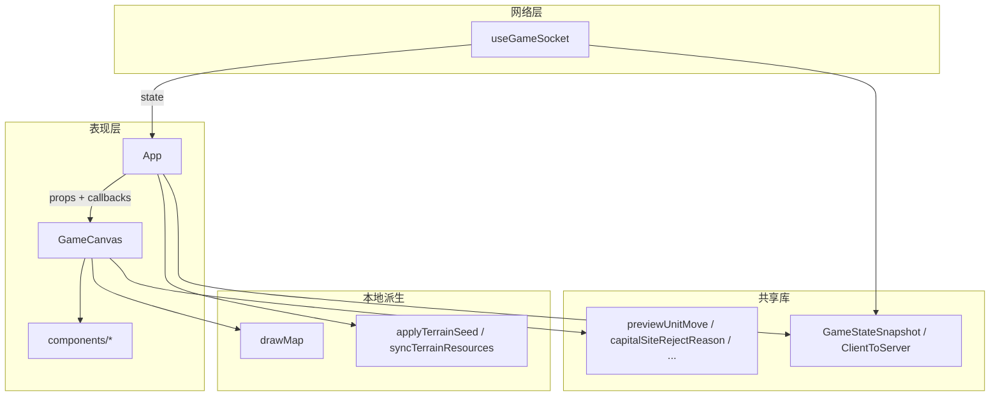

# 客户端架构

路径基准：`core/client`。共享协议与规则在 `core/shared`（包名 `@wop/shared`）。

## 1. 技术栈与构建

| 项 | 说明 |
|----|------|
| 框架 | React 19 + `react-dom/client` |
| 打包 | Vite 6（`@vitejs/plugin-react`） |
| 类型 | TypeScript；依赖 `@wop/shared` |
| 入口 | `src/main.tsx` → `App`；样式 `src/styles.css` |
| 静态资源 | `vite.config.ts` 的 `publicDir` 指向 `core/assets`（运行时 URL 以 `/icons/...`、`/ui/...` 访问） |
| 开发代理 | `/ws` → `ws://localhost:4358`（manager）；可用 `VITE_WS_URL` 覆盖 |

`vite.config.ts` 将 `@wop/shared` 直接 alias 到 `../shared/src/index.ts`，开发时与服务器共用同一套类型与规则函数。`@config.json` alias 到仓库根 `config.json`，供 F2 调试面板显示版本号。

## 2. 分层职责

- **网络层**（`net/useGameSocket.ts`）：连接、身份缓存、收发 JSON、聊天与生命周期事件。
- **应用层**（`App.tsx`）：持有 `GameStateSnapshot` 与本地 `TerrainMap`；把几乎所有玩家操作映射为 `send({ type: ... })`。
- **画布层**（`canvas/GameCanvas.tsx` + `drawMap.ts`）：相机、指针、选中、建造/联络线草稿、调动预览；每帧 `requestAnimationFrame` 绘制。
- **DOM UI**（`components/`）：检视 HUD、面板、聊天；坐标多为屏幕像素，叠在 canvas 之上。
- **共享规则**：客户端只 import 函数做校验/预览，不推进权威 tick。

## 3. 对局阶段（`GamePhase`）

定义于 `@wop/shared`：

| phase | 客户端行为摘要 |
|-------|----------------|
| `need_init` | 等待地图；地形清空；提示「等待房间地图…」 |
| `pick_capital` | 点选空地 → 半环菜单「定为首都」；画红圈互斥区 |
| `playing` | 完整建造、调动、开火等 |
| `spectating` | 可看检视信息，不可操作 |
| `ended` | 显示胜者；只读检视 |

`snapshot.role` 为 `player` | `spectator`，观战快照通常无迷雾过滤。

## 4. 权威状态 vs 本地状态

### 服务器权威（经 `GameStateSnapshot`）

- `tick`、`phase`、`you`（能源/组织/首都 HP）
- `buildings` / `liaisons` / `units`
- `connectedBuildingIds`（己方通信连通）
- `resourceSight`（每帧）
- `pollutionZones`、`resourceTerrain`（bootstrap / 再入房，或变化时；客户端保留上一值）
- `map` / `terrainSeed` / `allowRespawn`（仅开局/再入房；客户端缓存）
- `role` / `winnerId` / `winnerName`（bootstrap / 再入房，或变化时；客户端保留上一值）

### 仅客户端本地

| 状态 | 存放 | 用途 |
|------|------|------|
| `TerrainMap` | `App` → `terrain` | 填色、海岸判定、本地定都校验 |
| `pan` / `zoom` | `GameCanvas` refs | 相机（不进 React state，避免每帧 setState） |
| `selectionUi` / `buildMode` / `mobilize` / `trainUi` | `GameCanvas` state | 交互 UI |
| `liaisonDraft` | `GameCanvas` | 拖拽中的联络线折线 |
| `chatMessages` | `useGameSocket` | 最近 100 条聊天 |
| `destructionMarks` | `GameCanvas` ref | 己方建筑被毁后小地图警示（12s） |

**硬约束（代码注释反复强调）**：不要在本地加减 `you.energy` / `you.organization`；HUD 数字必须来自下一帧 `state`。

## 5. 命令路径

用户手势 → `GameCanvas` 本地校验/预览 → 调用 `App` 传入的 `onXxx` → `send(ClientToServer)` → 服务器 → `state` 快照回推 → `App.setState` → props 更新画布。

失败时：

1. 发送前本地拒绝：`logLocalReject`（调试日志）+ 可选 toast（如定都）。
2. 发送失败（WS 未开）：`useGameSocket` 设 `lastError`。
3. 服务器拒绝：`error` / `action_result` 消息。

## 6. 目录与模块角色

| 路径 | 角色 |
|------|------|
| `src/main.tsx` | `createRoot` + `StrictMode` |
| `src/App.tsx` | 视口、状态、错误 toast、F2、角落工具、命令包装 |
| `src/canvas/GameCanvas.tsx` | 主交互与 DOM 浮层编排（约 3400 行） |
| `src/canvas/drawMap.ts` | 布局变换、雾、建筑/单位/联络线绘制 |
| `src/canvas/drawMinimap.ts` | 小地图尺寸、视口框、拖拽 UV |
| `src/canvas/buildingIcons.ts` / `unitIcons.ts` | Image 缓存加载 |
| `src/canvas/terrainColors.ts` | 地形填色与资源描边 |
| `src/net/useGameSocket.ts` | WebSocket 生命周期 |
| `src/net/log.ts` | `[wop:scope]` 控制台日志 |
| `src/game/initGame.ts` | `requestGameInit` / `applyTerrainSeed` / `syncTerrainResources` |
| `src/ui/buildingUiIcon.ts` | 图标变体路径（own/enemy/ui/online/offline） |
| `src/debug/playerActionLog.ts` | 出站操作与服务器结果对齐的环形日志 |
| `src/components/*` | 见 [ui-components.md](./ui-components.md) |

## 7. 与 Manager / 房间的关系

客户端默认连同主机 `/ws`（由 manager 反代或 Vite 代理）。`hello` 后若 `welcome.state` 已有则直接进入对局；否则在 `/play/` 路径下用 URL `roomId` 或 `localStorage` 的 `wop:lastRoomId` 发 `join_room`。「返回」调用 `leaveRoom` 并 `window.location.assign("/")`（标题页是另一套 SPA）。

## 8. 资产约定（简述）

`core/assets` 经 Vite 以站点根路径提供：

- `/icons/buildings/...` — 己方（白）地图图标
- `/icons/buildings - orange/` — 敌方
- `/icons/buildings - black/` — UI 菜单
- `/icons/buildings - online|offline/` — 通信状态覆盖色
- `/icons/symbol/operation/` — 调动/建造/进攻等操作符
- `/ui/` — HUD 能源、警告、高级视野按钮等

路径改写见 `buildingUiIcon.ts`。
