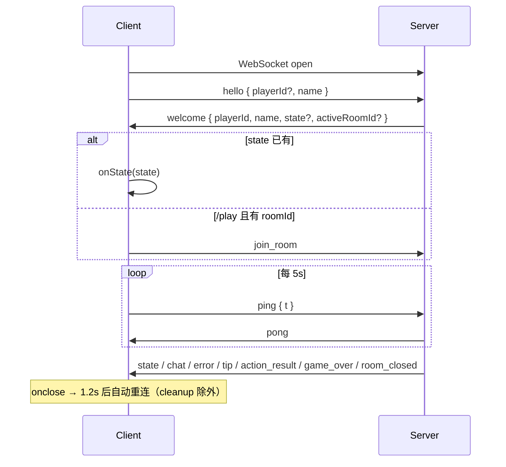

# 网络与协议（客户端视角）

源码：`core/client/src/net/useGameSocket.ts`、`net/log.ts`。消息类型定义在 `core/shared/src/index.ts` 的 `ClientToServer` / `ServerToClient`。

## 1. 连接地址

```ts
// 优先环境变量，否则同主机 /ws
VITE_WS_URL ?? `${wss|ws}//${location.host}/ws`
```

开发时 Vite 把 `/ws` 代理到 manager（`localhost:4358`）。

## 2. `useGameSocket` 导出

| 返回值 | 含义 |
|--------|------|
| `status` | `"connecting" \| "connected" \| "disconnected"` |
| `send(msg)` | JSON 发送；未 OPEN 时返回 `false` 并设 `lastError` |
| `lastError` / `clearError` | UI toast：`{ message, raw }` |
| `lastTip` / `clearTip` | 服务器 `tip` 提示（警告色 toast） |
| `playerId` / `playerName` | `welcome` 后写入 |
| `chatMessages` | 最多保留 100 条 |
| `leaveRoom()` | 清 `wop:lastRoomId` 并 `send({ type: "leave_room" })` |

可选参数：

- `onState(snapshot)` — 每次权威状态
- `onRoomLifecycle` — `game_over` / `room_closed`
- `autoConnect` — 默认 `true`；标题页可关

## 3. 本地身份缓存

| localStorage 键 | 用途 |
|-----------------|------|
| `wop:playerId` | 重连复用 UUID |
| `wop:playerName` | 默认名 `commander` |
| `wop:lastRoomId` | `/play` 断线后尝试 `join_room` |

`hello` 带缓存 `playerId`；服务器可发放新 id。`welcome` 后写回缓存；若带 `activeRoomId` 也会缓存房间。

## 4. 连接生命周期



每 tick 权威同步的载荷形状见 **[tick-packets.md](../shared/tick-packets.md)**（`type: "state"`；实体全量绝对值，顶层部分字段按 §3.0 省略）。

## 5. 入站消息处理

| `msg.type` | 行为 |
|------------|------|
| `welcome` | 设身份；有 `state` 则 `onState`（bootstrap，含 map/seed 等）；否则 play 回退 `join_room` |
| `state` | 缓存 `roomId`；`onState(msg.state)` → `App` 内 `mergeGameStateSnapshot`（E/O 绝对值；缺省字段保留缓存） |
| `chat` | 追加本地聊天，标记 `mine` |
| `action_result` | `applyServerActionResult` 对齐调试日志 |
| `game_over` / `room_closed` | 回调生命周期；关房清 lastRoom |
| `error` | `lastError`（友好 `message` + raw `code: message`） |
| `tip` | `lastTip` |
| `pong` | 静默 |

其它类型仅 debug 日志。房间大厅相关的 `room_ready` / `match_status` 等由 manager 标题页消费；对局 SPA 主要关心上表。

## 6. 出站：对局常用命令

`App.tsx` 包装后传给 `GameCanvas` 的回调，最终都是 `ClientToServer`：

| type | 典型参数 | 触发场景 |
|------|----------|----------|
| `place_capital` | `gx, gy` | 选都菜单；App 先跑 `capitalSiteRejectReason` |
| `build` | `buildingId, gx, gy, ground` | 建造树点选 |
| `build_liaison` | `kind, nodes` | 联络线确认 |
| `demolish` / `demolish_liaison` | `id` | 拆除 |
| `repair` / `level_upgrade` / `relocate_capital` | `id` | 建筑检视 |
| `reload` / `deploy` | `id, count` | 装填 / 部署 |
| `train` | `id, kind, u, targetIds` | 训练面板 |
| `fire` | `id, targetId? \| targetUnitId?` | 开火瞄准 |
| `move_units` / `blockade_units` / `supply_units` / `attack_units` / `hold_units` | 目的地 + sources/unitIds | 调动面板 Go |
| `assign_home` | `buildingId, unitIds` | 部署后归属 |
| `stop_units` | `unitIds, retreat?` | 停止/撤退 |
| `end_blockade` / `end_hold` | `unitIds` | 结束状态 |
| `mutual_defense` | `buildingId, partnerBuildingId` | 互防瞄准 |
| `end_mutual_defense` | `buildingId` | 解除互防 |
| `build_carrier` / `embark_air` / `disembark_air` | 舰载相关 | 检视 HUD |
| `chat` | `text` | 聊天输入 |

大厅类（`create_room`、`queue_match` 等）定义在 shared，本对局客户端一般不发。

## 7. 发送与操作日志

每次 `send`：

1. `log.info("net", "→", type, msg)`
2. `logOutgoingAction` → `PlayerActionLog` 记 `pending`（失败则 `fail`）
3. 服务器 `action_result` → `completePending` 或补一条

本地 UI 拒绝（未发网）走 `logLocalReject`，`ok: "fail"`，source `client`。

## 8. 日志开关

`net/log.ts`：控制台前缀 `[wop:scope]`。`localStorage.wop:log === "0"` 时静音 `debug` 级。

## 9. `App` 侧网络消费要点

- `onState`：`mergeGameStateSnapshot` 合并后再应用；有建筑/联络线/单位/E/O/phase/seed 变化时打 info 日志。
- `room_closed`：清空 `state`；idle 提示「房间因空闲已关闭」。
- `game_over`：toast「胜负已分」。
- `lastError` / `lastTip` → `ErrorToast`；调试原文进 F2 `errorLog`。
