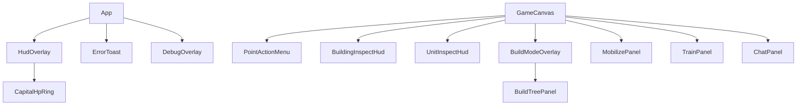

# UI 组件

路径：`core/client/src/components/`。这些是叠在 canvas 上的 DOM；多数用绝对定位的 `screenX/screenY`（canvas 本地像素）。

## 1. 总览

| 组件 | 角色 |
|------|------|
| `HudOverlay` | 左上角能源/组织 + 首都 HP 环 |
| `CapitalHpRing` | SVG/canvas 环显示首都生命 |
| `PointActionMenu` | 点选半环动作钮 |
| `BuildModeOverlay` | 全屏建造/联络线编辑壳 |
| `BuildTreePanel` | 升级树节点点击 |
| `BuildingInspectHud` | 建筑信息与操作 |
| `UnitInspectHud` | 单位信息与停止/撤退等 |
| `MobilizePanel` | 勾选驻军/野外部队并发令 |
| `TrainPanel` | 训练种类、U、多目标 |
| `ChatPanel` | 小地图上方聊天 |
| `ErrorToast` | 短暂错误/提示 |
| `DebugOverlay` | F2 状态与操作日志 |

## 2. `HudOverlay`

- Props：`hud: PlayerHudState`（**服务器权威**）、`windowHudSize`。  
- 首次 layout 测量资源块自然尺寸 `cap`，再 `scale = hudSize/cap.h`，避免窗口缩小时文字被裁切。  
- 组织条：`organization / organizationMax`。  
- 图标：`/ui/energy.png`、`/ui/organization_point.png`。

## 3. `PointActionMenu`

- `PointActionId`：`mobilize` | `lockdown` | `build` | `set_capital`。  
- 按钮中心：`(screenX + cos(θ)*arcRadius, screenY + sin(θ)*arcRadius)`，`angleDeg` 相对 +X。  
- 对局：`POINT_ACTIONS`（调动/封锁/建造）；选都：`CAPITAL_PICK_ACTIONS`。  
- `onPointerDown` stopPropagation，避免拖动画布。

## 4. `BuildModeOverlay` + `BuildTreePanel`

- 从建造钮飞入左上；`getBuildTree(currentBuildingId, ground)`；人工岛限制中型且排除纯海建筑。  
- 子模式「编辑联络线」：光纤/公路/铁路；`onLiaisonKindChange` / `onLiaisonEditActiveChange`。  
- `enterLiaisonNonce`：已打开时再按 E 切入联络线。  
- 关闭带动画（`BUILD_TREE_REVEAL_MS`、联络钮 300ms）；尊重 `prefers-reduced-motion`。  
- UI 图标用 `buildingUiIcon`（黑版）。

## 5. `BuildingInspectHud`

**动作类型** `BuildingInspectAction`：`demolish`、`upgrade`、`level_upgrade`、`relocate_capital`、`repair`、`deploy`、`reload`、`train`、`build_carrier`、`garrison`、`mutual_defense`、`supply`、`fire`、`attack`。

显示规则：

- 己方：完整 HP、U、通信等。  
- 敌方卫星级：仅类型；直接视野：类型+HP（注释 §4.5）。  
- `readOnly`（观战/结束）隐藏操作钮。  
- 装填：纵向滑条决定 `count`；核武可显示 `nukeReloadBlockReason`。  
- 部署：有 count 立即 `deploy`；否则打开归属（assign）动员面板。

实际发令在 `GameCanvas` 的 `onAction` 分支（含通信/污染门闩）。

## 6. `UnitInspectHud`

动作：`retreat` | `stop` | `embark_air` | `disembark_air` | `attack`。

- 状态中文：`idle→停留`、`moving→移动中`、`holding→驻守`、`blockading→封锁`、`fighting→交战`、`training→训练途中`。  
- 移动 ETA：`estimatePathTimeSec`。  
- 敌方直接视野：种类+状态，无 U/HP。  
- 航母：同格空军上下舰。

## 7. `MobilizePanel`

`MobilizeMode`：`move` | `blockade` | `supply` | `attack` | `hold` | `assign`。

- 列出可出兵建筑（`unitKindFromBuilding`、非建造中、非驻军锁定等）与野战单位。  
- `sources: Record<buildingId, u>`、`unitIds[]`。  
- 显示 O/E 消耗常量（来自 shared）。  
- `planError` 展示 dry-run 失败原因。  
- 按钮：Go / 停止 / 结束封锁或驻守 / 关闭。

## 8. `TrainPanel`

- 源建筑训练场；`TRAINABLE_KINDS`；若队列已锁种类则禁改。  
- 多目标：`allocateTrainingDeliveries` 预览分配；`trainEnergyCost` / `trainDurationSec`。  
- `onGo(amount)` 最终由 GameCanvas 调 `onTrain`。

## 9. `ChatPanel`

- 折叠显示最后一条；展开历史自动滚底。  
- `maxLength=200`；Enter 发送。  
- 宽度与小地图对齐（由 GameCanvas 传入）。

## 10. `ErrorToast` / `DebugOverlay`

- Toast：`toastKey` 变化重播动画；`variant` error/warn。  
- Debug：版本号 `@version.json`；连接 statusLine；错误列表；`usePlayerActionLog` 分类/状态标签（shared 文案）。

## 11. 角落工具（在 `App`，非 components 文件）

- 通信状态 / 敌方视野按钮：图片 `/ui/advanced_view/comm.png`、`view.png`。  
- 阶段提示 chip、返回主页按钮。样式在 `styles.css`。

## 12. 样式

全局：`core/client/src/styles.css`（点菜单、检视条、建造遮罩、HUD、聊天、调试层）。组件内少写内联，除定位坐标与 CSS 变量（如 `--hud-scale`）。
