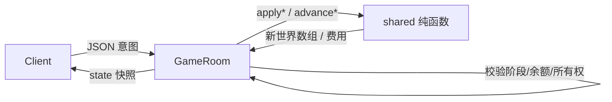

# 与 `@wop/shared` 的集成

包：`core/shared` → npm 名 `@wop/shared`。  
服务端规则**尽量不重写**：建筑费用、寻路、战斗、视野过滤、地形生成等均 import 自 shared。

## 1. 依赖方式

`core/server/package.json`：

```json
"dependencies": { "@wop/shared": "*", "ws": "^8.18.1" }
```

`core/package.json` workspaces 包含 `shared` 与 `server`。开发前通常需 `npm run build -w shared`，使 `dist/` 类型与 JS 可供 server 解析。

导入形态：

```ts
import { TICK_MS, type ClientToServer, generateTerrain, ... } from "@wop/shared";
```

无深层子路径 import；一律走包根 `exports["."]`。

## 2. 服务端使用的 shared 能力分类

### 时间与房间常量

| 符号 | 用途 |
|------|------|
| `TICK_HZ` / `TICK_MS` / `DT_SEC_PER_TICK`（`time.ts`） | tick 间隔；单位推进 `dt` |
| `ROOM_IDLE_MS` | 默认空闲销毁（再导出为 `DEFAULT_ROOM_IDLE_MS`） |
| `STARTING_ENERGY` / `STARTING_ORGANIZATION` | 选都时重置 HUD |
| `CAPITAL_HP_MAX` / `ORGANIZATION_BAR_MAX` | HUD 上限 |
| `COMM_WAVE_INTERVAL_TICKS` / `COMM_STEPS_PER_TICK` | 通讯扩散节奏 |
| `POLLUTION_*` / `NUKE_*` | 污染伤害与核弹 |

### 协议与快照类型

`ClientToServer`、`ServerToClient`、`GameStateSnapshot`、`GamePhase`、`SnapshotRole`、`PlayerHudState`、`AntiAirAmmoEvent` 等——房间填充快照、收发消息时对齐客户端。

### 地图 / 地形

`MAP_SIZES`、`isMapSizeId`、`DEFAULT_MAP_SIZE_ID`、`parseTerrainSeed`、`generateTerrain`、`isValidCapitalSite`、`isValidPortSite`、资源揭示/枯竭、`collectResourceSight` / `collectResourceTerrainSync` 等。

### 建筑与联络线

目录 `BUILDING_BY_ID`、`LIAISON_BY_ID`；费用预览与应用；通讯 `startCommWave` / `stepCommWave` / `isBuildingCommsLinked`；升级、迁都、拆除退款、建造视野 `isConstructionAllowedAt`；核拦截 `tryInterceptFlyingMissile` 等。

### 视野过滤（快照）

`filterBuildingsForViewer`、`filterLiaisonsForViewer`、`filterUnitsForViewer`、`filterResourceSightForViewer`、`shouldMaskUpgradeOnSatellite`。

### 单位（经 `units.ts`）

`applyUnitMove`、`applyUnitAttack`、`applyLiaisonAttack`、`applyUnitHold`、`advanceUnits`、`advanceBlockades`、`advanceHolds`、`advanceFightsAndSieges`、`advanceLiaisonCuts`、`advanceAntiAir`、`enqueueTraining`、`advanceTrainingQueues`、`createUnitGroup`、航母相关 `applyBuildCarrier` / `applyEmbarkAir` / `applyDisembarkAir` 等。

### 调试动作日志

`shouldLogClientAction`、`summarizeClientAction`、`formatCostDelta` → 房间发 `action_result`。

## 3. 分层原则（从代码归纳）



- **Shared**：无 I/O、无 WebSocket；给定世界返回结果或拒绝原因。
- **Server**：持有可变世界与 HUD；扣费；广播；生命周期。
- **Client**：展示；本地预测若有也必须以随后 `state` 纠正（E/O 尤其禁止自算权威值）。

## 4. 服务端刻意不使用的 shared 消息

大厅类 `create_room` / `join_room` / `queue_match` 等类型存在于 shared，但 `GameRoom.dispatch` 拒绝处理——留给 manager，避免核心房间依赖匹配队列。

## 5. 构建顺序建议

```bash
# 在 core/ 下
npm run build -w shared
npm run build -w server
# manager 再加载 dist/room.js
```

`npm run build`（core 根）会按 shared → server → client 顺序构建。
