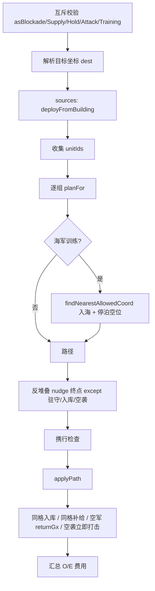

# 命令与寻路

源文件：

- `core/shared/src/units/orders.ts` — 下达/停止/封锁/补给/进攻/驻守/互防/改归属
- `core/shared/src/units/pathfind.ts` — 地形可通行、移速、A* / 空军直线

---

## `pathfind.ts`

### 地形分类（单位坐标）

基于 `cellsTouchingUnitCoord`（0.2 点触及的格）：

| 函数 | 判定 |
|------|------|
| `isMountainTerrain` | 触及任何山地 |
| `isFoothillTerrain` | 同时触及山地与陆地（山脚） |
| `isPureMountainTerrain` | 山地且非山脚（装甲禁入） |
| `isOceanTerrain` | 触及格**全是**海洋 |
| `isLandTerrain` | 触及格全是陆地 |

### `terrainAllowsKind`

- 空军：任意  
- 装甲：拒绝纯山区，**公路/铁路走廊例外**（含借道敌方公路）  
- 海军 / 航母：须纯海洋（港口格靠 `allowImpassableStart/Goal` 例外）  
- 陆地遇纯海洋：仅当 `transportAt` 命中（己方完成路/轨，或借道覆盖己方联络边的敌方完成公路）  

### `transportAt` / `speedAt`

- 距己方完成路/轨折线段 ≤ `0.12` Du 视为在交通上；铁路优先于公路。  
- **借道**：敌方已建成公路，且该格边与己方任意联络线（含线缆）同边时，按公路计速 / 可过水。  
- 移速：轨 `2` > 路 `0.8` > 兵种基础；山地再乘 `mountainSpeedFactor`（已在交通上时不乘）。

### `planAirPath`

直线 `[start, end]`；默认要求起终点都在机场工作范围并集内（`ignoreCoverage` 可跳过）。

### `planLandOrNavyPath` — 最小时间 A*

**输入要点**：`kind`、起终点、`MapConfig`、`TerrainMap`、联络线、`ownerId`、coverage 圆、以及：

| 选项 | 用途 |
|------|------|
| `ignoreCoverage` | 训练/撤退/改归属 |
| `ignoreTerrain` | 撤退穿越 |
| `allowImpassableStart/Goal` | 海军港口出发/停泊 |
| `rangeLabel` | `"radio"` \| `"port"` 错误文案 |

**算法步骤**：

1. 吸附起终点；校验 coverage（空且未 ignore → 起点无通信）。  
2. 校验起点/终点可通行（含港口例外）。  
3. 同格 → 单点路径，时间 0。  
4. 在 0.2 八邻域上 A*：代价 `g` = 累计**时间**（边长 / 进入格 `speedAt`）；启发 = 欧氏 / maxSpeed。  
5. 扩展时必须在 coverage 内（若有）且 `walkable`。  
6. `maxExpand`（默认 `PATHFIND_MAX_EXPAND_DEFAULT = 250_000`）防死循环；UI 预览用 `PATHFIND_MAX_EXPAND_PREVIEW`（经 `previewUnitMove` / `MoveContext.previewPathfind`）。失败返回中文 `error`。  
7. 单次规划内缓存 `walkable` / `speedAt`（装甲山区+水域判定较贵；跨海不可达时避免重复冻结主线程）。  
8. 回溯 `cameFrom` 得折线，`travelTimeSec = g(goal)`。纯海洋目标对陆军返回 `LAND_WATER_ERROR`。

辅助：`estimatePathTimeSec`、`findFreeUnitCoord`（螺旋空位）、`findNearestAllowedCoord`（训练海军就近入海）。

---

## `orders.ts`

### `MoveContext` / `MoveApplyResult`

```ts
MoveContext = {
  map, terrain, buildings, liaisons, units,
  connectedIds,  // 本玩家通信集合
  nextId         // 新单位 id
}
MoveApplyResult = {
  ok, error?, organizationCost, energyCost,
  buildings, units, travelTimeSec
}
```

失败时 `organizationCost`/`energyCost` 为 0，建筑/单位回滚为入参拷贝。

### 内部路径规划 `planFor`

按单位 home：港口海军用 `collectPortNavyCoverage` + `rangeLabel: "port"`；空军 `planAirPath`；其余 `planLandOrNavyPath`。港口格自动 `allowImpassableStart/Goal`。

### `applyPath`

- 路径长度 ≤ 1：立刻 `enterBlockading` / `enterHolding` / `enterFightArrive` 或 idle（可带 pendingSupply）。  
- 否则：`state` + `path` + `pathIndex: 1` + 各类 `pending*`。

### `applyUnitMove` — 主流程



**费用规则**：

| 模式 | O | E |
|------|---|---|
| 普通调动 | `UNIT_MOVE_O_COST * 组数` | 0 |
| 训练送达 | 0 | 0 |
| 补给 | `UNIT_SUPPLY_O_COST` | 0 |
| 驻守 | `UNIT_HOLD_O_COST` | `ENTER_E * 总 U` |
| 封锁 | `UNIT_BLOCKADE_O_COST` | `ENTER_E * 总 U` |
| 进攻 | `attackOrganizationCost(kinds)` | 0 |

携行在**移动 tick** 扣除，下单时不扣。

特殊：

- 空军普通移动到所属机场格 → 自动改为入库。  
- 空军非入库任务设置 `returnGx/Gy`。  
- 空军进攻且路径≤1：`applyAirHitAndRunStrike` 后立刻规划返航入库。  
- 退却锁：`retreating` 单位拒收调动。

### 薄封装

| 函数 | 行为 |
|------|------|
| `applyUnitBlockade` | `asBlockade: true` |
| `applyUnitSupply` | `asSupply: true` |
| `applyUnitAttack` | 要求攻击目标 |
| `applyUnitHold` | `asHold: true` |

### `applyMutualDefense`

两座己方已建成、相邻/对角、未互防、未驻守、可出城且有驻军的建筑互设 `mutualDefensePartnerId`，扣 2O。不在本函数里派兵；攻城 tick 里 `triggerMutualDefense` 响应。

### `applyEndMutualDefense`

任一方发起即可清双边 `mutualDefensePartnerId`（不退 O）。伙伴拆除/被毁/离图时由 `clearMutualDefensePair` / `reconcileMutualDefensePartners` 自动解除。

### `applyEndHold` / `applyEndBlockade`

选中单位退出 holding / blockading → idle。

### `applyUnitStop`

| 模式 | 行为 | 费用 |
|------|------|------|
| **停止** `retreat: false` | 陆海军原地清行为；空军=强制返航入库；交战/停泊/退却中不可 | −20E −3O |
| **撤退** `retreat: true` | 任意时刻可；`ignoreCoverage+ignoreTerrain` 规划回家入库；设 `retreating` | 0 |

内部 `beginRetreatHome`：已在家则 `returnToBuilding`；否则写 path + `depositOnArrival`。

### `applyAssignHome`（部署/改归属）

1. 校验同兵种、空位 `garrisonRoom` 足够。  
2. 旧 home 释放 away，新 home 增加 away，改 `homeBuildingId`。  
3. 空军飞向建筑中心并入库；陆海军停在外圈空位（无视电台）。  
4. 费用：`UNIT_MOVE_O_COST * 组数`。

### `previewUnitMove` / `previewTrainingDeliveryPath`

调用 `applyUnitMove` 但不由调用方扣费；返回路径折线供 UI。`isAirKind` 判空军。

---

## 与 tick 的衔接

Orders 只写「意图」（path + pending 标志）。真正位移、耗油、到达结算在 `advanceUnits`（[tick-combat.md](./tick-combat.md)）。
