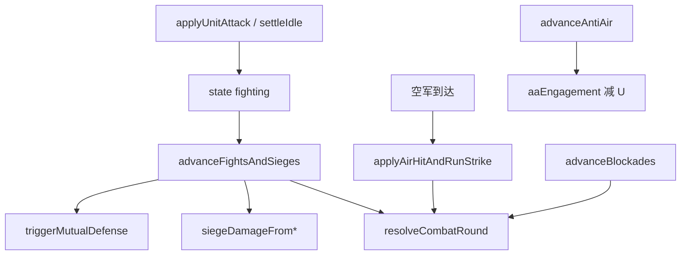

# Tick 推进与交战

源文件（均在 `core/shared/src/units/`）：

| 文件 | 职责 |
|------|------|
| `tick.ts` | `advanceUnits` — 行军/训练运送、返航、入库、反堆叠 |
| `combat.ts` | 单回合交战公式、攻城伤害、进攻 O 费 |
| `fight.ts` | 驻守维持、单位战/攻城、空军打了就跑、互防响应 |
| `blockade.ts` | 封锁维持与半径交战 |
| `antiAir.ts` | 防空对空军减员、导弹拦截 API |
| `liaisonAttack.ts` | 进攻联络线段 |

服务端每个 tick 典型串联（顺序由 server 决定，逻辑上依赖如下）：

---

## `combat.ts`

### `resolveCombatRound(ua0, kindA, ub0, kindB)`

\[
U'_A = \lfloor (U_A \cdot HP_A - dmg_A) / HP_A \rfloor
\]

- 对一方的伤害项默认为对方 U。  
- **空军不受陆/海军伤害**：若目标是空军且攻击方非空军，则 `dmg = 0`。  
- 单回合瞬时结算（注释：≤2 tick 预算）。

### 其它

- `cannotDamageAir` — 非空军打空军无伤  
- `siegeDamageFromUnits(u)` — 对建筑 HP = floor(U)  
- `siegeDamageFromBuilding(u)` — 对单位减编制 = ceil(U/3)  
- `attackOrganizationCost` — 含空/海则 3O 否则 2O  

---

## `tick.ts` — `advanceUnits`

**输入**：单位、建筑、联络线、地形、`connectedByOwner`、`dtSec`。  
**输出**：`TickMoveResult { units, buildings, removedIds }`。

### 主循环逻辑

1. 拷贝可变状态；记录本 tick `depositedU`（入库不算战损）。  
2. **空军 idle 且有 returnGx/Gy**：尝试 `tryStartAirReturn`。  
3. 仅处理 `moving` / `training`：  
   - 无有效 path → 优先 pending 进攻 settle，否则返航，否则 `settle(arrived)`。  
   - `ignoreCoverage`：training 或 `depositOnArrival`。  
   - `skipFuel`：入库/训练途中不耗携行。  
4. 在时间预算 `budget = dtSec` 内沿 path 推进：  
   - `speedAt` 得速度；`consumeCarriedForStep` 限距。  
   - 若下一步会离开 coverage：二分找到边界停住（`stoppedEarly`）。  
   - 油尽或边界：`stopForSupply` / `settle(false)`。  
5. 走完 path：pending 进攻优先于空返；否则 `settle(true)`。  
6. `yieldOffBuildingCenters` — 静止单位让开建筑中心（海军可留在港口格）。  
7. `releaseAwayForUnitDiff(..., depositedU)`；`autoEmbarkCoLocatedAir`。

### `settleIdle`（到达/中断结算）

按优先级：

1. `pendingBlockade` → `blockading`  
2. `pendingHoldBuildingId` → `holding`  
3. 进攻 → 空军：`applyAirHitAndRunStrike` + 返航；陆海：进入 `fighting` + 目标字段  
4. `pendingSupply` → `resupplyUnitFromStation`（可先 nudge）  
5. `depositOnArrival` → 按 id / 同格 / home 解析目标建筑，`returnToBuilding`；满则 `removed`  
6. 否则 idle + `nudgeOffBuildingCenters`

### `tryStartAirReturn`

清 `returnGx/Gy`，设 `depositOnArrival` + `depositBuildingId`，直线飞回 home（`ignoreCoverage`）。已在目标格则直接 settle。

---

## `blockade.ts` — `advanceBlockades`

对每个 `blockading` 单位（按 id 稳定排序）：

1. `blockadeTimerSec += dtSec`  
2. 每满 `UNIT_BLOCKADE_INTERVAL_SEC`（5s）：  
   - 先扣 `2E * U`；不足则退出封锁变 idle（本脉冲不打）  
   - 对 R≤2 内每个敌组按 id 顺序各打一轮 `resolveCombatRound`  
3. 战损后 `releaseAwayForUnitDiff` + 航母机库释放  

返回 `energyByOwner` 供 server 扣款。

---

## `fight.ts`

### `advanceHolds`

同封锁节奏：每 5s 扣 `1E*U`，不足则离开 holding。

### `applyAirHitAndRunStrike`

- 对单位：一轮交战  
- 对建筑：若有驻军先交战，再**总是**打一轮建筑 HP（与持续攻城「驻军或 HP」不同）  
- HP≤0：拆除建筑（空军伤占比规则 → 摧毁）  
- 结束后清 fighting 状态，保留 `returnGx/Gy` 供返航  

### `advanceFightsAndSieges`（概要）

推进 `fighting` 单位的 `combatTimerSec` / `siegeTimerSec`：

- 单位战：满 5s 一轮 `resolveCombatRound`；目标消失则 idle  
- 攻城：满 5s 处理驻军战或建筑 HP/反伤；累计 `siegeDamageDealt`；空军累计伤超阈值可摧毁逻辑见源码分支  
- 建筑被打可触发 `triggerMutualDefense`：从互防伙伴派出单位赶往守建筑外圈；伙伴已不存在则清 `mutualDefensePartnerId`  
- 本 tick 结束 `reconcileMutualDefensePartners` 再扫一遍孤儿互防链  
- 占领：`capturePending`、拆除返还 `occupyDemolishRefund`（投入 E × 0.5）  

### `findHoldCoordOutside` / `isBuildingHeld`

驻守站位在建筑外螺旋环；判断是否已有单位驻守某建筑。

---

## `antiAir.ts`

常量：

| 符号 | 值 | 含义 |
|------|-----|------|
| `ANTI_AIR_AMMO_PER_ENGAGEMENT` | 2 | 进入对空交战扣弹 |
| `ANTI_AIR_AMMO_PER_INTERCEPT` | 1 | 拦一枚导弹 |
| `ANTI_AIR_DRAIN_RATE_OF_ENTRY` | 0.1 | 每秒减「进入时 U」的 10% |
| `ANTI_AIR_FLOOR_RATIO` | 0.5 | 减至进入时 U 的 50% 为止 |
| `ROCKET_FORCE_BUILDING_IDS` | 导弹/远程/核 | 可拦截；**不含**臼炮 `gun` |

`advanceAntiAir`：

1. 列出存活防空炮（建成、有 HP、未污染）  
2. 对每架敌空军：是否在工作范围并集内  
3. 新进入且弹药≥2：扣弹，记录 `aaEngagement { buildingId, entryU, damageAcc }`  
4. 范围内按秒累计伤害，整 U 扣减到 floor  
5. 离开范围清除 engagement  

`tryInterceptFlyingMissile(s)`：调用方提供弹道/落点 stub；射程内耗弹拦截（世界尚无持久飞行实体时由 server 在发射结算时调用）。

---

## `liaisonAttack.ts`

### `applyLiaisonAttack`

包装 `applyUnitMove` 到段附近，写入 `liaisonCut { liaisonId, ax..by, durationSec, elapsedSec: -… }`。拆除用时 = 建造该段造价对应的秒数（含地形附加 E）。

### `advanceLiaisonCuts`

- `elapsedSec < 0`：赶路，靠近段（默认 ~2.25 Du）后改为 ≥0 开始计时  
- 计时满：`removeLiaisonSegment` 拆段，按长度分摊 `investedE`，折线碎成多条  

### `removeLiaisonSegment`

从折线去掉一段；无剩余节点则删线；否则生成碎片（首片保留原 id）。

---

## 交战相关调用图

