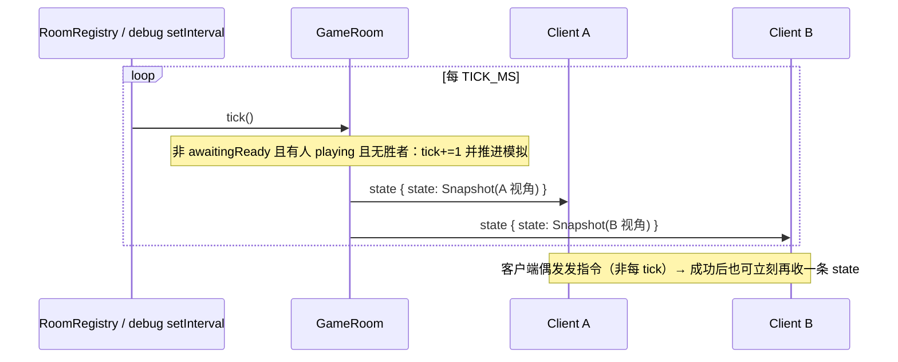
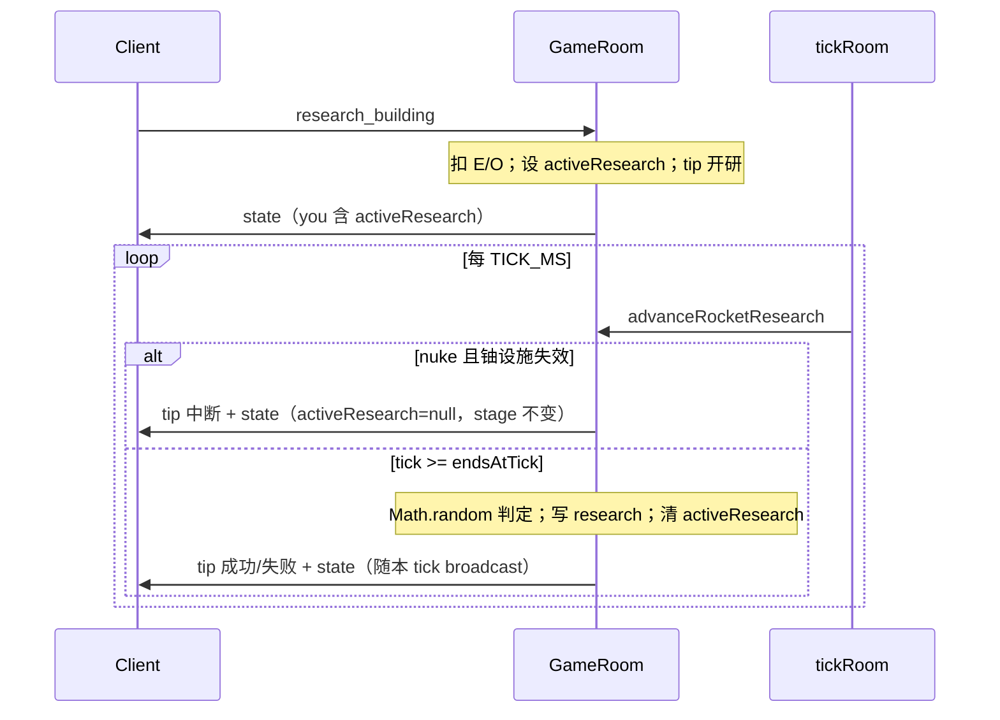

# Tick 周期通信数据包

本文描述客户端与服务端之间 **按仿真 tick 节奏** 交换的 WebSocket 载荷。类型定义在 `core/shared/src/index.ts`；组装与广播在 `core/server/src/room.ts`（`snapshotFor` / `broadcastState` / `tickRoom`）；时钟由 `manager` 的 `RoomRegistry`（或 server 调试入口）按 `TICK_MS` 驱动。

> **聚焦范围**：每 tick（及同 tick 内附带）的报文，含快照顶层的准备 / 读档 / 组队字段；火箭研究因挂在 `you` + tick 结算，线协议见 **§7.1**。  
> **不展开**：`hello` / 大厅 / 建造与单位指令 / `export_save` 等非周期消息 → 见 [types-protocol.md](./types-protocol.md)、[manager/save-load.md](../manager/save-load.md)、[server/networking.md](../server/networking.md)、[client/networking.md](../client/networking.md)。  
> **仿真步骤**（建造推进、交战等）→ 见 [server/game-loop.md](../server/game-loop.md)、[tick-combat.md](./tick-combat.md)。  
> **视野规则细节** → 见 [vision.md](./vision.md)。

---

## 1. 时钟与方向

| 项 | 值 / 说明 | 源码 |
|----|-----------|------|
| 频率 | `TICK_HZ = 5`（200 ms/tick） | `core/shared/src/time.ts`（经 `index.ts` 再导出） |
| 间隔 | `TICK_MS = 1000 / TICK_HZ`；manager 侧 `GAME_TICK_MS = TICK_MS` | `manager/src/gameBridge.ts` |
| 谁驱动 | `RoomRegistry.setInterval(..., GAME_TICK_MS)` → 各房间 `room.tick()` | `manager/src/rooms.ts` |
| 谁发谁收 | **服务端 → 各在房玩家**：每 tick（及多数成功指令后）推送个性化快照 | `room.ts` `broadcastState` |
| 客户端每 tick 是否上报 | **否**。客户端不发「tick」「ack」「输入帧」类消息；对局中只发事件型 `ClientToServer`（建造、调动等） | `useGameSocket.ts` |



要点：

- **`awaitingReady`**（`pick_capital` / `ready_lobby` / `restore_lobby`）、**无人 `playing`**、或 **已有胜者**：仍会 `broadcastState()`，但**不**推进 `tick` 与模拟（见 `tickRoom`）。
- **建筑物 / 联络线可增量**：常规 tick 对 `buildings` / `liaisons` 相对该连接上次已发送的**已过滤**集合发 `*Delta`；约每 10 秒（`TICKS_PER_10S`）或 bootstrap 再发全量数组重置基线。`units` 等其余实体仍每帧全量；E/O 从不发增量。其它顶层字段按 §3.0 省略。
- 传输：每帧一个 JSON 对象，`type` 判别联合类型；底层 `JSON.stringify` / `JSON.parse`。

---

## 2. 每 tick 主消息：`state`

| 方向 | `type` | 顶层字段 |
|------|--------|----------|
| Server → Client | `"state"` | `state: GameStateSnapshot` |

对应类型：

```ts
{ type: "state"; state: GameStateSnapshot }
```

客户端处理（`core/client/src/net/useGameSocket.ts` → `App.onState`）：收到后经 `mergeGameStateSnapshot` **合并**进本地状态——常规字段以本包为准替换；§3.0 中缺省的开局/变化字段保留上一帧已知值。`you.energy` / `you.organization` 仍为服务端绝对权威。

同一 tick 末尾，房间对每个已 `join` 的玩家各发 **一条** 个性化 `state`（`broadcastState` → `sendPlayerState` → `packWireSnapshot`）。

---

## 3. `GameStateSnapshot` 顶层字段

定义：`core/shared/src/index.ts`。逻辑全量：`room.ts` → `snapshotFor(player)`；上线载荷：`packWireSnapshot(player, { bootstrap })`。

| 字段 | 类型 | 含义 | 发送规则 |
|------|------|------|----------|
| `tick` | `number` | 当前仿真 tick（`awaitingReady` / 无人 playing / 已胜时可不递增，但快照仍带当前值） | 每帧 |
| `map?` | `MapConfig` | 本局地图尺寸 | **仅开局 / 再入房** |
| `you` | `PlayerHudState` | **本观众** HUD（绝对 E/O；先 `syncCapitalHud`） | 每帧 |
| `buildings?` | `PlacedBuilding[]` | 可见建筑全量（视野过滤 / 观战终局全量 / `restore_lobby` 卫星门面） | **bootstrap / 每 `TICKS_PER_10S` 基线刷新** |
| `buildingsDelta?` | `SnapshotListDelta<PlacedBuilding>` | 相对该连接上次已发送过滤集的增量 | **常规 tick**（无变化则省略） |
| `liaisons?` | `PlacedLiaison[]` | 可见联络线全量 | **同 buildings** |
| `liaisonsDelta?` | `SnapshotListDelta<PlacedLiaison>` | 联络线增量 | **同 buildingsDelta** |
| `units` | `UnitGroup[]` | 可见单位组 | 每帧 |
| `connectedBuildingIds` | `string[]` | **本玩家**已发布、与首都通讯连通的建筑实例 id | 每帧 |
| `pollutionZones?` | `PollutionZone[]` | 核污染区（全员同内容浅拷贝，不过滤） | **bootstrap / 再入房，或相对该连接上次发送变化时** |
| `phase` | `GamePhase` | **该玩家**视角阶段 | 每帧 |
| `terrainSeed?` | `number \| null` | 地形种子；客户端本地 `generateTerrain` | **仅开局 / 再入房** |
| `resourceSight` | `ResourceSightCell[]` | 已揭示储量环（玩家视角再经直接视野过滤） | 每帧 |
| `resourceTerrain?` | `ResourceTerrainSync` | 枯竭格（`cleared`）+ 矿点储量（`deposits`）；驱动地形重绘；**不过滤** | **bootstrap / 再入房，或相对该连接上次发送变化时** |
| `players?` | `{ id: string; name: string }[]` | 花名册（检视 HUD 显示所有者名） | 每帧（可选字段，现实现仍带） |
| `roomId?` | `string` | 托管对局房间 id | 每帧（可选字段，现实现仍带） |
| `allowRespawn?` | `boolean` | 首都陷落后再选都 vs 观战 | **仅开局 / 再入房** |
| `role?` | `SnapshotRole` | `"player"` \| `"spectator"` | **bootstrap / 再入房，或相对该连接上次已发送值变化时** |
| `winnerId?` / `winnerName?` | `string \| null` | 终局信息（主胜者） | **bootstrap / 再入房，或相对该连接上次已发送值变化时**（成对省略） |
| `winnerTeamId?` / `winnerPlayerIds?` / `winnerNames?` | 队胜扩展 | 组队终局全队名单 | **每帧**（现实现；`packWireSnapshot` 未随 `winnerId` 一起省略） |
| `teams?` | `TeamRoster`（`Record<playerId, teamId>`） | 队伍花名册 | 每帧（现实现；客户端 merge 可缓存） |
| `teamMode?` | `boolean` | 队胜 / 无中局再选都 | 每帧（现实现） |
| `teamInvites?` | `TeamInvitePending[]` | 与本观众相关的待处理邀请 | 每帧 |
| `allyGarrisonRequests?` | `AllyGarrisonRequest[]` | 指向本观众建筑的友方进驻申请 | 每帧 |
| `ready?` | `boolean` | 本观众是否已 Ready（`ready_lobby` / `restore_lobby`） | 每帧（现实现） |
| `readyPlayerIds?` | `string[]` | 当前已 Ready 的玩家 id | 每帧（现实现） |
| `restoreMode?` | `boolean` | 是否处于读档准备门闸（`restore_lobby`） | 每帧（现实现） |
| `restoreHolder?` | `boolean` | 本观众是否为存档持有者（不可选都） | 每帧（现实现） |
| `mappedSaveId?` | `string \| null` | 本观众已映射的存档身份 id | 每帧（现实现） |
| `canPickCapital?` | `boolean` | 本观众当前可选都 / 继承身份 | 每帧（现实现） |
| `canAbandonCapital?` | `boolean` | 本观众可放弃首都并重选 / 再继承 | 每帧（现实现） |
| `restoreIdentities?` | `RestoreIdentityOption[]` | 可读档身份列表（非 `restore_lobby` 时为空数组） | 每帧（现实现） |

> 组队时 `connectedBuildingIds` 为同队已发布连通建筑 id 的并集；视野过滤传入 `teams`。  
> `restore_lobby` 时 `connectedBuildingIds` / `units` 为空；建筑与联络线为卫星门面（见 §5）。

### 3.0 字段发送与客户端合并

**开局 / 再入房（bootstrap）** — `syncPlayerOnJoin` → `packWireSnapshot(..., { bootstrap: true })`（`welcome.state` 与紧随的 `state`）：

- 必带：`map`、`terrainSeed`、`allowRespawn`，以及当前 `role`、`winnerId` / `winnerName`（可为 `null`）。
- 必带：当前全量 `pollutionZones`、`resourceTerrain`（枯竭格权威快照）。
- 必带：**全量** `buildings` / `liaisons`（已按观众过滤或 `restore_lobby` 卫星门面）；不发 `*Delta`。
- 同时带出逻辑快照中的组队 / Ready / 读档 UI 字段（与常规帧相同，见上表）。
- 触发：首次 `join`、同 `playerId` 重连入房；会清空该连接上的 `lastSentChange` 后再打包（重置实体与 change-only 基线）。

**常规 tick / 指令后广播** — `packWireSnapshot(..., { bootstrap: false })`：

- **不发** `map` / `terrainSeed` / `allowRespawn`（服务端 `delete`；客户端若误收到也可忽略，以缓存为准）。
- `role`、`winnerId` / `winnerName`：与该玩家连接上一次已发送值比较，**未变则省略**；角色切换、终局刚产生胜者等必须发出。
- `winnerTeamId` / `winnerPlayerIds` / `winnerNames`：现实现**不**随上述成对省略，仍每帧带出。
- `pollutionZones`、`resourceTerrain`：相对该连接上次已发送 JSON 指纹比较，**未变则省略**；核弹落点新增污染区、资源枯竭 / 矿点储量变化等必须发出（整段替换，非增量）。
- **`buildings` / `liaisons`**：
  - 若距该连接上次**全量**实体包已过 ≥ `TICKS_PER_10S`（`ticksPerSeconds(10)`，约 10 秒仿真时间）→ 再发**全量**数组，并重置该连接基线（不发 `*Delta`）。
  - 否则相对该连接上次已发送的过滤集合算 diff，发 `buildingsDelta` / `liaisonsDelta`（无变化则整段省略）；**不发**全量数组。
  - 视野：diff 在**过滤后**（或 restore 门面）集合上计算——刚进入视野 → `upserts`；刚离开视野 → `removes`；实体字段变化 → `upserts`（整实体替换）。

**`SnapshotListDelta<T>`**：

```ts
{ upserts: T[]; removes: string[] }
```

- `upserts`：按 `id` 替换或插入完整实体（过滤后形态，与全量数组元素同形）。
- `removes`：按 `id` 从客户端缓存删除（含离开视野、被拆除等）。

**客户端合并** — `mergeGameStateSnapshot(prev, next)`（`core/shared`，`App.onState` 调用）：

| 缺省 / 字段 | 行为 |
|-------------|------|
| `map` / `terrainSeed` / `allowRespawn` | 保留上一帧缓存 |
| `role` / `winnerId` / `winnerName` / `winnerTeamId` / `winnerPlayerIds` / `winnerNames` | 保留上一帧已知值 |
| `pollutionZones` / `resourceTerrain` | 保留上一帧已知值 |
| `teams` / `teamMode` / `teamInvites` / `allyGarrisonRequests` | 保留上一帧已知值 |
| `ready` / `readyPlayerIds` / `restoreMode` / `restoreHolder` / `mappedSaveId` / `canPickCapital` / `canAbandonCapital` / `restoreIdentities` | 保留上一帧已知值 |
| `buildings` / `liaisons` 全量数组 | **整段替换**本地列表 |
| `buildingsDelta` / `liaisonsDelta` | `applySnapshotListDelta` 应用到本地缓存；合并结果**不含** delta 字段 |
| 全量与 delta 皆缺省 | 保留上一帧列表 |
| 其余字段（含 `tick` / `you` / `units` / `phase` / `connectedBuildingIds` / `resourceSight` / `players` / `roomId`） | 以本包为准整段替换 |

> 说明：`index.ts` 部分字段注释写「变化时上线」；当前 `packWireSnapshot` **实际省略**的只有 bootstrap 三字段 + `role` / `winnerId`·`winnerName` + `pollutionZones` / `resourceTerrain` + buildings/liaisons 全量↔delta。组队 / Ready / 读档 UI 等字段现实现每帧带出，但 merge 已按「缺省则保留」处理，便于日后收紧。

### 3.1 `MapConfig`

| 字段 | 类型 | 含义 |
|------|------|------|
| `id` | `"89x59"` \| `"119x79"` \| `"179x119"` | 地图档位（小 / 中 / 大） |
| `cellsX` / `cellsY` | `number` | 经向 / 纬向格数 |
| `linesX` / `linesY` | `number` | 经线 / 纬线数（= cells + 1） |

### 3.2 `PlayerHudState`（`you`）

| 字段 | 类型 | 含义 |
|------|------|------|
| `capitalHp` / `capitalHpMax` | `number` | 首都生命（与首都建筑 HP 同步） |
| `energy` | `number` | 能源 E（服务端权威绝对值） |
| `organization` / `organizationMax` | `number` | 组织度 O |
| `research` | `RocketResearchProgressMap` | 火箭科技解锁进度（按建筑 id；见 §7.1） |
| `activeResearch` | `ActiveRocketResearch \| null` | 进行中的限时研究；无则为 `null` |

`research` / `activeResearch` 随 `you` **每帧整段下发**；客户端对 `you` 以本包为准替换（§3.0），无独立 delta。类型与结算逻辑见 `buildings/research.ts`；线协议细节见 §7.1。

**`RocketResearchProgressMap`**：`Partial<Record<RocketResearchId, RocketResearchEntry>>`，键为 `missile` \| `advenced_missile` \| `nuke_missile`（拼写保持现状）。缺省键视为 `{ stage: 0, unlocked: false }`。

| `RocketResearchEntry` 字段 | 类型 | 含义 |
|----------------------------|------|------|
| `stage` | `number` | 下一档尝试的 0-based 阶下标 |
| `unlocked` | `boolean` | 是否已解锁（可建造该火箭建筑） |

| `ActiveRocketResearch` 字段 | 类型 | 含义 |
|-----------------------------|------|------|
| `buildingId` | `RocketResearchId` | 研究目标 |
| `endsAtTick` | `number` | 结算绝对仿真 tick（`tick >= endsAtTick` 时 resolve） |
| `stage` | `number` | 本次尝试的 0-based 阶下标 |

### 3.3 `GamePhase` / `SnapshotRole`

| `phase` | 含义 |
|---------|------|
| `need_init` | 房间待初始化地图（正常托管房间创建后不应出现） |
| `pick_capital` | 选首都（新开局尚未定都；含允许重生时的再选；读档未映射且可落都时） |
| `ready_lobby` | 新开局已定都后的准备门闸（与读档同一套 Ready UI；可 `abandon_capital` 重回选都） |
| `restore_lobby` | 读档开局前：卫星全图 + 准备门闸（可继承身份 / 部分座位选都） |
| `playing` | 对局中 |
| `spectating` | 观战 |
| `ended` | 结束 |

`role`：`"spectator"` 时拿未过滤世界；`"player"` 时走视野过滤（见 §5）。`restore_lobby` 另有卫星门面路径，不走普通 `filter*`。

房间内阶段由 `phaseFor(session)` 按观众计算：`awaitingReady` 时有首都 → `ready_lobby`，无首都 → `pick_capital`；读档且仍在门闸 → 全员 `restore_lobby`。全员 Ready 后清 `awaitingReady`，才进入可推进模拟的 `playing`。

### 3.4 准备 / 读档 / 组队嵌套类型（快照顶层携带）

| 类型 | 字段 | 含义 |
|------|------|------|
| `TeamInvitePending` | `fromPlayerId`, `toPlayerId` | 自定义房待处理邀请 |
| `AllyGarrisonRequest` | `id`, `fromPlayerId`, `unitId`, `buildingId`, `unitKind`, `unitU`, `createdAt` | 友方进驻审批（仅下发给建筑所有者） |
| `RestoreIdentityOption` | `savePlayerId`, `name`, `hasCapital`, `claimed` | 读档身份选项（`inherit_identity`） |

客户端切换 Ready / 放弃首都 / 继承身份等走事件型 `ClientToServer`（`set_ready`、`abandon_capital`、`inherit_identity`），**不**经 tick 上报；成功后房间立刻 `broadcastState()`（§7）。`export_save` / `save_export` 由 manager 处理加密下载，不进仿真 tick 流。

---

## 4. 嵌套实体字段（快照内携带）

下列为**权威/己方全量**时的字段；敌方经视野裁剪后部分字段会被清零、省略或改写（§5）。

### 4.1 `PlacedBuilding`（`buildings/actions.ts`）

| 字段 | 类型 | 含义 |
|------|------|------|
| `id` | `string` | 实例 id |
| `buildingId` | `string` | 目录建筑 id（卫星视野下可能被 `satelliteBuildingId` 门面替换） |
| `ownerId` | `string` | 所有者 |
| `gx` / `gy` | `number` | 整数格点 |
| `hp` / `hpMax` | `number` | 生命 |
| `level?` | `number` | 线性等级（雷达/港口/兵营等） |
| `u` | `number` | 在营编制 |
| `awayOccupiedU?` | `number` | 外出占用编制 |
| `storeE` | `number` | 补给站储能 |
| `ammo` | `number` | 防空弹药 |
| `fireCooldownUntilTick?` | `number` | 发射冷却截止 tick（不含） |
| `trainingQueue?` | `TrainingJob[]` | 训练场 FIFO 队列 |
| `investedE` | `number` | 累计建造/升级投入 E |
| `buildTicksRemaining` / `buildTicksTotal` | `number` | 建造进度 |
| `constructionHalted?` | `boolean` | 受击中断建造 |
| `repairedAtTick?` | `number \| null` | 上次修理完成 tick |
| `repairTicksRemaining?` / `repairTicksTotal?` | `number` | 修理进度 |
| `repairHpBefore?` / `repairHpRestore?` | `number` | 修理插值用 |
| `satelliteBuildingId?` | `string \| null` | 升级中卫星门面 id |
| `visionLevel?` | `"satellite"` \| `"direct"` | **过滤快照上**观众可见级别 |
| `buildPaused?` | `boolean` | 己方在建：无建造视野且未路轨连通时暂停 |
| `mutualDefensePartnerId?` | `string` | 互防伙伴建筑 id |
| `capturePending?` | `boolean` | 攻城占领待处理 |
| `polluted?` | `boolean` | 是否在污染区内 |

`TrainingJob`：`{ id, kind, u, targetBuildingId, ticksRemaining, ticksTotal }`（`kind` 为可训练兵种）。

### 4.2 `PlacedLiaison`（`buildings/liaison.ts`）

| 字段 | 类型 | 含义 |
|------|------|------|
| `id` | `string` | 实例 id |
| `kind` | `"fiber"` \| `"road"` \| `"railway"` | 线缆 / 公路 / 铁路 |
| `ownerId` | `string` | 所有者 |
| `nodes` | `{ gx, gy }[]` | 折线节点（≥ 2） |
| `investedE` | `number` | 投入 E |
| `buildTicksRemaining` / `buildTicksTotal` | `number` | 建造进度（敌方仅掩码 `1/1` 在建 / `0/0` 完成，§5.2） |
| `visionLevel?` | `"satellite"` \| `"direct"` | 过滤快照上的可见级别 |

### 4.3 `UnitGroup`（`units/types.ts`）

| 字段 | 类型 | 含义 |
|------|------|------|
| `id` / `ownerId` | `string` | 组 id / 所有者 |
| `kind` | `UnitKind` | `infantry` \| `armor` \| `navy` \| `navy_carrier` \| `air` |
| `u` | `number` | 编制；敌方直接视野快照中常为 `0`（见 `strengthHidden`） |
| `gx` / `gy` | `number` | 位置（0.2 吸附） |
| `carriedE` | `number` | 每 U 携行补给（空军为 0） |
| `state` | `UnitState` | `idle` \| `moving` \| `holding` \| `blockading` \| `fighting` \| `training` |
| `homeBuildingId` | `string` | 归属建筑 |
| `path?` / `pathIndex?` | 路点数组 / 下标 | 行军路径（敌方快照省略） |
| `depositOnArrival?` / `depositBuildingId?` | | 训练送达入库 |
| `retreating?` | `boolean` | 撤退中 |
| `returnGx?` / `returnGy?` | `number` | 空军任务返航点 |
| `pendingBlockade?` / `pendingSupply?` / `supplyBuildingId?` | | 到达后封锁 / 补给 |
| `blockadeTimerSec?` | `number` | 封锁脉冲计时 |
| `pendingAttackUnitId?` / `pendingAttackBuildingId?` | | 到达后进攻目标 |
| `fightTargetUnitId?` / `siegeBuildingId?` | | 交战 / 攻城目标 |
| `combatTimerSec?` / `siegeTimerSec?` | `number` | 交战 / 攻城计时 |
| `siegeDamageDealt?` / `siegeAirDamageDealt?` | `number` | 攻城累计伤害 |
| `pendingHoldBuildingId?` / `holdBuildingId?` / `holdTimerSec?` | | 驻守 |
| `mutualDefenseForBuildingId?` / `mutualDefenseHomeBuildingId?` | | 互防响应 |
| `embarkedAirU?` / `embarkedAirHomeBuildingId?` | | 航母搭载空军 |
| `aaEngagement?` | `{ buildingId, entryU, damageAcc }` | 防空交战状态 |
| `liaisonCut?` | `{ liaisonId, ax, ay, bx, by, durationSec, elapsedSec }` | 切联络线段 |
| `visionLevel?` | `"satellite"` \| `"direct"` | 过滤标记（单位卫星不可见，敌方仅 `direct`） |
| `strengthHidden?` | `boolean` | 敌方直接视野：强度隐藏（`u` 置 0） |

### 4.4 `PollutionZone`

| 字段 | 类型 | 含义 |
|------|------|------|
| `id` | `string` | 区 id |
| `gx` / `gy` | `number` | 圆心格点 |
| `radiusDu` | `number` | 半径（Du） |

### 4.5 资源相关

**`ResourceSightCell`**（已揭示储量环）：

| 字段 | 类型 | 含义 |
|------|------|------|
| `x` / `y` | `number` | 采样坐标（整数格或矿点质心小数） |
| `kind` | `"oil"` \| `"uranium"` \| `"forest"` | 资源种类 |
| `reserve` / `reserveMax` | `number` | 当前 / 最大储量 |

**`ResourceTerrainSync`**（地形层同步，**全图下发、不按视野裁剪**）：

| 字段 | 类型 | 含义 |
|------|------|------|
| `cleared` | `{ x, y }[]` | 资源已枯竭的格子 |
| `deposits` | `{ id, reserve }[]` | 油/铀矿点当前储量 |

---

## 5. 全量 vs 过滤（按玩家裁剪）

`snapshotFor` 决定裁剪路径：

```ts
const role = spectatorIds.has(player.id) ? "spectator" : "player";
const restoreLobby = inRestoreLobby(); // restoreMode && awaitingReady
const fullVision = role === "spectator" || phaseFor(player) === "ended";
```

| 观众条件 | `buildings` / `liaisons` / `units` / `resourceSight` |
|----------|------------------------------------------------------|
| `restore_lobby` | **卫星门面**：建筑/联络线经 `satelliteFacade*`（HP/库存等清零，`visionLevel: "satellite"`）；`units = []`；`resourceSight` 全量（不过滤） |
| `role === "spectator"` 或 `phase === "ended"` | 浅拷贝权威数组（全量） |
| 普通 `player` | 分别调用 `filterBuildingsForViewer` / `filterLiaisonsForViewer` / `filterUnitsForViewer` / `filterResourceSightForViewer`（传入 `teams`，友方按己方待遇） |

**始终按玩家定制、但非「迷雾」的字段：**

- `you`、`connectedBuildingIds`、`phase`、`role` — 本观众会话（`role` 在 bootstrap 与变化时上线，见 §3.0）；`restore_lobby` 时 `connectedBuildingIds = []`
- `teamInvites` / `allyGarrisonRequests` / Ready·读档 UI 字段 — 按本观众过滤或计算，现实现每帧带
- `players`、`roomId`、`tick`、`teams`、`teamMode` — 房间级，现实现仍每帧带
- `pollutionZones`、`resourceTerrain` — 房间级、不过滤；上线规则同 change-only（bootstrap + 变化，见 §3.0）
- `map`、`terrainSeed`、`allowRespawn` — 房间级，但**仅 bootstrap 上线**（§3.0）

### 5.1 建筑过滤摘要（`filterBuildingForViewer`）

| 可见级别 | 结果 |
|----------|------|
| `none` | 不进入快照 |
| 己方 | 全字段拷贝；在建时可能带 `buildPaused` |
| 敌方 `direct` | 保留 id/类型/坐标/HP/建造剩余；`u`/`storeE`/`ammo`/`investedE` 置 0；无修理队列等细节 |
| 敌方 `satellite` | 门面 `buildingId`；HP/进度全 0；库存类置 0 |

### 5.2 联络线过滤摘要

| 级别 | 结果 |
|------|------|
| 己方 | 全量 + `visionLevel: "direct"` |
| 敌方 `direct` | 保留路径；`investedE = 0`；建造 ticks 掩码为在建 `1/1`、已完成 `0/0`（`maskedLiaisonBuildTicks`，不泄露真实进度，在建期间不产生逐 tick delta） |
| 敌方 `satellite` | 公路仅完成后可见（`0/0`）；在建铁路可见，建造 ticks 同上掩码为 `1/1` |
| fiber 等不可卫星见 | 通常不到卫星分支（见 [vision.md](./vision.md)） |

### 5.3 单位过滤摘要（`filterUnitForViewer`）

| 情况 | 结果 |
|------|------|
| 己方 | 全量（含 `path` / `pathIndex`，便于客户端预览行军） |
| 敌方无直接视野 | **省略**（无卫星单位） |
| 敌方直接视野 | 位置 + `kind` + 受限 `state`；`u = 0`、`carriedE = 0`、`strengthHidden: true`；**无** path / 航母搭载 / 防空交战等；`homeBuildingId = ""` |
| 仅 `airOnly` 源命中 | 只揭示敌方空军 |

### 5.4 资源环过滤

`resourceSight`：仅**直接视野**（排除 `airOnly` 源）内的已揭示储量点进入玩家快照。

---

## 6. 同 tick 可能附带的非 `state` 消息

绝大多数 tick **只发** `state`。例外：仿真子步骤可向**特定玩家**另发提示（仍属 tick 路径，但不是世界快照）。

| `type` | 何时 | 字段 | 说明 |
|--------|------|------|------|
| `tip` | `advanceUnitAntiAir` 产生弹药事件后 | `{ message: string }` | 如「防空炮接敌交战，消耗 N 发弹药」；仅通知相关建筑所有者 |
| `tip` | `advanceRocketResearch` 结算成功 / 失败；核铀设施中断 | `{ message: string }` | 见 §7.1；仅通知该研究者 |

实现：`notifyAaAmmoEvents` / `cancelActiveResearch` / 研究结算 → `sendTip`。客户端用 toast 展示，**不**改权威状态（进度以随后的 `state.you` 为准）。

终局时 tick 路径外还会发 `game_over` / 随后可能 `room_closed`（见房间销毁流程）；本文不展开。

---

## 7. 与「指令即时广播」的关系

成功处理玩家 `dispatch`（建造、调动、研究等）后，房间通常**立即** `broadcastState()`，**不等**下一个时钟 tick。因此：

- 客户端可能在两次 clock tick 之间收到额外的 `state`；
- 载荷形状与每 tick 的 `state` **相同**（常规帧，非 bootstrap；仍遵循 §3.0 省略 / buildings·liaisons 增量规则）；
- 经济等按秒取模的变化仍主要出现在 tick 广播里（`simulateEconomy`）；研究**结算**也在 tick 路径（`advanceRocketResearch`，见 §7.1）。

客户端 **ping**（约每 5s）→ 服务端 **pong**：延迟探测，**不是** tick 同步，且不刷新空闲计时。

### 7.1 火箭研究线协议（`research_building`）

火箭科技（导弹 → 远程导弹 → 核导弹）为**事件型 C2S + 每帧 `you` 快照 + tick 结算**。机制/数值表见 [buildings.md](./buildings.md) 与 `buildings/research.ts`；本节只记线协议。

#### C2S：`research_building`

```ts
{ type: "research_building"; buildingId: string }
```

| 字段 | 含义 |
|------|------|
| `buildingId` | 研究目标：`missile` \| `advenced_missile` \| `nuke_missile`（非法值 → `error` `unknown_target`） |

- 仅 `phaseFor(session) === "playing"` 时可发起（否则走通用 `rejectIfNotPlaying`）。
- 服务端：`dispatch` → `tryResearchBuilding` → `canStartRocketResearch`（纯校验）。
- **成功**：立刻扣本档 `energy` / `organization`；写入 `you.activeResearch = { buildingId, stage, endsAtTick }`（`endsAtTick = tick + durationTicks`，`durationTicks = rocketResearchDurationTicks(energyCost)`，即 `energyCost / 50` 秒）；`sendTip` 开研文案；`broadcastState()`（§7）。
- **失败**：`error` `{ code, message }`，**不**改 HUD、**不**广播（`action_result` 仍可能经 dispatch 外层记录，见 [debug.md](./debug.md)）。

| `error.code`（研究专用） | 典型 `message` |
|--------------------------|----------------|
| `unknown_target` | 未知研究目标 |
| `busy` | 已有研究进行中 |
| `already_unlocked` | `{名}已解锁` |
| `prereq_locked` | 须先解锁{前置名} |
| `nuke_uranium_infra` | 铀矿机/铀工厂未开采、未工作或未接入通信（研究文案） |
| `no_stage` | 无可用研究阶段 |
| `not_enough_energy` | 能源不足（需要 N E） |
| `not_enough_org` | 组织度不足（需要 N O） |

开研 tip 形如：`开始研究{名} · 第 {stage+1} 阶 · {E}E {O}O · {chance}%`（展示名：导弹 / 远程导弹 / 核导弹）。

#### S2C：快照字段与合并

进度**只**出现在个性化 `state.state.you`（§3.2），不进 `buildings` / 世界实体：

| 字段 | 发送 | 客户端 |
|------|------|--------|
| `you.research` | 每帧随 `you` | `mergeGameStateSnapshot` 整段替换 `you` |
| `you.activeResearch` | 每帧；无进行中为 `null` | 同上 |
| `you.energy` / `you.organization` | 开研扣费后立刻反映在指令后广播；结算本身不退款 | 服务端权威绝对值 |

他人看不到你的研究进度（无跨玩家字段）。再入房 bootstrap `you` 同样带当前 `research`（及通常为 `null` 的 `activeResearch`，见下）。

#### 时序：开研扣费 → tick 结算 → tip



要点：

- **扣费时机**：仅 `tryResearchBuilding` 成功时；失败 / 中断 / RNG 失败均**不退**已扣 E/O。
- **结算时机**：`tickRoom` 推进 `tick` 后调用 `advanceRocketResearch`；当 `tick >= active.endsAtTick` 时 resolve。RNG 仅服务端（`Math.random` → `rollRocketResearchSuccess`）；成功 → `unlocked: true`；失败 → `stage = min(stage+1, 末阶)`（末阶可反复刷）。
- **成功 tip**：`{名}研究成功，已解锁`。
- **失败 tip**：`{名}研究失败，进入第 {nextStage+1} 阶（{chance}%）`（无下一档文案时仅「研究失败」）。
- 结算后的 `research` / `activeResearch=null` 随**本 tick** `broadcastState` 下发（不必另等指令广播）。

#### 离房 / 再入房 / 首都重生

| 事件 | `research`（解锁/阶） | `activeResearch` | tip |
|------|----------------------|------------------|-----|
| `leave` | 写入 `departedResearchByPlayer`，同 `playerId` 再 join 时 `createHud(stashed)` 恢复 | `cancelActiveResearch(..., "leave")` → `null`（**不** `stage+1`、不退款） | `{名}研究失败（离房中断），可重试第 {stage+1} 阶` |
| 同座重连（未 leave，仅换 ws） | 保留 | 保留（可继续跑完） | — |
| 首都陷落且允许重生 | 保留（跨重生） | 清为 `null` | — |
| 观战淘汰 | 保留在 HUD | 清为 `null` | — |

#### 核铀设施门槛（仅线相关）

- **开研**：`nuke_missile` 走与装填同精神的 `nukeUraniumInfraRejectReason(..., "research")`；不满足 → `error` `nuke_uranium_infra`（文案含「研究」而非「装填」）。
- **进行中**：每 `NUKE_RESEARCH_INFRA_CHECK_INTERVAL_TICKS`（5 秒墙钟）以及结算当 tick 再检；失效 → `cancelActiveResearch(..., "nuke_uranium_infra")`：清 `activeResearch`，**不** `stage+1`、不退款；tip `{名}研究失败（铀设施中断），可重试第 {stage+1} 阶`。随后靠 tick / 广播的 `state.you` 同步。

未解锁时客户端仍可能发 `build` 该火箭建筑；服务端另拒 `research_locked`（建造路径，非本消息）。

---

## 8. 非每 tick 消息（仅索引）

| 类别 | 典型 `type` | 文档 |
|------|-------------|------|
| 会话 | `hello` / `welcome`、`leave_room` | [client/networking.md](../client/networking.md)、[server/sessions.md](../server/sessions.md) |
| 大厅 | `create_room`、`join_room`、`queue_match`、`room_ready`、`match_status`… | [manager/lobby-ws.md](../manager/lobby-ws.md) |
| 准备 / 读档门闸 | `set_ready`、`abandon_capital`、`inherit_identity`；结果仍走 `state` | [types-protocol.md](./types-protocol.md)、[manager/save-load.md](../manager/save-load.md) |
| 存档导出 | `export_save` → `save_export`（manager 加密；不进仿真 tick） | [manager/save-load.md](../manager/save-load.md) |
| 定都/基建/训练/开火/单位命令 | `place_capital`、`build`、`move_units`… | [types-protocol.md](./types-protocol.md)、[server/networking.md](../server/networking.md) |
| 火箭研究 | `research_building`；进度/进行中见 `you.research` / `you.activeResearch` | **§7.1**、[buildings.md](./buildings.md) |
| 组队 / 友方进驻 | `team_invite*`、`ally_garrison_*`；快照侧见 §3 | [types-protocol.md](./types-protocol.md) |
| 反馈 | `error`、`action_result`、`chat`、`tip` | 同上 + [debug.md](./debug.md)；研究 tip 见 §6 / §7.1 |

入房时：`welcome` 内嵌 bootstrap `state`（含 `map` / `terrainSeed` / `allowRespawn` 等），随后再发一条同内容普通 `state`（兼容只监听 `state` 的客户端）——这是**会话同步 / 再入房全量初始态**，不是时钟 tick。

---

## 9. 源码索引

| 主题 | 路径 |
|------|------|
| `TICK_HZ` / `TICK_MS` / seconds↔ticks 助手 | `core/shared/src/time.ts`（经 `index.ts` 再导出） |
| `GamePhase` / `GameStateSnapshot` / `SnapshotListDelta` / `mergeGameStateSnapshot` / `applySnapshotListDelta` / 协议联合类型 | `core/shared/src/index.ts` |
| 火箭研究类型 / 校验 / 时长 / 结算纯函数 | `core/shared/src/buildings/research.ts` |
| 组队 / 友方进驻类型 | `core/shared/src/teams.ts` |
| 读档身份选项 | `core/shared/src/save.ts`（`RestoreIdentityOption`） |
| 嵌套实体类型 | `buildings/actions.ts`、`liaison.ts`、`pollution.ts`、`units/types.ts`、`terrain/types.ts`、`map.ts` |
| 视野与快照裁剪 | `core/shared/src/vision/vision.ts`、`units/filter.ts` |
| `snapshotFor` / `satelliteFacade*` / `packWireSnapshot` / `broadcastState` / `tickRoom` / `phaseFor` / `tryResearchBuilding` / `advanceRocketResearch` / `departedResearchByPlayer` | `core/server/src/room.ts` |
| 时钟调度 | `manager/src/rooms.ts`、`manager/src/gameBridge.ts`（`GAME_TICK_MS`） |
| 客户端收包 / 合并 | `core/client/src/net/useGameSocket.ts`、`App.tsx`（`mergeGameStateSnapshot`） |
