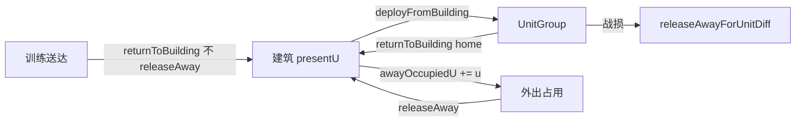

# 单位核心：目录、驻军、占用、电台、补给、训练、航母

目录：`core/shared/src/units/`

本文件覆盖单位**静态定义与资源/占用模型**；下达命令与寻路见 [orders-pathfind.md](./orders-pathfind.md)；每 tick 推进见 [tick-combat.md](./tick-combat.md)。

---

## `catalog.ts` — 兵种与行动费用

### `UnitKind` / `UnitState`

- 兵种：`infantry` | `armor` | `navy` | `navy_carrier` | `air`
- 状态：`idle` | `moving` | `holding` | `blockading` | `fighting` | `training`

### `UnitKindDef`（每 1U）

| 字段 | 作用 |
|------|------|
| `hp` | 交战公式中的单 U 生命 |
| `speedDuPerS` | 基础移速；路/轨可覆盖 |
| `visionR` | 目录中的视野半径（实际过滤用 vision 模块常量） |
| `carryEMax` / `duPerE` | 携行上限与「1E 可行走 Du」；空军为 `null` |
| `mountainBlocked` | 装甲：禁止**纯山区**（山脚可过） |
| `mountainSpeedFactor` | 步兵山区 ×0.5 |

### 关键行动常量（摘录）

| 常量 | 值 | 用途 |
|------|-----|------|
| `UNIT_COORD_STEP` | `0.2` | 单位格 |
| `UNIT_MOVE_O_COST` | `1` | 每组调动 −1O |
| `UNIT_STOP_E/O_COST` | `20` / `3` | 停止 |
| `UNIT_BLOCKADE_*` | 进入 5O+2E/U；每 5s 2E/U；R=2 | 封锁 |
| `UNIT_SUPPLY_O_COST` | `1` | 补给 |
| `UNIT_SIEGE_INTERVAL_SEC` / `UNIT_COMBAT_ROUND_INTERVAL_SEC` | `5` | 攻城/交战节拍 |
| `UNIT_ATTACK_LAND_O_COST` / `AIR_NAVY` | `2` / `3` | 进攻 |
| `UNIT_HOLD_*` | 进入 5O+1E/U；每 5s 1E/U | 驻守 |
| `UNIT_MUTUAL_DEFENSE_O_COST` | `2` | 互防 |
| `CARRIER_BUILD_E` / `AIR_CAPACITY` / `HULL_U` | `500` / `3` / `1` | 航母 |
| `ROAD_MOVE_SPEED` / `RAIL_MOVE_SPEED` | `0.8` / `2` | 借道路速 |

### 辅助函数

- `unitKindFromBuilding(buildingId)` — 由建筑类型推断可派出兵种（聚落系→步兵，港口→海军，机场→空军，装甲营→装甲等）。
- `garrisonLockedInBuilding` — 市镇/都市/首府/首都驻军**不能离城**。
- `isCarrierKind` — `navy_carrier`。

---

## `types.ts` — `UnitGroup` 运行时结构

同一建筑派出的编制为一组。关键字段：

| 字段 | 含义 |
|------|------|
| `id` / `ownerId` / `kind` / `u` | 身份与编制数 |
| `gx,gy` | 0.2 吸附坐标 |
| `carriedE` | 每 U 携行填充（空军常 0） |
| `state` | 状态机 |
| `homeBuildingId` | 派出归属；空军返航目标 |
| `path` / `pathIndex` | 路点；`pathIndex` 指向下一目标 |
| `depositOnArrival` / `depositBuildingId` | 到达入库（训练/返航/撤退） |
| `retreating` | 撤回途中锁命令 |
| `returnGx/Gy` | 空军任务后直线回程骨架 |
| `pendingBlockade` / `pendingSupply` / `supplyBuildingId` | 到达后行为 |
| `blockadeTimerSec` | 封锁节拍累计秒 |
| `pendingAttack*` / `fightTargetUnitId` / `siegeBuildingId` | 进攻与交战 |
| `combatTimerSec` / `siegeTimerSec` / `siegeDamageDealt*` | 交战/攻城计时与累计伤 |
| `pendingHoldBuildingId` / `holdBuildingId` / `holdTimerSec` | 驻守 |
| `mutualDefenseFor*` / `mutualDefenseHome*` | 互防响应出兵 |
| `embarkedAirU` / `embarkedAirHomeBuildingId` | 航母机库 |
| `aaEngagement` | 防空持续减员状态 |
| `liaisonCut` | 拆联络线段（`elapsedSec < 0` 赶路，`≥0` 拆除计时） |
| `visionLevel` / `strengthHidden` | 过滤快照用 |

`UnitMoveRequest` / `UnitMoveSource` — 命令层输入：`sources` 派出、`unitIds` 已有组，以及 `asTrainingDelivery` / `asBlockade` / `asSupply` / `asHold` / `attackTarget*` 等标志。

---

## `garrison.ts` — 驻军与派出/入库

### 坐标

- `snapToUnitCoord` — 0.2 吸附并清浮点噪声  
- `unitCoordKey` — `"gx,gy"` 占位键  
- `findUnitNear` — 点击拾取最近单位，默认半径 0.35 Du  
- `findUnitsInRadius` — 圆形半径内全部单位（近到远）；对局点选 R 由客户端按屏幕 **10 mm** 反推 Du（见 `docs/client/game-canvas.md`）  

### 编制占用

| 函数 | 含义 |
|------|------|
| `presentU` | 在营 `building.u` |
| `awayOccupiedU` | 外出仍占 Umax 的编制 |
| `occupiedGarrisonU` | present + away |
| `releaseAwayOccupation` | 减 away |
| `releaseAwayForUnitDiff` | 对比 tick 前后单位组，按 `homeBuildingId` 释放战损 away；`ignoreDepositedU` 排除本 tick 已入库的 U |

### `deployFromBuilding`

1. 校验数量、是否 `garrisonLocked`、能否派出该种  
2. `presentU` 足够则扣 `u`、加 `awayOccupiedU`  
3. 在建筑坐标创建满携行的 `UnitGroup`（`state: idle`）  

### `returnToBuilding`

- `releaseAway: true`：回家野战单位，房间 = `Umax - present`，并减少 away  
- 否则（训练送达等）：房间 = `Umax - present - away`，不释放 away  

`shouldReleaseAwayOnDeposit`：训练 / `state === "training"` 不释放；仅当目标是 `homeBuildingId` 时释放。

`createUnitGroup` / `defaultCarriedE` — 不经建筑直接造组（训练完成、测试）。

---

## `filter.ts` — 单位视野快照

- **己方**：完整拷贝（含 path，供行军预览）  
- **敌方无直接视野**：省略（无卫星单位轮廓）  
- **敌方直接视野**：保留位置/种类/部分状态，`u=0` + `strengthHidden`，无 path / 机库 / 防空交战  

`filterUnitsForViewer` 先 `collectAllDirectVisionSources` 再逐个过滤。  
`unitHp` / `isMovingState` 为薄封装。

---

## `occupy.ts` — 反堆叠与停泊

| 函数 | 作用 |
|------|------|
| `isUnitDocked` | idle 且与己方港口或己方航母同格（空军/航母船体本身不算停泊） |
| `canUnitStop` | 非交战且非停泊 |
| `canUnitRetreat` | `u>0` 且未在退却 |
| `buildingCenterKeys` | 建筑中心占位，野战 idle 应让开 |
| `blocksUnitCell` | 默认互斥；友好航母↔空军且机库有空则可同格（自动装载） |
| `occupiedUnitKeys` | 静止单位占位（忽略 moving/training） |
| `resolveFreeUnitCoord` | 螺旋找空 0.2 格 |

---

## `radio.ts` — 活动范围（非视野）

| 函数 | 覆盖来源 |
|------|----------|
| `collectRadioCoverage` | 已建成、已通信、未污染的 `boardcast` 电台，经 `workRangeCircles`（含雷达协同） |
| `collectAirportCoverage` | 指定机场 |
| `collectPortNavyCoverage` | 指定港口 |
| `collectMovingUnitCoverage` | 空军→机场；港口海军/航母→港口；其余陆地→电台 |
| `collectUnitActivityCoverage` | 按 air/land 二选一 |
| `isInsideAnyCircle` | 点是否在圆并集内 |

训练送达、撤退、改归属等路径用 `ignoreCoverage` / 空 coverage，不走这套约束。

---

## `supply.ts` — 携行补给

公式：`cost = distance / duPerE`（每 U 的 carriedE 填充）。

| 函数 | 作用 |
|------|------|
| `usesCarriedSupply` | 非空军 |
| `carriedECostPerU` / `maxTravelDuFromCarried` | 费用与航程 |
| `consumeCarriedForStep` | 一步可走实际距离；可耗尽 |
| `resupplyUnitFromStation` | 从 `storeE` 按 U 均分补给，每 U 至少 1E，邻格也算到达 |
| `findSupplyStationAt` | 优先 id，再最近邻格 |
| `pathLengthDu` / `unitGridChebyshev` / `isNearUnitCoord` | 几何辅助 |

---

## `train.ts` — 训练场队列与空位

| 常量/类型 | 含义 |
|-----------|------|
| `TRAIN_E_PER_U` | 步 25 / 装 50 / 海 75 / 空 125 |
| `TRAIN_O_COST` | `2` → 每次训练下单 −2O（不按 U） |
| `TRAIN_DURATION_E_PER_SEC` | `20` → 用时 = 总 E / 20 秒 |
| `TrainingJob` | 队列项：kind、u、目标建筑、ticks |
| `garrisonRoom` | Umax − occupied |
| `pendingInboundU` | 队列 + 在途 `depositBuildingId` |
| `availableTrainingRoom` | 空位 − 在途承诺 |
| `allocateTrainingDeliveries` | 按目标顺序填满，超额整单拒绝 |
| `enqueueTraining` / `advanceTrainingQueues` | 入队与 tick 推进（完成后由 server 调运送） |

`buildingAcceptsUnitKind` 要求目标建筑 `unitKindFromBuilding` 与训练兵种一致。

---

## `carrier.ts` — 航母

| 函数 | 作用 |
|------|------|
| `applyBuildCarrier` | 港口扣 `CARRIER_HULL_U` 派出 `navy_carrier`，费用 `CARRIER_BUILD_E`（通信由调用方先验） |
| `applyEmbarkAir` | 同格 idle 空军装入 `embarkedAirU`，释放原 away，野外组消失或减员 |
| `applyDisembarkAir` | 弹出空军组 |
| `carrierAirRoom` / `carrierCapacityLabel` / `carrierMoveSpeedDuPerS` | UI/逻辑辅助 |
| `autoEmbarkCoLocatedAir` | tick 末同格自动装载（由 `advanceUnits` 调用） |
| `releaseEmbarkedAirForCarrierDiff` | 航母损毁时释放机库空军对机场的 away |

---

## 数据流：派出与占用

