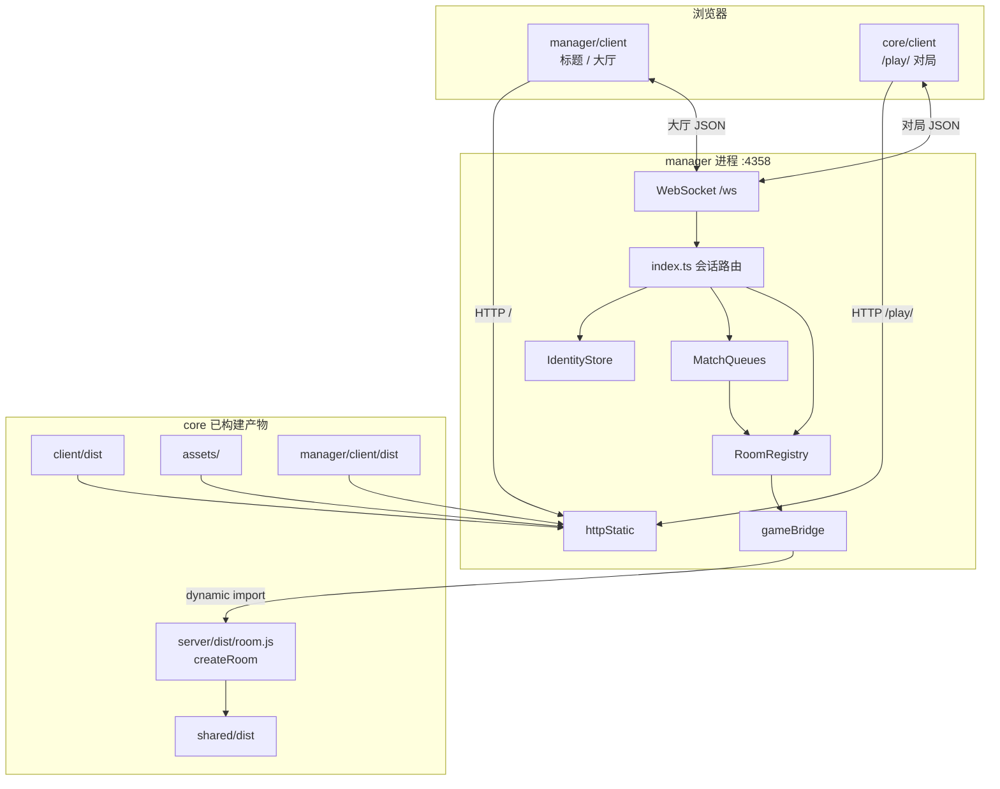

# Manager 架构

路径基准：`manager/`。包名 `@wop/manager`（`private`，`"type": "module"`）。标题 UI 为独立包 `@wop/manager-client`（`manager/client`）。

## 1. 在仓库中的位置

Manager **不是** `core/` npm workspaces 的一部分。根目录 `start.cmd` / `start.sh` / `build.cmd` 把它与 `core` 串成产品：

| 树 | 角色 |
|----|------|
| `core/` | `@wop/shared` + `@wop/server` + `@wop/client` |
| `manager/` | 产品进程：静态托管 + 大厅 + 多房间调度 |

运行时依赖关系：

## 2. 技术栈

| 项 | 说明 |
|----|------|
| 运行时 | Node.js；ESM（`NodeNext`） |
| HTTP | `node:http` `createServer` → `handleStatic` |
| WebSocket | 依赖 `ws`；`WebSocketServer({ server, path: "/ws" })` |
| 编译 | `tsc` → `manager/dist/`；入口 `dist/index.js` |
| 开发 | `tsx watch src/index.ts`（`npm run dev`） |
| 标题客户端 | Vite 6 + React 19（**不**依赖 `@wop/shared`） |

`package.json` 脚本：

| 脚本 | 行为 |
|------|------|
| `build` | `tsc` + `npm run build --prefix client` |
| `build:server` | 仅 `tsc` |
| `build:client` | 仅标题客户端 |
| `start` | `node dist/index.js` |
| `typecheck` | `tsc --noEmit` |

## 3. 进程启动顺序（`src/index.ts`）

`main()` 控制流（准确对应源码顺序）：

1. `new IdentityStore()` → `load()` → `start()`（定时清理过期身份）。
2. `new RoomRegistry()`、`new MatchQueues()`。
3. `sessions: Map<WebSocket, ConnSession>`、`byPlayer: Map<playerId, ConnSession>`。
4. `rooms.setHooks({ onRoomClosed })`：房间关闭时清空会话 `roomId` 并下发 `{ type: "room_closed", ... }`。
5. `matchQueues.bind(rooms, { send, onMatchFormed })`：成房后把各玩家会话的 `roomId` 绑上。
6. `rooms.start()`：启动 `setInterval(tickAll, GAME_TICK_MS)`。
7. `await resolveGameRoomFactory()`：预热加载 `createRoom`（失败则进程 fatal）。
8. `createServer(handleStatic)` + `WebSocketServer` `/ws`。
9. `server.listen(PORT)`；`SIGINT` / `SIGTERM` → `rooms.stop()`、`identity.stop()` / `flush()`、关闭 WS 与 HTTP。

关键变量：

| 符号 | 含义 |
|------|------|
| `PORT` | `Number(process.env.PORT ?? "4358")` |
| `ConnSession` | `{ ws, playerId, name, roomId }`；`roomId` 非空表示已入座 |
| `sessions` | 当前连接 → 会话 |
| `byPlayer` | `playerId` → **最新**会话（重连覆盖） |

## 4. 职责边界

| 职责 | 归属 | 说明 |
|------|------|------|
| 标题 UI / 匹配 UI | `manager/client` | 成功后 `location.href = /play/?roomId=` |
| 对局 UI / 画布 | `core/client` | 仍连同主机 `/ws` |
| 身份 UUID / 昵称 | `identity.ts` | 持久化 `manager/data/identities.json` |
| 大厅协议 | `protocol.ts` + `index.ts` | 建房 / 加入 / 匹配 / 离房 |
| 房间表与 15 Hz tick | `rooms.ts` | 不实现规则 |
| 权威仿真与对局协议 | `@wop/server` `GameRoom` | 经 `gameBridge` 加载 |
| 规则与对局消息类型 | `@wop/shared` | manager **不** import shared；仅镜像大厅字段 |

Manager 对对局消息保持 **opaque**：非大厅 `type` 且会话已绑定 `roomId` 时，调用 `rooms.dispatch(playerId, msg)`。

## 5. 构建产物（概念）

| 路径 | 来源 | 运行时谁读 |
|------|------|------------|
| `manager/dist/*.js` | `tsc` | `start.js` → `node dist/index.js` |
| `manager/client/dist/` | Vite | `httpStatic` 服务 `/` |
| `core/client/dist/` | Vite（core） | `httpStatic` 服务 `/play/` |
| `core/server/dist/room.js` | `tsc`（core） | `gameBridge` 动态 `import` |
| `core/shared/dist/` | `tsc`（core） | 被 `room.js` 依赖 |
| `core/assets/` | 源资源树 | 图标 `/icons`、`/ui` 等回落 |

`start.js` 在缺关键产物时会触发 `npm run build`（见 [start-and-hosting.md](./start-and-hosting.md)）。`node_modules/`、巨大二进制资产不在本文展开。

## 6. 与调试入口的区别

`@wop/server` 的 `dist/index.js` 会自行监听（默认 `:8787`）单房间，仅供调试。Manager **只**加载 `dist/room.js`，由本进程统一托管 HTTP/WS 与多房间。细节见 [game-bridge.md](./game-bridge.md) 与 [../server/README.md](../server/README.md)。

## 7. 相关子文档

- [start-and-hosting.md](./start-and-hosting.md) — 启动器与静态路径路由  
- [lobby-ws.md](./lobby-ws.md) — WS 分流与房间/匹配  
- [game-bridge.md](./game-bridge.md) — 与 `GameRoom` 的缝合面  
- [title-spa.md](./title-spa.md) — 标题客户端  
