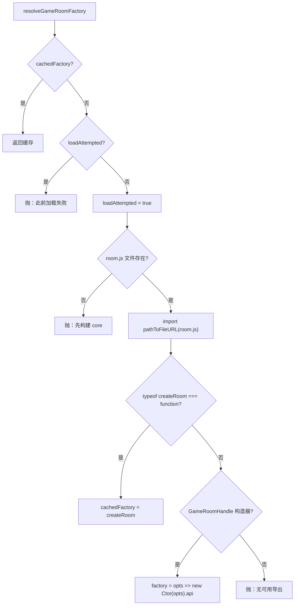

# Game Bridge（对接 `@wop/server`）

对应源码：`manager/src/gameBridge.ts`。被 `rooms.ts` 调用以创建权威房间实例。

## 1. 目的

Manager 不把 `@wop/server` 写进 `package.json` dependencies，而是按仓库相对路径 **动态 `import`** 已构建的库入口：

```text
core/server/dist/room.js
```

该文件是 `@wop/server` 的 `main` / `exports` 目标，导出 `createRoom`（及兼容的 `GameRoomHandle` 类）。**禁止** import `dist/index.js`：后者会启动调试用 WebSocket 监听。

## 2. 时钟常量

```ts
export const GAME_TICK_MS = 1000 / 15;
```

与 `@wop/shared` 的 `TICK_HZ = 15` / `TICK_MS` 对齐。`RoomRegistry.start()` 用该间隔对所有房间调用 `game.tick()`。

## 3. 契约镜像类型

Manager 侧自行声明与 core 对齐的 TypeScript 接口（不 import shared/server 类型包），避免编译期硬依赖：

### 3.1 `GameRoomCreateOptions`

| 字段 | 说明 |
|------|------|
| `roomId` | 房间码 |
| `maxPlayers` | 人数上限 |
| `allowRespawn` | 是否允许首都沦陷后重生 |
| `mapSize` | `"89x59"` \| `"119x79"`（来自 `protocol.MapSizeId`） |
| `seed?` | 地图种子 |
| `idleMs?` | 空闲超时（可选；由 core 默认处理） |

### 3.2 `RoomSend`

`(msg: unknown) => void` — GameRoom 向该玩家推送 JSON 对象时调用。`rooms.wsRoomSend(ws)` 在 socket `OPEN` 时 `JSON.stringify` 写出。

### 3.3 `GameRoomEvent`

| `type` | 字段 | Manager 响应（见 `rooms.ts`） |
|--------|------|-------------------------------|
| `game_over` | `roomId`, `winnerId`, `winnerName` | `destroyRoom(..., "game_over")` |
| `room_closed` | `roomId`, `reason`: `idle` \| `game_over` \| `destroyed` | `finalizeClosed` |
| `player_left` | `roomId`, `playerId` | 监听存在；当前 registry 未单独分支处理 |

### 3.4 `GameRoomHandle`（方法摘要）

| 成员 | 用途 |
|------|------|
| `join({ playerId, name, send })` | 入座；成功时 core 侧会经 `send` 推 welcome/state |
| `setSend(playerId, send)` | 断线后改绑发送函数；disconnect 时绑 `noopSend` |
| `leave(playerId)` | 主动离房，移除座位 |
| `dispatch(playerId, msg)` | 对局消息 |
| `tick()` | 推进仿真 |
| `snapshot(playerId)` | 按玩家取快照（manager 主路径未直接用） |
| `destroy(reason?)` | 关闭房间并应发出 `room_closed` |
| `isIdle(now?)` | 空闲判定（core tick 内也可自毁） |
| `on(listener)` | 生命周期订阅；返回取消函数 |
| `getPlayerIds` / `getSpectatorIds` / `playerCount` | 座位查询 |
| `closed` / `winnerId` / `winnerName` 等只读字段 | 状态 |

`JoinRoomResult`：`{ ok: true, playerId, state }` 或 `{ ok: false, code, message }`。

## 4. 加载逻辑：`resolveGameRoomFactory`



要点：

- 使用 `pathToFileURL(CORE_GAME_ROOM_MODULE).href` 再动态 `import`，保证 Windows 路径可用。
- 一次失败后 `loadAttempted` 仍为 true，后续调用直接抛错（避免反复尝试）。
- 成功日志：`[manager] GameRoom createRoom loaded from core/server/dist/room.js`（或 Handle 类变体）。

## 5. 其它导出

| 函数 | 行为 |
|------|------|
| `createGameRoom(opts)` | `await resolveGameRoomFactory()` 后调用工厂 |
| `isRealGameRoomAvailable()` | `cachedFactory != null` |

`index.ts` 在监听端口前 `await resolveGameRoomFactory()`，确保缺构建时尽早失败，而不是等到第一局建房。

## 6. 与 core 实现的对应

`core/server/src/room.ts` 导出：

- `createRoom(options): GameRoom`
- `class GameRoomHandle`（包装 `.api`）

Manager 的接口是该表面的镜像；字段与事件名需与 core 保持同步。规则与对局 `ClientToServer` / `ServerToClient` 定义在 `@wop/shared`，由 GameRoom 解释；manager 只转发。

进一步阅读：[../server/room.md](../server/room.md)、[../server/networking.md](../server/networking.md)、[../server/game-loop.md](../server/game-loop.md)。
