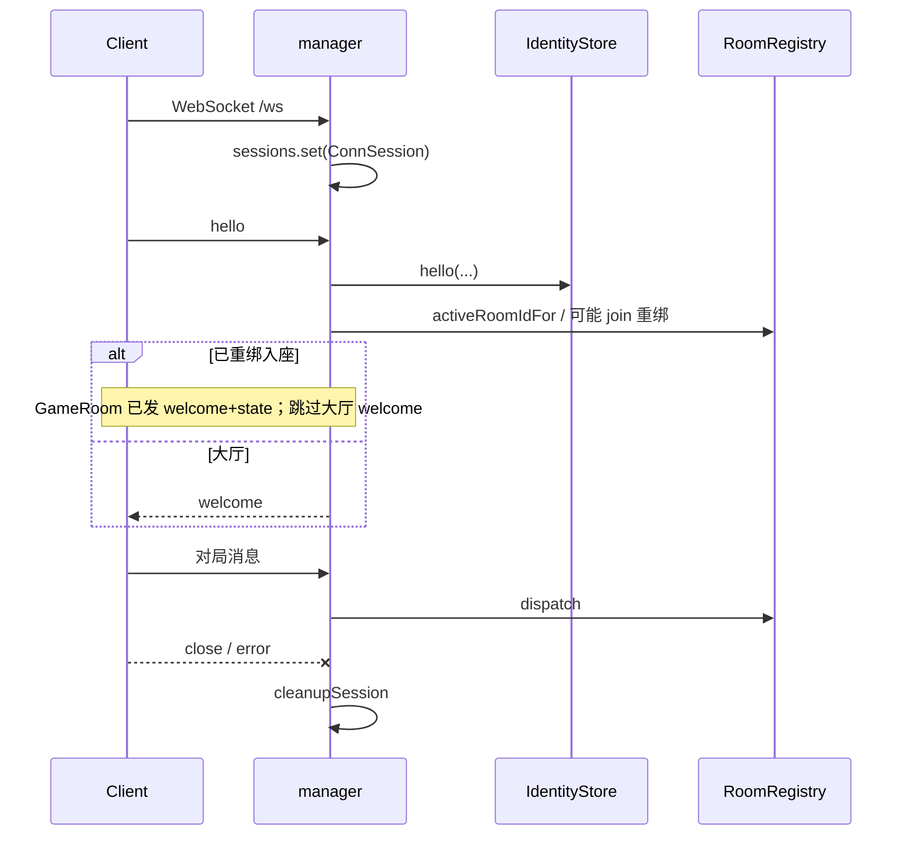
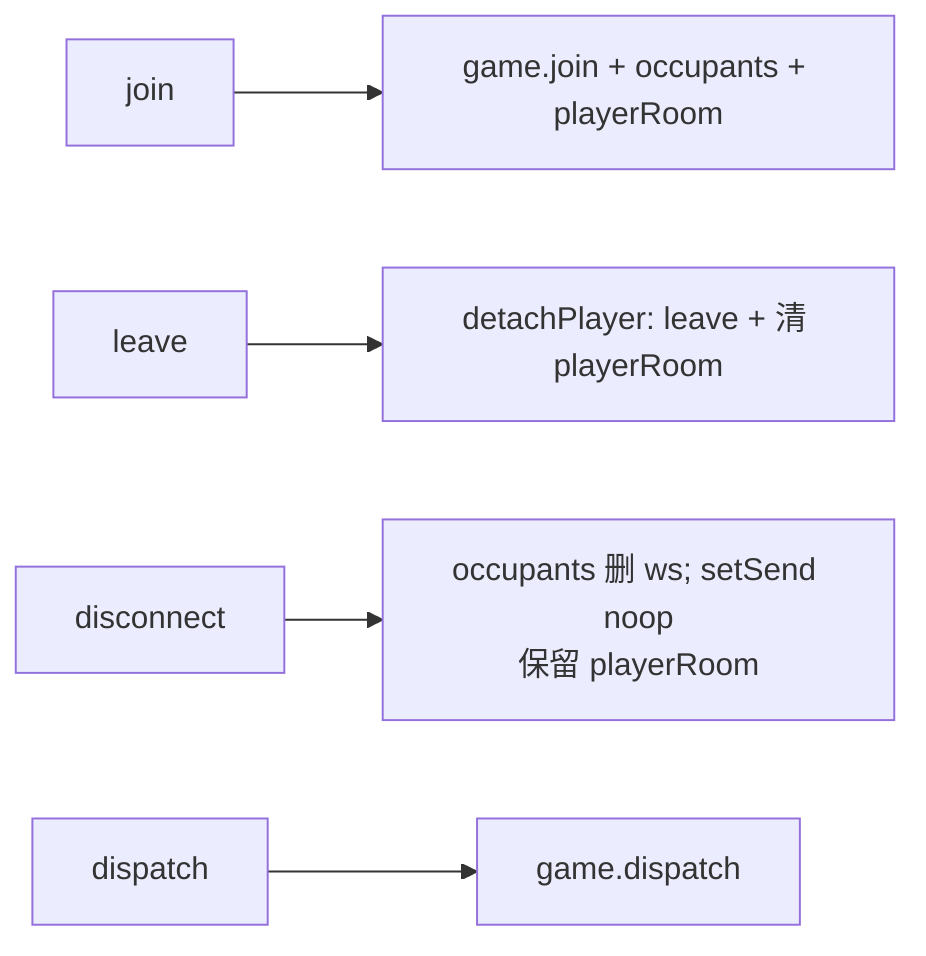
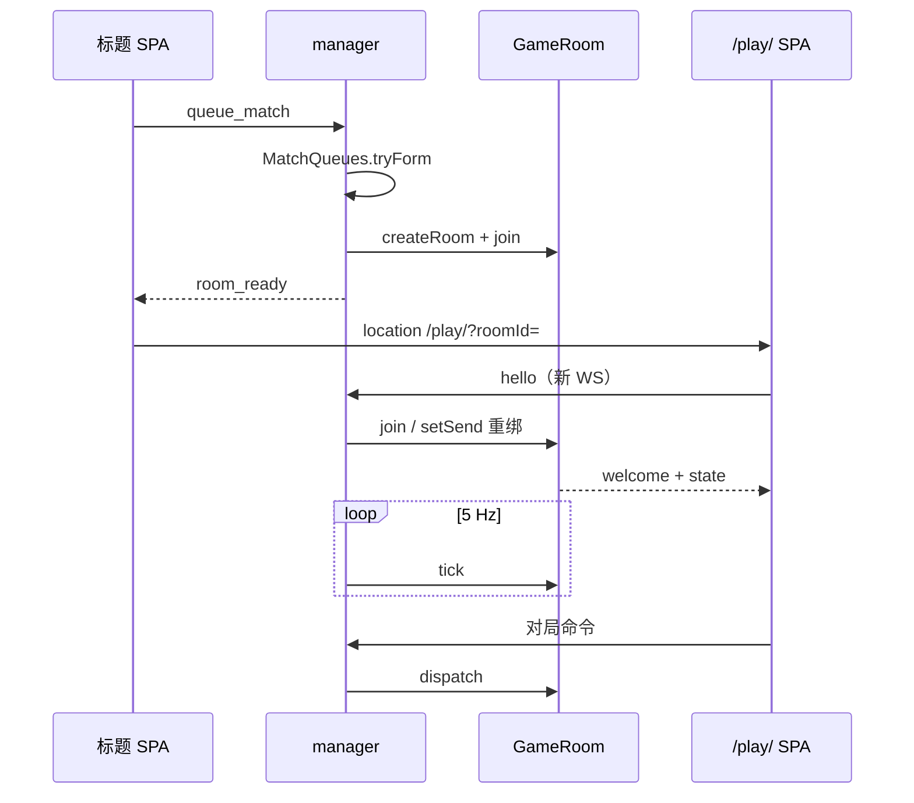

# 大厅、WebSocket 与房间调度

对应源码：`manager/src/index.ts`、`protocol.ts`、`identity.ts`、`lobby.ts`、`rooms.ts`。

## 1. 协议（`protocol.ts`）

大厅消息由 manager 本地处理；注释写明与 shared 侧大厅字段应对齐。对局消息 **不在此枚举**，按 opaque 对象转发。

### 1.1 客户端 → 服务端（`LobbyClientMessage`）

| `type` | 字段 | 说明 |
|--------|------|------|
| `hello` | `playerId?`, `name?` | 身份握手 / 改名 |
| `ping` | `t: number` | 延迟探测 |
| `create_room` | `mapSize`, `seed?`, `allowRespawn`, `maxPlayers`, `saveBlob?` | 自定义建房；`saveBlob` 为 base64 `.wopsave`（读档） |
| `export_save` | — | 对局中导出加密存档（需 `config.json` `saveKey`） |
| `join_room` | `roomId` | 按房间码加入 |
| `queue_match` | `playerCount?`, `teamFormat?` | FFA：`playerCount` 2–5；组队：`teamFormat`（`2v2`…）隐含座位数 |
| `cancel_queue` | — | 取消匹配 |
| `leave_room` | — | 离房回大厅 |

`isLobbyClientMessage`：仅按 `type` 字符串判断是否属于上表。  
`isMapSizeId`：`"89x59"` \| `"119x79"`。

### 1.2 服务端 → 客户端（`LobbyServerMessage`）

| `type` | 主要字段 |
|--------|----------|
| `welcome` | `playerId`, `name`, `activeRoomId?` |
| `pong` | `t` |
| `error` | `code`, `message` |
| `save_export` | `blob`, `filename?` | 加密存档下载 |
| `room_ready` | `roomId` |
| `room_status` | `roomId`, `players`, `maxPlayers`, `mapSize`, `allowRespawn`, `teamMode?` |
| `room_closed` | `roomId`, `reason` |
| `queued` | `playerCount`, `teamFormat?` |
| `match_status` | `playerCount`, `queued`, `needed`, `teamFormat?` |
| `queue_cancelled` | — |

### 1.3 匹配队列键

`MatchQueues` 按 `ffa:{2|3|4|5}` 或 `team:{format}` 分队；成房时 `allowRespawn=false`，人数 ≥4 用 `119x79`。组队局写入随机 `teams` 并 `teamMode=true`。

`send` / `sendError` 在 `index.ts`：仅当 `ws.readyState === OPEN` 时 `JSON.stringify`。

## 2. 身份（`identity.ts`）

`IdentityStore`：UUID ↔ 显示名，断线后 **7 天 TTL**，持久化 `IDENTITY_DATA_PATH`（`manager/data/identities.json`）。

### 2.1 常量

| 常量 | 值 |
|------|-----|
| `TTL_MS` | 7 天 |
| `SAVE_DEBOUNCE_MS` | 500 |
| `CLEAN_INTERVAL_MS` | 1 小时 |

### 2.2 `IdentityRecord` / 文件格式

```ts
{ playerId, name, lastSeenAt: number | null }  // online → lastSeenAt null
// 文件：{ version: 1, identities: IdentityRecord[] }
```

### 2.3 `hello(playerId, name)` 控制流

1. `purgeExpired()`。
2. `sanitizeName`：trim、最长 24；空则 `指挥官-{1000–9999}`。
3. 若 `playerId` 为合法 UUID 且记录未过期：更新昵称、`lastSeenAt = null`、加入 `online`，返回副本。
4. 否则 `randomUUID()` 新建记录并入表。

`markDisconnected`：移出 `online`，写 `lastSeenAt = Date.now()`。  
过期判定：在线永不过期；`lastSeenAt == null` 不过期；否则超时删除。  
`flush`：`mkdir` 后原子写 JSON（debounce 经 `queueSave`）。

## 3. WebSocket 会话与消息分流（`index.ts`）

### 3.1 连接生命周期



`cleanupSession`：从 `sessions` 删除；`matchQueues.remove`；`rooms.onDisconnect`（**不清座位**，只断发送）；若 `byPlayer` 仍指向本会话则删除并 `identity.markDisconnected`。

### 3.2 `handleMessage` 分支

1. JSON 解析失败 → `BAD_JSON`。
2. 无 `type` → `BAD_MESSAGE`。
3. **`isLobbyClientMessage`** → `switch` 大厅处理（见下节）。
4. 否则若已有 `playerId` 且 `roomId` → `rooms.dispatch`；失败 → `NOT_IN_ROOM`。
5. 否则 → `UNKNOWN_MESSAGE`。

大厅操作前多数路径调用 `requireIdentity`（未 hello → `NOT_HELLO`）。

### 3.3 大厅 case 摘要

| case | 校验 / 行为 |
|------|-------------|
| `hello` | 身份；若 `activeRoomIdFor` 有房则 `rooms.join` 重绑（成功则 return，不发大厅 welcome）；否则发 `welcome`（可含 `activeRoomId`） |
| `ping` | `pong` 回显 `t` |
| `create_room` | 未在房；`mapSize`；`maxPlayers` 2–10；出队；`createRoom` + `join`；失败则 `destroyRoom`；成功 `room_ready` + `room_status` |
| `join_room` | 房间码规范化后须匹配 `/^[A-Z0-9]{4,8}$/`；若会话在其它房先 `leave`；出队；`join`；成功状态消息同上 |
| `queue_match` | 未在房；人数 2–5；`enqueue`；`queued` + `match_status` |
| `cancel_queue` | `cancel`；成功发 `queue_cancelled` |
| `leave_room` | `rooms.leave`；`session.roomId = null` |

错误码示例：`ALREADY_IN_ROOM`、`BAD_MAP`、`BAD_MAX`、`BAD_ROOM_ID`、`CREATE_FAILED`、`BAD_QUEUE`，以及 join 返回的 `ROOM_NOT_FOUND` / `ROOM_FULL` / `ROOM_CLOSED` 等。

房间关闭钩子：`onRoomClosed` 对仍绑定该房的玩家发 `room_closed` 并清 `session.roomId`。

## 4. 匹配队列（`lobby.ts`）

`MatchQueues`：按目标人数 `2 | 3 | 4 | 5` 各一条 FIFO。

| 函数 / 规则 | 说明 |
|-------------|------|
| `mapSizeForMatch` | ≤3 → `"89x59"`；≥4 → `"119x79"` |
| 成房参数 | `maxPlayers = playerCount`，`allowRespawn = false`，无自定义 seed |
| `enqueue` | 先 `remove` 旧队列项，再 push，广播 status，`tryForm` |
| `tryForm` | `while (q.length >= playerCount)` splice 一批 → `createRoom` → 逐人 `join` → `room_ready` / `room_status` / 或 error → `onMatchFormed` |
| `broadcastStatus` | 向该队列所有人发 `match_status` |
| `cancel` / `remove` | 离队并广播 |

`bind(rooms, hooks)` 注入 `RoomRegistry` 与 `send` / `onMatchFormed`。`index` 的 `onMatchFormed` 把各玩家 `sess.roomId` 设为新房 ID。

## 5. 房间注册表（`rooms.ts`）

### 5.1 数据结构

| 结构 | 含义 |
|------|------|
| `rooms: Map<roomId, RoomMeta>` | 活动房间 |
| `playerRoom: Map<playerId, roomId>` | 座位分配（断线仍保留，便于重连） |
| `occupants`（在 `RoomMeta`） | 当前绑定的 `WebSocket` |
| `destroying` | 防止重入销毁 |
| `tickTimer` | `GAME_TICK_MS` 间隔；`unref` |

`RoomMeta`：`roomId`、`maxPlayers`、`allowRespawn`、`mapSize`、`seed?`、`occupants`、`game: GameRoomHandle`、`createdAt`、`unsub`。

### 5.2 房间码

- 字母表：`ABCDEFGHJKLMNPQRSTUVWXYZ23456789`（去易混字符）。
- `generateRoomCode`：6 字节随机 → 6 字符。
- `normalizeRoomId`：trim + upper。
- 冲突时最多再试 32 次；仍冲突抛 `ROOM_CODE_EXHAUSTED`。
- `createRoom` 的 `maxPlayers` 经 `clampInt(..., 2, 10)`。

### 5.3 创建与事件

`createGameRoom(...)` 成功后：

```ts
meta.unsub = game.on((ev) => {
  if (ev.type === "game_over") void destroyRoom(roomId, "game_over");
  else if (ev.type === "room_closed") finalizeClosed(roomId, ev.reason);
});
```

### 5.4 `join` / `leave` / `onDisconnect` / `dispatch`



- `join`：满员且非已入座 → `ROOM_FULL`；若玩家在其它房先 `detachPlayer`。
- `onDisconnect`：**不**调用 `GameRoom.leave`，以便标题→`/play/` 换页或刷新后 `hello` 重绑。
- `dispatch`：按 `playerRoom` 找房；房间不存在或 `closed` 返回 `false`。

### 5.5 `destroyRoom` / `finalizeClosed`

1. 标记 `destroying`；若未 `closed` 则 `game.destroy(reason)`（规范化为 `idle` \| `game_over` \| `destroyed`）。
2. destroy 应触发 `room_closed` → `finalizeClosed`；若 registry 仍有条目则兜底再 finalize。
3. `finalizeClosed`：`unsub`、从 `rooms` 删除、清相关 `playerRoom`、调 `hooks.onRoomClosed`。

### 5.6 Tick

`tickAll`：遍历未 `closed` 的房间，`try/catch` 调用 `game.tick()`；单房异常只打 warn，不影响其它房。

`activeRoomIdFor(playerId)`：查 `playerRoom`，若房已不在 map 则清映射返回 `null`（供 `welcome.activeRoomId` / 重连）。

## 6. 端到端：从匹配到对局



标题侧在收到 `room_ready` 后立即跳转（见 [title-spa.md](./title-spa.md)）；对局 SPA 重新 hello，manager 用 `playerRoom` 把新 socket 绑回同一 `GameRoom`。
