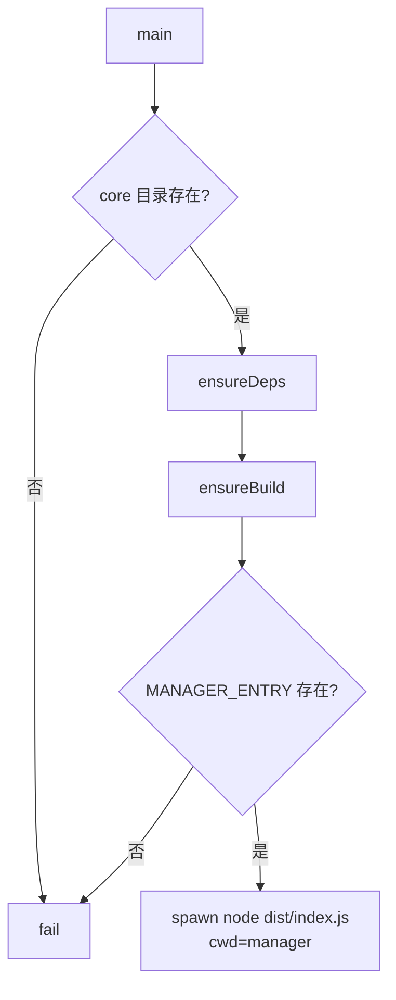
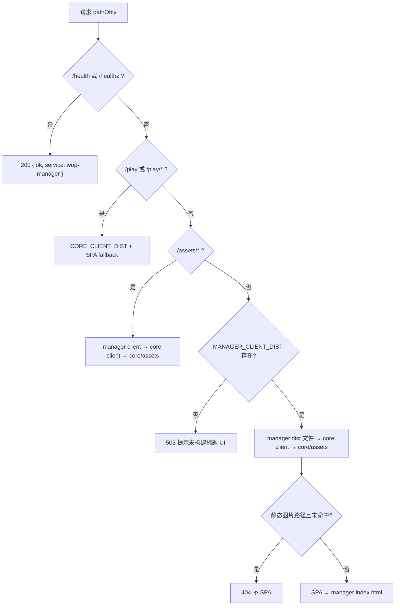

# 启动与静态托管

对应源码：`manager/start.js`、`manager/start.sh`、`manager/src/paths.ts`、`manager/src/httpStatic.ts`。

## 1. `start.js` — 产品启动器

跨平台入口（根目录 `start.cmd` / `start.sh` 转调此处）。路径均相对本文件所在的 `manager/`。

### 1.1 关键路径常量

| 符号 | 解析结果 |
|------|----------|
| `CORE_ROOT` | `../core` |
| `MANAGER_ROOT` | `manager/` |
| `SHARED_DIST` | `core/shared/dist/index.js` |
| `SERVER_DIST` | `core/server/dist/index.js`（存在性检查；**运行不加载**） |
| `SERVER_ROOM_DIST` | `core/server/dist/room.js` |
| `CORE_CLIENT_DIST` | `core/client/dist/index.html` |
| `MANAGER_ENTRY` | `manager/dist/index.js` |
| `MANAGER_CLIENT_DIST` | `manager/client/dist/index.html` |
| `*_NODE_MODULES` | `core` / `manager` / `manager/client` 的 `node_modules` |

### 1.2 流程

**`ensureDeps`**：若对应 `node_modules` 不存在，则在该目录 `npm install`（`core`、`manager`、`manager/client` 分别检查）。

**`ensureBuild(force)`**：

- `force` = `process.env.WOP_BUILD === "1"` 或 CLI 含 `--build`。
- 缺 shared / server（`index.js` 或 `room.js`）/ core client → `npm run build`（cwd=`core`）。
- 缺 manager 入口或标题 `index.html` → `npm run build:server`（manager）再 `npm run build`（`manager/client`）。

**`run` 注意**：Windows 上对 `npm` 使用 `npm.cmd`，且 **`shell: false`**，避免带空格的路径被 shell 截断。

### 1.3 环境变量

| 变量 | 作用 |
|------|------|
| `PORT` | 传给子进程；`index.ts` 默认 `"4358"` |
| `WOP_BUILD` | `"1"` 强制重建 |
| `WOP_SAVE_KEY` | `.wopsave` AES 密钥；仅由 `start.cmd` / `start.sh` 设置（见 [save-load.md](./save-load.md)） |

启动日志前缀：`[wop-start]`。

## 2. `start.sh`

Bash 包装：检查 `node` 与同目录 `start.js`，`export PORT` 与示例 `WOP_SAVE_KEY`，`exec node start.js "$@"`。构建/安装逻辑在 `start.js`。

## 3. `paths.ts` — 运行时路径

从编译后文件位置反推包根（`src/` 或 `dist/` 的上一级皆为 `manager/`）：

| 导出 | 指向 |
|------|------|
| `MANAGER_ROOT` | `manager/` |
| `CORE_ROOT` | `../core` |
| `MANAGER_CLIENT_DIST` | `manager/client/dist` |
| `CORE_CLIENT_DIST` | `core/client/dist` |
| `CORE_ASSETS` | `core/assets` |
| `IDENTITY_DATA_PATH` | `manager/data/identities.json` |
| `CORE_GAME_ROOM_MODULE` | `core/server/dist/room.js` |

全部为相对仓库布局的绝对路径；不写死盘符。

## 4. `httpStatic.ts` — HTTP 路由

`handleStatic(req, res)` 仅处理 `GET` / `HEAD`；其它方法 `405`。

### 4.1 路由优先级

### 4.2 `/play/`

- 缺 `CORE_CLIENT_DIST` → `503` 明文提示需构建 core client。
- `/play`、`/play/` → `index.html`；否则去掉 `/play/` 前缀后 `safeJoin`。
- 文件未命中 → SPA fallback 到 `core/client/dist/index.html`。

### 4.3 `/assets/`

浏览器里两个 SPA 都可能请求绝对路径 `/assets/...`（Vite 哈希包）。查找顺序：

1. `MANAGER_CLIENT_DIST/assets/...`
2. `CORE_CLIENT_DIST/assets/...`
3. `CORE_ASSETS/`（去掉 `/assets/` 前缀后的相对路径）

### 4.4 标题与其它路径

- 缺标题 dist → HTML `503` 说明页（仍提示 `/ws` 与 `/play/`）。
- `/` → `index.html`；其它路径先试 manager dist，再 core client dist，再 `core/assets`。
- **`isStaticAssetPath`**：`/icons/`、`/ui/` 或常见图片/字体后缀 —— 未找到时 **不** SPA fallback（避免 `` 收到 HTML）。

### 4.5 安全与缓存

- `safeJoin(root, reqPath)`：`decodeURIComponent` + `normalize`，拒绝跳出 `root` 的路径遍历。
- MIME 表覆盖 html/js/css/json/图片/字体/map 等。
- `Cache-Control`：`.html` 为 `no-cache`；其它 `public, max-age=3600`。

## 5. 与开发代理的关系

`manager/client/vite.config.ts` 开发服务器 `:5174` 将 `/ws`、`/play`、`/assets` 代理到 `localhost:4358`，因此本地可一边 `tsx`/`node` 跑 manager，一边 Vite 改标题页。生产则由同一 `4358` 进程直接托管构建产物。

详见 [title-spa.md](./title-spa.md)。
