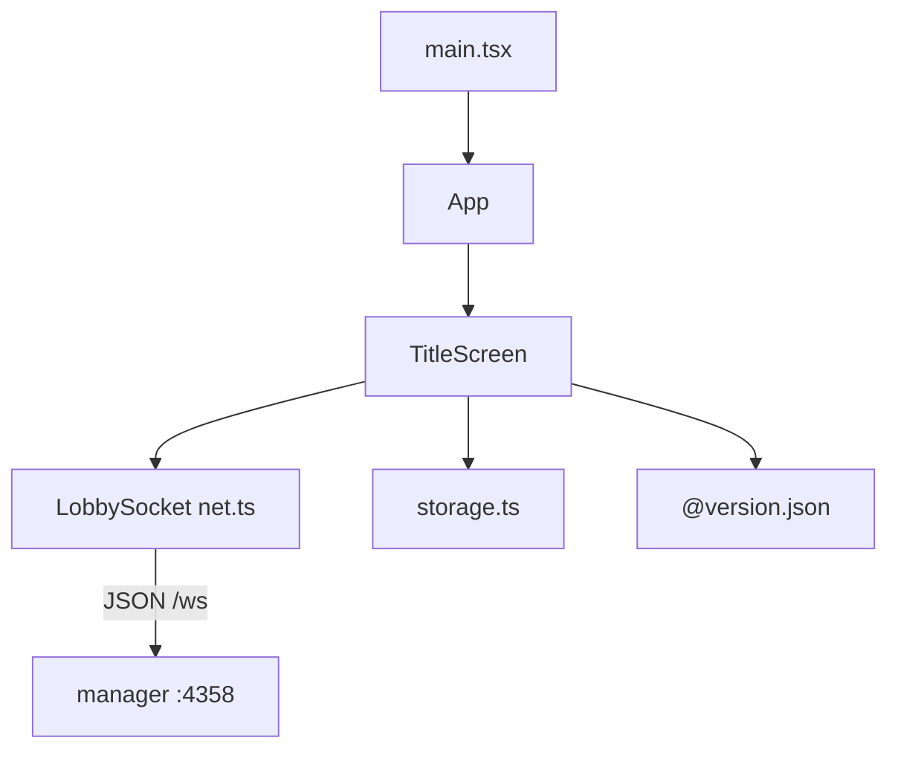

# 标题 SPA（`manager/client`）

包名 `@wop/manager-client`。独立 Vite + React 19 项目，**不**依赖 `@wop/shared`。生产由 manager 的 `httpStatic` 从 `manager/client/dist` 托管在 `/`。

## 1. 技术栈与配置

| 项 | 说明 |
|----|------|
| 入口 HTML | `index.html`（标题「纸上谈兵 4」；加载 Google Fonts：Noto Serif SC / Source Sans 3） |
| 挂载 | `src/main.tsx` → `<App />` → `TitleScreen` |
| 样式 | `src/styles.css` |
| 版本 | `@version.json` alias → 仓库根 `version.json` |
| 开发端口 | `5174`（`host: true`） |
| 代理 | `/ws`（WS）、`/play`、`/assets` → `http(s)://localhost:4358` |
| 构建 | `tsc --noEmit && vite build` → `dist/` |

`fs.allow` 放宽到仓库根，以便读取 `version.json`。插件 `watch-version-json` 在开发时监听该文件变更。

## 2. 模块图



| 文件 | 职责 |
|------|------|
| `App.tsx` | 仅渲染 `TitleScreen` |
| `screens/TitleScreen.tsx` | 连接状态、昵称、匹配、建房、加入、重入；处理服务端大厅消息 |
| `net.ts` | `LobbySocket` + 与服务端对齐的客户端消息类型 |
| `storage.ts` | `localStorage` 键：`wop:playerId` / `wop:playerName` / `wop:lastRoomId` |

## 3. `LobbySocket`（`net.ts`）

- URL：`${ws|wss}//${location.host}/ws`（开发时经 Vite 代理到 manager）。
- `connect`：已有 OPEN/CONNECTING 则跳过；`onclose` 若非主动关闭则 1200ms 后重连。
- `send(ClientMsg)`：仅 OPEN 时发送。
- `ClientMsg` 与 manager `protocol.LobbyClientMessage` 同形；`ServerMsg` 为宽松 `{ type, ... }`。

## 4. 本地存储（`storage.ts`）

| API | 行为 |
|-----|------|
| `loadCachedIdentity` / `saveIdentity` | 读写 playerId、name |
| `loadLastRoomId` / `saveLastRoomId` | 上次房间码；`null` 则 removeItem |
| `randomDefaultName` | `指挥官-{1000–9999}`（与服务端 sanitize 空名规则同风格） |

读写均 try/catch，私密模式失败则静默忽略。

## 5. `TitleScreen` 控制流

### 5.1 连接与 hello

1. 挂载时 `socket.connect()`；卸载 `close()`。
2. `conn === "open"` 时发送一次 `hello`（用缓存 `playerId` + 当前昵称）。
3. 昵称 blur /「保存」/ 匹配·建房·加入前调用 `rename()` → 再发 `hello` 更新名。

### 5.2 服务端消息处理

| `msg.type` | UI 行为 |
|------------|---------|
| `welcome` | 写入 playerId/name；保存身份；更新 `activeRoomId` |
| `queued` | `queuing=true`；状态文案 |
| `match_status` | `queueInfo`：`匹配中 queued/needed` |
| `queue_cancelled` | 清队列 UI |
| `room_ready` | `goPlay(roomId)` → 跳转对局 |
| `room_closed` | 清 active；若等于 lastRoom 则清缓存；中文 reason 映射 |
| `error` | 错误状态文案 |

`roomClosedReason` 映射：`idle`→空闲超时，`game_over`→对局结束，`destroyed`→已解散，`join_failed`→加入失败。

### 5.3 进入对局

```ts
function goPlay(roomId: string) {
  saveLastRoomId(roomId);
  window.location.href = `/play/?${new URLSearchParams({ roomId })}`;
}
```

整页导航到 manager 托管的 `core/client`；对局端用新 WebSocket 再 hello，由 manager 按 `playerRoom` 重绑座位（见 [lobby-ws.md](./lobby-ws.md)）。

### 5.4 UI 区块（与源码 section 对应）

1. 连接点 + `versionJson.version`
2. 品牌「纸上谈兵」+ 副标题
3. 指挥官名称
4. **匹配**：人数 2–5（选项文案含地图尺寸暗示）；开始 / 取消
5. **创建房间**：人数上限 2–10、地图、可选种子、允许重生、创建并进入
6. **输入房间码**：最长 8，自动 upper
7. **重新加入**：`activeRoomId ?? lastRoomId`
8. 状态行

匹配选项展示规则与服务端 `mapSizeForMatch` 一致：2–3 人标 89×59，4–5 人标 119×79（客户端仅展示；真正 mapSize 由服务端成房时决定）。

## 6. 与对局客户端的分工

| | 标题 SPA | 对局 SPA（`core/client`） |
|--|----------|---------------------------|
| 包 | `@wop/manager-client` | `@wop/client` |
| 依赖 shared | 否 | 是 |
| 主要消息 | 大厅协议 | 对局协议 + hello |
| 成功匹配后 | 跳转 `/play/?roomId=` | 渲染权威 state |

二者共用同一 `/ws` 与同一套 localStorage 身份键前缀 `wop:`（对局端亦有自己的存储逻辑）。
