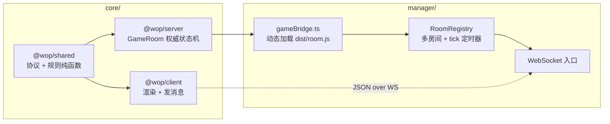
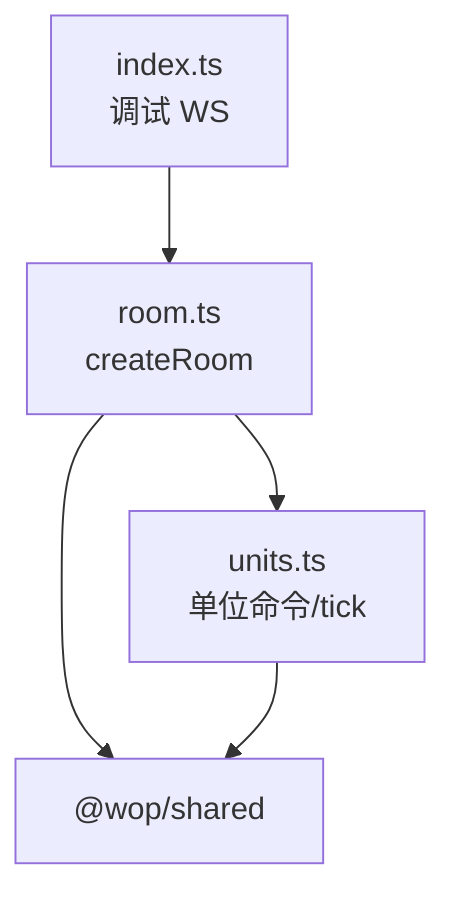

# 服务端架构

路径基准：`core/server`。包名：`@wop/server`。

## 1. 在仓库中的位置



| 包 | 职责 |
|----|------|
| `@wop/shared` | `TICK_HZ`/`TICK_MS`、消息联合类型、地图/地形/建筑/单位/视野纯逻辑 |
| `@wop/server` | 单局房间状态机；接收 `dispatch`；每 tick 推进并 `broadcastState` |
| `manager` | 身份、大厅、`create_room`/`join_room`、多房间注册、真正的 WS 连接 |
| `@wop/client` | UI；消费 `state` 快照；不信任本地 E/O |

`core/package.json` 的 workspaces 为 `shared` / `server` / `client`。根目录另有独立的 `manager/` 包，通过文件系统路径加载已编译的 `core/server/dist/room.js`，而不是 npm workspace 依赖。

## 2. 包入口与脚本

来源：`core/server/package.json`。

| 字段 | 值 | 含义 |
|------|-----|------|
| `main` / `exports["."]` | `./dist/room.js` | **库入口是 room，不是 index** |
| `exports["./room"]` | 同上 | 显式子路径 |
| `dev` | `tsx watch src/index.ts` | 调试服务器热重载 |
| `build` | `tsc -p tsconfig.json` | 输出到 `dist/` |
| `start` | `node dist/index.js` | 跑调试入口 |
| 依赖 | `@wop/shared`、`ws` | 规则 +（仅调试入口用）WebSocket |

TypeScript：`module`/`moduleResolution` = `NodeNext`，`rootDir`=`src`，`outDir`=`dist`。

### 2.1 库用法（推荐）

```ts
import { createRoom, type GameRoom } from "@wop/server";
// 或：从编译产物 core/server/dist/room.js 动态 import

const room = createRoom({
  roomId: "ABCD12",
  maxPlayers: 4,
  allowRespawn: false,
  mapSize: "89x59",
  seed: 12345,       // 可选
  idleMs: 5 * 60e3,  // 可选，默认 ROOM_IDLE_MS
});

room.on((ev) => { /* game_over | room_closed | player_left */ });
setInterval(() => room.tick(), TICK_MS);

const joined = room.join({
  playerId: "...",
  name: "Alice",
  send: (msg) => ws.send(JSON.stringify(msg)),
});
room.dispatch(playerId, clientMsg);
```

### 2.2 调试入口 `src/index.ts`

职责：本地单房间联调，**不应被 manager import**（副作用：立刻 `listen`）。

流程要点：

1. `createRoom({ roomId: env WOP_DEBUG_ROOM_ID ?? "DEBUG1", maxPlayers: 10, allowRespawn: true, mapSize: "89x59" })`
2. `WebSocketServer({ port: PORT ?? 8787 })`
3. 连接后：首条消息若非 `hello` 也会分配 `playerId` 并 `join`；之后 `dispatch`
4. `close` → `room.leave`
5. `setInterval(() => room.tick(), TICK_MS)`
6. 监听 `room_closed` / `game_over` 打日志

`RoomSend` 在调试入口里直接 `ws.send(JSON.stringify(msg))`；`GameRoom` 内部则用 `makeSocket` 把 `RoomSend` 伪装成 `ws.WebSocket` 形状，以便与 `units.ts` 的 `sendError(session.ws, …)` 签名兼容。

## 3. 职责边界：server vs manager

| 能力 | `core/server` | `manager` |
|------|---------------|-----------|
| 地形生成 | `createRoom` 时 `generateRoomTerrain` | 传 `mapSize`/`seed` |
| 玩家身份持久化 | 仅接受调用方给的 `playerId` | `identity.ts` 等 |
| `create_room` / `join_room` / 匹配队列 | `dispatch` 里 **拒绝**（`lobby_only`） | 处理并调用 `RoomRegistry` |
| WebSocket 帧编解码 | 调试入口有；库本身无 | 有 |
| `tick` 定时器 | 调试入口有；库只暴露 `tick()` | `GAME_TICK_MS` 全局 `tickAll` |
| 空闲销毁 | `tick` 内 `isIdle` → `destroy("idle")` | 订阅 `room_closed` 清理注册表 |

## 4. 模块关系（server 内部）



- `room.ts`：房间生命周期、建筑/联络线/经济/通讯/胜负、消息路由、状态快照与广播。
- `units.ts`：把单位相关 `ClientToServer` 映射到 shared 的 `apply*` / `advance*`，并扣 E/O、写回世界数组、触发 `broadcast`。
- 二者共享同一套可变世界：`buildings` / `liaisons` / `units` / `terrain` / `connectedByOwner`（由 room 持有，作为 `UnitWorld` 传入）。

## 5. 权威状态与客户端约定

来自 `GameStateSnapshot` 注释与 `sendPlayerState`：

- `you.energy` / `you.organization` **始终发绝对值**，从不发增量。
- 每 tick（有人在 `playing` 时）`broadcastState()`；经济虽在 1 Hz / 10s / 30s 突变，客户端仍以权威世界切片为准（实体全量；`map`/`terrainSeed`/`allowRespawn` 仅 bootstrap；`role`/winner 仅变化时）。
- 视野：非观战/未结束时，建筑、联络线、单位、资源视野经 `filter*ForViewer` 过滤；观战与 `ended` 看全图。
- 地形本体不通过网络下发格子；`terrainSeed` 仅在开局/再入房下发，客户端本地 `generateTerrain` 并缓存；资源枯竭等用 `resourceTerrain` / `resourceSight` 同步。

## 6. 关键导出一览

| 导出 | 文件 | 说明 |
|------|------|------|
| `createRoom` | `room.ts` | 工厂；创建时立刻生成地形 |
| `GameRoom` | `room.ts` | 房间接口类型 |
| `GameRoomHandle` | `room.ts` | 薄包装类，`api` 属性指向同一接口（供 manager 备选加载） |
| `CreateRoomOptions` / `JoinRoomOptions` / `JoinRoomResult` | `room.ts` | 创建/加入参数与结果 |
| `RoomSend` / `GameRoomEvent` / `GameRoomListener` | `room.ts` | 出站回调与生命周期事件 |
| `DEFAULT_ROOM_IDLE_MS` | `room.ts` | 等同 shared 的 `ROOM_IDLE_MS`（5 分钟） |
| `UnitSession` / `UnitWorld` 及各类 `handle*` / `advance*` | `units.ts` | 单位子系统（主要由 room 内部使用） |
