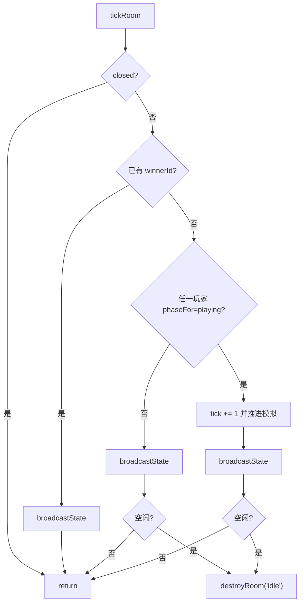

# 游戏循环（`tick`）

时钟频率由 `@wop/shared` 定义：`TICK_HZ = 15`，`TICK_MS = 1000/15 ≈ 66.67ms`。  
`GameRoom` **不自带定时器**；调试入口与 `manager` 的 `RoomRegistry` 负责 `setInterval(..., TICK_MS)` 后调用 `room.tick()`。

## 1. `tickRoom` 总控流

实现：`core/server/src/room.ts` 内 `tickRoom`。

要点：

- **无人 playing**（例如全员还在选都）：仍广播快照，但不推进 `tick` 与模拟。
- **已有胜者**：只广播，不再模拟。
- 每次真正模拟结束都发**完整** `state`（含绝对 E/O）。

## 2. 单 tick 模拟顺序

有玩家 `playing` 时，严格按下序：

| 顺序 | 调用 | 作用 |
|------|------|------|
| 1 | `tick += 1` | 模拟时钟前进 |
| 2 | `syncPollutionFlags` | 建筑 `polluted` 标志 ↔ 污染区 |
| 3 | `advanceConstruction` | 建造 tick−1；污染/无建造视野则暂停；完工填驻军 |
| 4 | `advanceRepair` | 修复/续建进度；结束时可能 `finishConstructionInPlace` |
| 5 | `advancePollutionCapitalDamage` | 按污染间隔对污染区内首都扣 HP |
| 6 | 若 `tick % COMM_WAVE_INTERVAL_TICKS === 0`：`beginCommWaves` | 从各首都重启扩散（未完成的波不打断） |
| 7 | `advanceCommWaves` | 每 tick 走 `COMM_STEPS_PER_TICK`；**完成才**提交 `connectedByOwner` |
| 8 | `simulateEconomy` | 见下节 |
| 9 | `advanceUnitTraining` | 训练队列；完工生成单位并尝试送货路径 |
| 10 | `advanceUnitMovement` | 单位移动（`TICK_MS/1000` 秒） |
| 11 | `advanceUnitAntiAir` | 防空持续消耗；`tip` 通知弹药事件 |
| 12 | `advanceUnitBlockades` | 封锁维护费 + 交战；扣玩家 E |
| 13 | `advanceUnitCombat` | 驻守维护 → 战斗/围城 → 切联络线；扣 E |
| 14 | `reconcileCapitals` | 0 HP 首都移除 → `onCapitalFallen` → 可能 `game_over` |
| 15 | `broadcastState` | 全员个性化快照 |
| 16 | 空闲检查 | 可能 `destroyRoom("idle")` |

单位相关封装见 [units.md](./units.md)；规则细节在 `@wop/shared`。

## 3. 经济节奏 `simulateEconomy`

基于 `tick` 取模（`TICKS_PER_SEC = TICK_HZ` 等）：

| 条件 | 行为 |
|------|------|
| `tick % TICKS_PER_30S === 0` 且有地形 | `depleteResourcesForMiners`（开采耗储量） |
| `tick % TICKS_PER_SEC === 0` 且有地形 | `revealResourcesUnderMiners` |
| 每秒 | `energyIncomePerSecond` → `hud.energy +=` |
| 每 10 秒 | `powerDrainPer10s` → 扣 E |
| 每 30 秒 | `orgBonusPer30s` → O 上限封顶 `organizationMax` |
| 任意时刻若 `energy < 0` | 负能量转首都 HP 伤害，`energy` 置 0 |

连通参数：`connectedByOwner.get(playerId)` 传入收入/功耗/组织计算（未连通建筑通常不计）。

## 4. 通讯波与「已发布」连通

- **发布集** `connectedByOwner`：客户端看到的 `connectedBuildingIds`，命令校验 `rejectIfNotLinked` / `isBuildingCommsLinked` 使用它。
- **波进行中**：`beginCommWaves` 用 `startCommWave(..., publishedLinks)`；`stepCommWave` 推进；`done` 后才 `connectedByOwner.set(ownerId, wave.connected)`。
- 因此迁都/选都后立刻 `begin`+`advance`，但大规模重建连通有跨 tick 延迟。

## 5. 建造推进细节（tick 内）

`advanceConstruction` 跳过条件：

- `buildTicksRemaining <= 0`
- `constructionHalted`（受击中断，需玩家「继续建造」）
- 点在污染区
- `!isConstructionAllowedAt(...)`（无直接视野且公路/铁路未把节点连入视野）

联络线只减 `buildTicksRemaining`，无 HP 公式。

## 6. 与命令路径的关系

玩家 `dispatch` 成功路径通常**立刻** `broadcastState()`，不等下一个 tick。  
Tick 广播保证移动中单位、经济、建造进度等持续同步。

空闲计时不因纯 tick 刷新；只有 join / 选都 / 非 ping·hello 的 dispatch 调用 `touchInteraction`。选都阶段长时间无人操作仍可能 idle 毁房。
