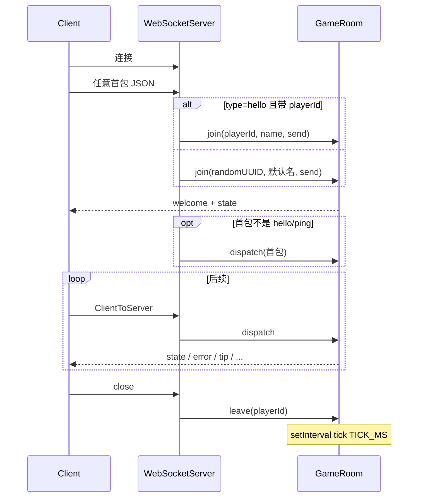

# 网络与消息协议

`@wop/server` **不绑定**具体传输实现（调试入口除外）。协议类型定义在 `@wop/shared` 的 `core/shared/src/index.ts`：`ClientToServer` / `ServerToClient`。

## 1. 传输约定

| 约定 | 说明 |
|------|------|
| 编码 | 每帧一个 JSON 对象，字段 `type` 判别联合类型 |
| 出站 | 调用方提供 `RoomSend = (msg: ServerToClient) => void` |
| 入站 | 调用方解析后 `room.dispatch(playerId, msg)` |
| 身份 | 房间只认已 `join` 的 `playerId`；不在此包做 token 鉴权 |

### 调试入口消息流（`src/index.ts`）



Manager 路径类似，但 `hello` / `create_room` / `join_room` 等在进入 `GameRoom.dispatch` **之前**由大厅处理；进房后才 `dispatch` 游戏消息（见 `manager/src/index.ts`）。

## 2. 房间侧处理的客户端消息

下列类型在 `dispatchPlayerMessage` 中落地。大厅类型会收到 `error.code = "lobby_only"`。

### 2.1 系统 / 会话

| type | 字段 | 房间行为 |
|------|------|----------|
| `ping` | `t: number` | 立即 `pong` 回传同一 `t`；**不**刷新空闲计时 |
| `hello` | `playerId?`, `name?` | 已在房内时仅可更新 `name`（≤24）；不重发 welcome |
| `chat` | `text` | 空白压缩、trim、最长 200；广播 `chat` |
| `init` | `mapSize?`, `seed?` | **拒绝** `init_disabled`（地图创建时已生成） |

### 2.2 首都与基建

| type | 关键字段 | 含义 |
|------|----------|------|
| `place_capital` | `gx`, `gy` | 选都格点（会 snap） |
| `build` | `buildingId`, `gx`, `gy`, `ground` | 新建或升级链；`ground` 为客户端地形上下文 |
| `build_liaison` | `kind`, `nodes[]` | `fiber`/`road`/`railway` 路径节点 |
| `demolish` / `demolish_liaison` | `id` | 拆除建筑或联络线实例 |
| `repair` | `id` | 修复或「继续建造」 |
| `level_upgrade` | `id` | 雷达/港口/兵营等线性升级 |
| `relocate_capital` | `id` | 首府实例 → 新首都 |
| `reload` | `id`, `count` | 装填弹药 |
| `deploy` | `id`, `count` | 补给站部署储能 |
| `fire` | `id`, `targetId?`, `targetUnitId?` | 臼炮系开火 |

### 2.3 单位（完整字段见 shared）

| type | 要点 |
|------|------|
| `train` | 训练场 `id`，`kind`，`u`，`targetIds`/`targetId` |
| `move_units` | 目标 `gx,gy`；`sources` 和/或 `unitIds` |
| `assign_home` | `buildingId` + `unitIds` |
| `stop_units` | `unitIds`；`retreat?` 空军撤退 |
| `blockade_units` / `end_blockade` | 封锁 / 结束 |
| `supply_units` | `supplyBuildingId` + 目标格 + 来源 |
| `attack_units` | 单位/建筑目标，或联络线段 `targetLiaisonId`+四端点 |
| `hold_units` / `end_hold` | 驻守 |
| `mutual_defense` | 两建筑互防 |
| `end_mutual_defense` | 解除互防 |
| `build_carrier` | 港口 `id` |
| `embark_air` / `disembark_air` | 航母上下飞机 |

### 2.4 大厅消息（房间拒绝）

`create_room`、`join_room`、`queue_match`、`cancel_queue`、`leave_room` —— 字段定义仍在 shared，供 manager/client 使用；`GameRoom` 统一 `lobby_only`。

## 3. 服务端出站消息

| type | 何时 | 字段要点 |
|------|------|----------|
| `welcome` | `join` | `playerId`, `name`, `activeRoomId`, `state?` |
| `state` | join 同步（bootstrap）、每 tick 广播、多数成功操作后 | `state: GameStateSnapshot`（常规帧可省略 map/seed/allowRespawn 与未变 role/winner/pollutionZones/resourceTerrain） |
| `pong` | 响应 `ping` | `t` |
| `error` | 校验失败 | `code`, `message`（人类可读，常中文） |
| `tip` | 如防空弹药消耗提示 | `message` |
| `chat` | 聊天广播 | `playerId`, `name`, `text`, `t` |
| `game_over` | 宣布胜者 | `roomId`, `winnerId`, `winnerName` |
| `room_closed` | 销毁 | `roomId`, `reason`: `idle`\|`game_over`\|`destroyed` |
| `action_result` | 可记录的客户端动作之后 | 见 shared `PlayerActionResultMsg` |

Manager 还会发 `room_ready`、`match_status`、`room_status` 等；**这些不由 `GameRoom` 发出**。

完整字段表、嵌套实体与视野裁剪细节见 **[tick-packets.md](../shared/tick-packets.md)**（本文 §4 为摘要）。

## 4. `GameStateSnapshot` 字段含义（房间填充）

逻辑全量由 `snapshotFor`；上线由 `packWireSnapshot`（bootstrap vs 常规）。发送规则摘要见 [tick-packets.md](../shared/tick-packets.md) §3.0。

| 字段 | 含义 | 发送 |
|------|------|------|
| `tick` | 当前模拟 tick | 每帧 |
| `map` | `MapConfig`（尺寸等） | 仅 join / 再入房 |
| `you` | 该玩家 HUD 绝对值 | 每帧 |
| `buildings` / `liaisons` | 经视野过滤；bootstrap / 每 150 tick 全量，否则 `*Delta` | 见 [tick-packets.md](../shared/tick-packets.md) §3.0 |
| `units` | 经视野过滤或全量拷贝 | 每帧 |
| `connectedBuildingIds` | 本玩家已提交通讯连通的建筑实例 id | 每帧 |
| `pollutionZones` | 核污染区列表 | bootstrap / 再入房，或变化时 |
| `phase` | **该玩家**视角阶段 | 每帧 |
| `terrainSeed` | 客户端本地重生成地形 | 仅 join / 再入房 |
| `resourceSight` | 已揭示储量 | 每帧 |
| `resourceTerrain` | `cleared`（枯竭格）+ `deposits` 同步 | bootstrap / 再入房，或变化时 |
| `players` | `{id,name}[]` 花名册 | 每帧 |
| `roomId` | 房间 id | 每帧 |
| `allowRespawn` | 房间元数据 | 仅 join / 再入房 |
| `role` | `player` \| `spectator` | bootstrap / 再入房，或相对该连接上次发送变化时 |
| `winnerId` / `winnerName` | 胜负信息 | bootstrap / 再入房，或相对该连接上次发送变化时 |

## 5. 常见 `error.code`（房间发出，非穷尽）

| code | 场景 |
|------|------|
| `room_closed` / `room_full` | `join` 结果（非 WS error 帧时也可作为 JoinRoomResult） |
| `lobby_only` | 大厅消息误进房间 |
| `init_disabled` | 手动 init |
| `not_playing` / `spectating` / `ended` | 阶段不对 |
| `not_linked` | 建筑未进通讯网 |
| `polluted` / `polluted_zone` | 污染限制 |
| `not_owner` / `not_found` | 所有权/缺失 |
| `not_enough_energy` / `not_enough_org` | 资源不足 |
| `move_rejected` / `train_rejected` / … | 单位子系统拒绝 |
| `unknown_action` | 未识别 type |

## 6. 生命周期事件（进程内，非 WS）

`GameRoomEvent` 通过 `room.on`：

```ts
| { type: "game_over"; roomId; winnerId; winnerName }
| { type: "room_closed"; roomId; reason: "idle"|"game_over"|"destroyed" }
| { type: "player_left"; roomId; playerId }
```

注意：`game_over` **同时**会向玩家 WebSocket 发同名消息；manager 收到事件后通常再 `destroyRoom(..., "game_over")`，最终可能再走 `room_closed`。
