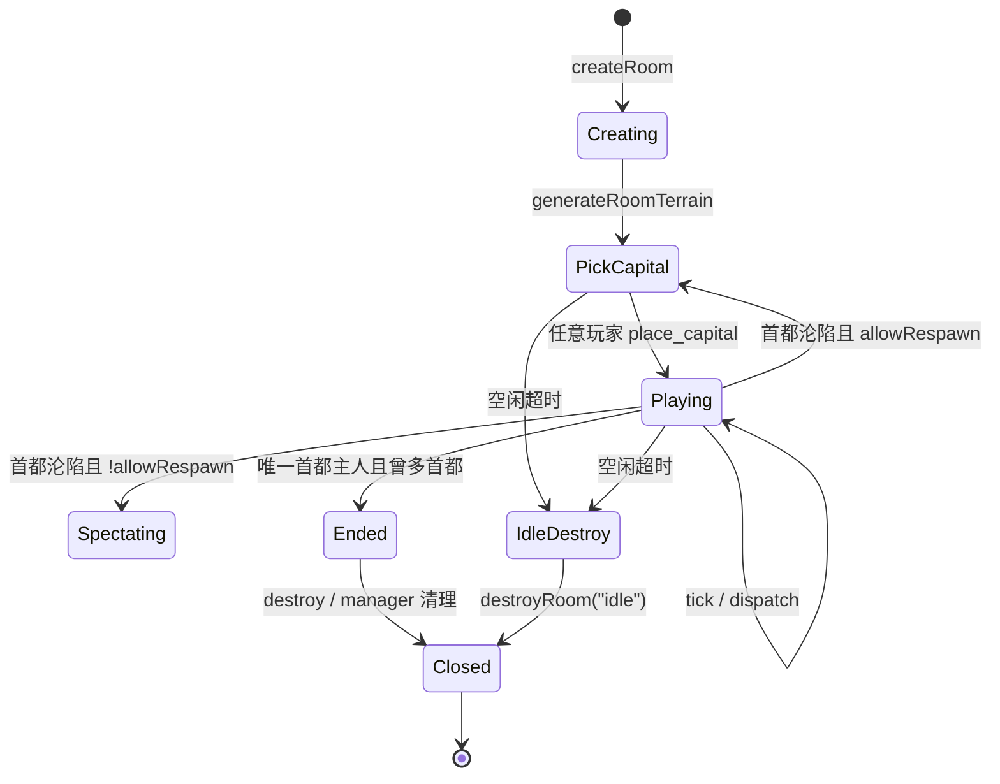
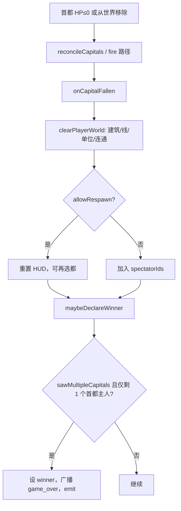

# 房间（`room.ts`）

文件：`core/server/src/room.ts`。

## 1. 职责

`createRoom(options)` 返回一个**隔离的对局房间** `GameRoom`：

- 创建时按 `mapSize`/`seed` **立即生成地形**（不再接受客户端 `init`）。
- 管理玩家会话、建筑、联络线、单位、污染区、通讯连通集。
- 处理游戏内 `ClientToServer`（大厅类消息拒绝）。
- 按外部调用的 `tick()` 推进模拟并广播个性化 `state`。
- 在空闲超时、胜负、或显式 `destroy` 时关闭并发出事件。

## 2. 创建选项与公开 API

### `CreateRoomOptions`

| 字段 | 含义 |
|------|------|
| `roomId` | 房间标识（管理器生成的短码或调试 `DEBUG1`） |
| `maxPlayers` | 夹到 **2–10** |
| `allowRespawn` | 首都沦陷后：`true` 清空势力并回选都；`false` 进观战 |
| `mapSize?` | `MapSizeId`；非法则 `DEFAULT_MAP_SIZE_ID` |
| `seed?` | 地形种子；经 `parseTerrainSeed` |
| `idleMs?` | 无交互销毁阈值；默认 `ROOM_IDLE_MS`（5 分钟） |

### `GameRoom` 主要方法

| 方法 | 行为摘要 |
|------|----------|
| `join({ playerId, name, send })` | 新建或重连；`welcome` + `state`；满员 `room_full` |
| `setSend(playerId, send)` | 仅重绑出站通道（重连导航用） |
| `leave(playerId)` | 移除会话；发出 `player_left`（**不**清世界实体） |
| `dispatch(playerId, msg)` | `ping`→`pong`；`hello` 可改名；其余进 `dispatchPlayerMessage` |
| `tick()` | 见 [game-loop.md](./game-loop.md) |
| `snapshot(playerId)` | 当前视角快照，未知玩家 `null` |
| `destroy(reason?)` | 关房、广播 `room_closed`、清空 `players` |
| `isIdle(now?)` | `now - lastInteractionAt >= idleMs` |
| `on(listener)` | 订阅 `game_over` / `room_closed` / `player_left`；返回取消函数 |

只读属性：`roomId`、`maxPlayers`、`allowRespawn`、`idleMs`、`lastInteractionAt`、`closed`、`winnerId`、`winnerName`。

### `GameRoomHandle`

类包装：`new GameRoomHandle(opts).api` ≡ `createRoom(opts)`。`manager` 的 `gameBridge` 在模块无 `createRoom` 导出时会退而使用该类。

## 3. 闭包内关键状态变量

| 变量 | 类型/角色 |
|------|-----------|
| `closed` | 房间是否已销毁 |
| `winnerId` / `winnerName` | 胜者；非空后 `phaseFor` → `ended` |
| `lastInteractionAt` | 最近非 ping 交互时间（创建、join、选都、多数 action） |
| `spectatorIds` | 无重生规则下的观战者 |
| `knownCapitalOwners` | 曾拥有/仍应拥有首都的玩家；沦陷处理用 |
| `sawMultipleCapitals` | 是否曾经存在 ≥2 个首都主人；**为 true 后才允许宣布胜者**（避免开局一人选都即结算） |
| `players` | `Map<playerId, PlayerSession>` |
| `buildings` / `liaisons` / `units` | 世界实体数组（原地变异 + 整表替换） |
| `pollutionZones` | 核弹污染区（服务端权威） |
| `connectedByOwner` | `ownerId → Set<buildingInstanceId>` 已**提交**的通讯连通 |
| `commWaves` | 进行中的扩散波；波完成才写回 `connectedByOwner` |
| `tick` | 模拟计数；有人 `playing` 时每 `tick()` +1 |
| `phase` | 房间级字符串；**玩家有效阶段以 `phaseFor(session)` 为准** |
| `terrain` | `TerrainMap \| null`；创建后非 null |
| `clearedResourceCells` | 已枯竭资源格键，供 `resourceTerrain` 同步 |
| `MAP` | 当前 `MapConfig` |
| `listeners` | 生命周期监听集合 |

### `PlayerSession`

```ts
{ id, name, hud: PlayerHudState, ws: WebSocket /* 实为 RoomSend 适配器 */ }
```

`hud` 字段：`capitalHp`/`capitalHpMax`/`energy`/`organization`/`organizationMax`。首都 HP 通过 `syncCapitalHud` 与建筑权威同步。

## 4. 房间生命周期



### 4.1 创建

1. 规范化 `maxPlayers`、`idleMs`、`MAP`。
2. `generateRoomTerrain(seed)`：清空建筑/线/单位/污染/连通/观战/胜者标记；`generateTerrain`；`phase = "pick_capital"`；`tick = 0`。
3. `touchInteraction()`。
4. 返回 `api`。

### 4.2 加入 / 重连

`join`：

- 已关闭 → `{ ok:false, code:"room_closed" }`
- 已有同 `playerId` → 更新 `name`、`ws=makeSocket(send)`，`syncPlayerOnJoin`（发 `welcome` + `state`）
- 满员 → `room_full`
- 否则新建 `PlayerSession`（`createHud()`），再同步

`leave` 只删会话并发 `player_left`；建筑与单位仍留在世界上（断线不等于势力清除）。

### 4.3 关闭

`destroyRoom(reason)`：`closed=true`，`phase="ended"`，向所有仍在线玩家发 `room_closed`，`emit` 同事件，`players.clear()`。

空闲：`tickRoom` 末尾若 `isIdleNow()` 则以 `"idle"` 自毁。交互刷新点：`join`、`place_capital`、`dispatch` 中非 `ping`/`hello` 的消息（`touchInteraction`）。

## 5. 玩家阶段 `phaseFor`

| 条件 | 返回 |
|------|------|
| `closed` 或已有 `winnerId` | `ended` |
| 在 `spectatorIds` | `spectating` |
| 无 `terrain` | `need_init`（正常房间创建后不应出现） |
| 无本人首都建筑 | `pick_capital` |
| 其余 | `playing` |

`rejectIfNotPlaying`：非 `playing` 时发 `error`（观战/结束/未选都等文案）并返回 true。

## 6. 快照与出站

`snapshotFor(player)` 组装**逻辑全量** `GameStateSnapshot`：

- `you`：拷贝 HUD（先 `syncCapitalHud`）
- `buildings`/`liaisons`/`units`/`resourceSight`：全视或 `filter*ForViewer`
- `connectedBuildingIds`：已发布连通
- `pollutionZones`、`phase`、`terrainSeed`、`resourceTerrain`
- `players` 花名册、`roomId`、`allowRespawn`、`role`、`winnerId`/`winnerName`

`packWireSnapshot(player, { bootstrap })` 再按规则裁剪上线字段：bootstrap 带 `map`/`terrainSeed`/`allowRespawn`、当前 `role`/winner、`pollutionZones`/`resourceTerrain`，以及**全量** `buildings`/`liaisons`；常规帧省略 bootstrap 三者，且仅在相对该连接 `lastSentChange` 变化时带 `role`/winner/`pollutionZones`/`resourceTerrain`；`buildings`/`liaisons` 相对该连接上次已发送过滤集发 `*Delta`，距上次全量 ≥ 150 tick 时再发全量重置基线。

`syncPlayerOnJoin`：清空 `lastSentChange` → bootstrap 打包 → 先 `welcome`（含 `activeRoomId`、`state`），再发一条同内容 `state`（兼容只监听 `state` 的客户端）。

`makeSocket(sendFn)`：伪造 `readyState=OPEN` 的对象，`send(jsonString)` 时 `JSON.parse` 再交给 `RoomSend`——因为内部统一用 `ws.send(JSON.stringify(msg))` 路径。

## 7. 核心控制流

### 7.1 选都 `handlePlaceCapital`

1. 需已有地形；每人只能一座首都。
2. `snapToBuildNode` → `capitalSiteRejectReason` / `isValidCapitalSite` / `capitalExclusionRejectReason` / 格子占用检查。
3. 推入 `capital` 建筑；`connectedByOwner` 初始化为 `{capital.id}`。
4. HUD 重置为 `STARTING_ENERGY` / `STARTING_ORGANIZATION`。
5. 若房间尚未 `playing`，`tick=0`；`phase="playing"`；移出观战；`knownCapitalOwners.add`；立刻跑一轮通讯波；`broadcastState`。

### 7.2 建造 `tryBuild`

校验目录、地形/`ground`、港口海岸、污染、资源矿点、升级祖先链、费用；扣 E/O；新建或原地改 `buildingId`（可设 `satelliteBuildingId` 伪装）；`buildTicksRemaining` 由费用与「是否在建造视野内」决定（视野外即使 0 tick 也挂 1 tick 等连通）。

人工岛：费用通过后才替换岛建筑，避免失败留下空海。

### 7.3 联络线 `tryBuildLiaison`

节点吸附、去重、相邻性、最大长度；铁路端点锚定与校验；`resolveLiaisonBuildOverlap`（重叠修剪/退款）；扣 E 写入 fragments。

### 7.4 拆除 / 修复 / 升级 / 迁都 / 装填 / 部署 / 开火

均在 `room.ts` 内实现，模式一致：

1. `rejectIfNotPlaying`（及按需 `rejectIfNotLinked` / `rejectIfPolluted`）
2. 所有权与规则校验
3. 扣资源、改世界
4. `broadcastState()`

开火对建筑：可经 `tryInterceptFlyingMissile` 被防空拦截；核弹成功落点追加 `pollutionZones`；首都 HP≤0 摧毁时 `onCapitalFallen`。

### 7.5 首都沦陷与胜负



`leave` **不会**触发沦陷；只有首都实体消失/归零才会。

### 7.6 `dispatchPlayerMessage` 路由摘要

| `msg.type` | 处理 |
|------------|------|
| `init` | 恒拒绝 `init_disabled` |
| `create_room` / `join_room` / `queue_match` / `cancel_queue` / `leave_room` | `lobby_only` |
| `place_capital` … 建筑/联络线/火力 | 上列 handlers |
| `train` / `move_units` / … 单位系 | 委托 `units.ts` |
| `chat` | 截断 200 字后全房间广播 |
| 其他 | `unknown_action` |

`dispatch` 外层：对可记录动作在 `finally` 里发 `action_result`（依赖 shared 的 `shouldLogClientAction` 等）。

## 8. 与 `units.ts` 的交接

几乎所有单位命令传入同一 `UnitWorld` 形状：

```ts
{ map: MAP, terrain, buildings, liaisons, units, connectedByOwner }
```

以及：`phaseFor(session)==="playing"`、`sendError`、`broadcastState`、`slog`。训练/航母还需通讯连通布尔值。

Tick 侧：`advanceUnitTraining` → `advanceUnitMovement` → `advanceUnitAntiAir` → `advanceUnitBlockades` → `advanceUnitCombat`，封锁/驻守的 E 消耗写回各玩家 `hud.energy`。
