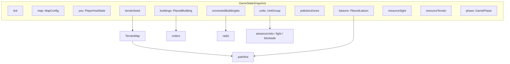
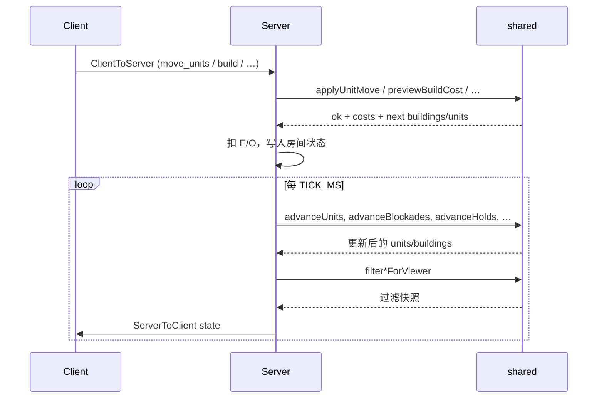

# Shared 层架构

## 角色定位

`@wop/shared`（`core/shared`）是 WarOnPaper 的**规则与仿真纯函数库**：

| 层 | 职责 |
|----|------|
| **shared** | 类型、常量、目录表、命令校验/应用、寻路、tick 推进、视野过滤、经济核算。**不**持有 WebSocket、不读 DOM、不持久化。 |
| **server**（`core/server`） | 房间权威状态、扣资源、按 `TICK_HZ` 调用 shared 推进、按玩家过滤后广播 `state`。 |
| **client**（`core/client`） | 渲染、输入、用同一套 shared 做**预览**（造价、路径、可否建造）；**不**自创能量/组织度余额。 |

权威原则（见 `index.ts` 中 `PlayerHudState` 注释）：

- `energy` / `organization` 由服务端记账；客户端只展示，affordance 可用 shared 算费用。
- 单位/建筑实体以服务端 `GameStateSnapshot` 为准；视野过滤在 shared 中实现，由 server 在发快照前调用。
- 每 tick 的 WS 载荷字段表 → [tick-packets.md](./tick-packets.md)。

## 时间与房间常量

定义于 `core/shared/src/index.ts`：

| 符号 | 值 | 含义 |
|------|-----|------|
| `TICK_HZ` | `15` | 服务端广播/仿真频率（注释：10–20 Hz 目标） |
| `TICK_MS` | `1000/15` | 每 tick 毫秒 |
| `ORGANIZATION_BAR_MAX` | `50` | 组织度条上限 |
| `CAPITAL_HP_MAX` | `60` | 首都 HP 上限（HUD） |
| `STARTING_ENERGY` | `500` | 开局 E |
| `STARTING_ORGANIZATION` | `10` | 开局 O |
| `ROOM_IDLE_MS` | `5 * 60 * 1000` | 空闲房间销毁阈值（manager + GameRoom） |

`buildings/actions.ts` 内部用本地 `TICKS_PER_SEC = 15`，与 `TICK_HZ` 保持一致（避免循环 import）。

## 数据模型总览

核心实体：

1. **`MapConfig`**（`map.ts`）— 格网尺寸：`cellsX/Y` 与线网 `linesX/Y`（线数 = 格数 + 1）。
2. **`TerrainMap`**（`terrain/types.ts`）— 由 bootstrap 下发的 `terrainSeed` 在 client/server **各自** `generateTerrain` 再生（客户端缓存 seed，常规 tick 不再带）；资源枯竭用 `resourceTerrain`（`cleared` + `deposits`；bootstrap / 变化时下发）同步。
3. **`PlacedBuilding`** — 格点整数坐标；驻军 `u` + `awayOccupiedU`；建造/修理 tick；训练队列等。
4. **`PlacedLiaison`** — 折线节点（整数格点）；线缆/公路/铁路。
5. **`UnitGroup`** — 0.2 Du 坐标；路径、状态机、携行 E、交战/驻守/封锁字段。

## 命令 → 状态 → Tick 数据流

典型调用链（单位调动）：

1. 客户端发 `move_units`（`sources` / `unitIds` + 目标坐标）。
2. Server 组装 `MoveContext`，调用 `applyUnitMove`（`units/orders.ts`）。
3. Orders 内部：`deployFromBuilding`（驻军）→ `planAirPath` / `planLandOrNavyPath`（寻路）→ `applyPath` 写入 `path` / `pending*`。
4. 每 tick：`advanceUnits` 按 `speedAt` 与携行补给推进坐标；到达后 `settleIdle` 进入封锁/驻守/交战/补给/入库。
5. 并行 tick：`advanceBlockades`、`advanceHolds`、`advanceFightsAndSieges`、`advanceAntiAir`、`advanceLiaisonCuts` 等（由 server 编排）。

## 状态机（单位）

`UnitState`（`units/catalog.ts`）：

| 状态 | 含义 |
|------|------|
| `idle` | 停留（含港口/航母「停泊」场景） |
| `moving` | 行军 |
| `training` | 训练产出运送途中（可无视活动范围） |
| `holding` | 驻守己方建筑外 |
| `blockading` | 封锁，周期交战 R=2 |
| `fighting` | 单位战或攻城 |

附加标志：`retreating`（撤回归属建筑前拒收其他命令）、`depositOnArrival`、`pendingBlockade` / `pendingSupply` / `pendingHold*` / `pendingAttack*`、`liaisonCut`、`aaEngagement` 等，见 [units-core.md](./units-core.md)。

## 坐标两套网格

| 网格 | 步长 | 用途 |
|------|------|------|
| **建筑 / 联络线格点** | 整数 1 Du | `PlacedBuilding.gx/gy`，联络线 `nodes` |
| **单位坐标** | `UNIT_COORD_STEP = 0.2` | `UnitGroup` 位置与 A* 节点 |

`snapToUnitCoord` / `snapToBuildNode` 分别吸附；寻路邻居为 8 向 0.2 步。

## 通信与活动范围

- **通信链路**（`buildings/comm.ts`）：自首都扩散波，经线缆/公路/铁路/电台；结果为 `connectedBuildingIds`。
- **直接视野**（`vision/vision.ts`）：已通信且建成的己方建筑 + 己方野外单位。
- **单位活动范围**（`units/radio.ts`）：陆地 → 电台工作范围并集；空军 → 所属机场；港口海军 → 该港口工作范围（均可并入邻近雷达圆）。

建造中断与 `buildPaused`：见 `isConstructionAllowedAt`（视野或公路/铁路连入视野）。

## 包边界约定

- 所有仿真函数尽量 **纯**：输入状态 → 新状态 + 费用；由 server 扣资源。
- 失败用 `{ ok: false, error: string }` 或 `MoveApplyResult.ok === false`，错误文案面向玩家中文。
- `index.ts` 是唯一公共 API 面；内部 `.js` 扩展名符合 ESM/`tsc` 输出。
