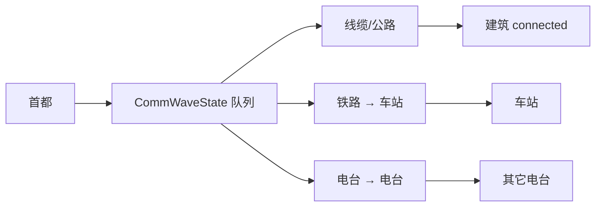

# 建筑、联络线、通信与经济

目录：`core/shared/src/buildings/`

| 文件 | 职责 |
|------|------|
| `catalog.ts` | 建筑定义表、造价/工期、建造树、发射冷却 |
| `actions.ts` | `PlacedBuilding`、放置/修理/拆除/迁都逻辑 |
| `levelUpgrade.ts` | 雷达/港口/兵营/装甲营/机场线性 1–10 级 |
| `workRange.ts` | 工作半径圆 + 雷达协同 |
| `economy.ts` | 产电、炼化、功耗、资源揭示/枯竭、核装填条件 |
| `liaison.ts` | 线缆/公路/铁路折线几何与造价 |
| `comm.ts` | 自首都通信波扩散 |
| `pollution.ts` | 核污染区 |

---

## `catalog.ts`

### `BuildingDef` 要点

- `prereq` / `upgradeLevels`：空地升级链；造价按累计等级 × `BUILD_E_PER_LEVEL`(10)  
- `hp` / `u` / `storeEMax` / `ammoMax` / `reloadE` / `h` / `unitH` / `deployStepE` / `workR`  
- `p` / `orgBonus` / `rawP` / `requiresResource` / `refineVia`  
- `flags`：`seaOnly`、`lineBuild`、`relocateOnly`、`unique`、`noPowerDrain`  

`BUILDINGS` / `BUILDING_BY_ID` 为唯一目录源。  
`getInvestedLevels` / `getBuildEnergyCost` / `getBuildDurationSec` / `getBuildTree` / `getUpgradeTargets` 支撑 UI 与放置。  
`launchCooldownSec` / `withLaunchCooldown`：装填相关发射冷却（秒 ↔ tick）。

---

## `actions.ts` — `PlacedBuilding`

运行时实例字段（摘录）：

| 字段 | 含义 |
|------|------|
| `id` / `buildingId` / `ownerId` / `gx,gy` | 身份与整数格点 |
| `hp` / `hpMax` / `level?` | 耐久与线性等级 |
| `u` / `awayOccupiedU?` | 在营 / 外出占用 |
| `storeE` / `ammo` | 补给储能 / 防空弹药 |
| `fireCooldownUntilTick?` | 发射冷却截止 |
| `trainingQueue?` | 训练场 FIFO |
| `investedE` / `buildTicksRemaining` / `buildTicksTotal` | 投入与建造进度 |
| `constructionHalted?` | 建造中受损 → 须「继续建造」 |
| `repairedAtTick?` / `repairTicks*` / `repairHp*` | 修理状态 |
| `satelliteBuildingId?` | 升级中卫星门面 |
| `mutualDefensePartnerId?` | 互防；伙伴消失或 `end_mutual_defense` 时清除 |
| `capturePending?` | 攻陷待拆/修 |
| `polluted?` | 污染失效 |

### 关键导出逻辑

| 符号 | 作用 |
|------|------|
| `BUILD_O_COST` 等 | 建造/拆除/装填/迁都 O 费与拆除/修理 E 公式常量 |
| `snapToBuildNode` / `nodeKey` / `findBuildingAt` / `Near` | 格点工具 |
| `isBuildingComplete` | `buildTicksRemaining <= 0` |
| `buildingStartsEmptyGarrison` / `initialBuildingGarrisonU` | 兵营/装甲营空编；其它满编 |
| `constructionHp` / `repairHp` | 建造/修理中 HP 插值 |
| `previewBuildCost` / `previewRepairCost` / `previewContinueBuildCost` | UI 预览 |
| `canPlaceBuildingDef` | 地形/前置等放置校验（配合 ground） |
| `interruptBuildOrRepairOnDamage` / `applyBuildingHpDamage` | 受伤中断与 HP |
| `demolishEnergyRefund` / `isDemolishLockedByRepair` | 拆除返还与修复后锁拆 |
| `applyCapitalRelocateInPlace` | 迁都到首府 |
| `durationSecToTicks` | 秒 → tick（与 15Hz 对齐） |

---

## `levelUpgrade.ts`

可升级：`radar` | `port` | `barracks` | `armor_barracks` | `airport`。

- 费用：从 L 升到 L+1 = `(L+1)^5` E  
- 属性：level 1 = 目录基值，level 10 = 5×，线性插值（`linearStatMultiplier`）  
- `effectiveHpMax` / `effectiveUmax` / `effectiveWorkR`  
- `previewLinearUpgrade` / `applyLinearUpgrade` / `romanLevelLabel`  

---

## `workRange.ts`

`workRangeCircles(building, buildings, connectedIds)`：

1. 自身 `effectiveWorkR` 圆  
2. 若自身已通信：并入距离 &lt; `RADAR_WORK_BOOST_DIST_DU`(1.5) 且已通信的同阵营雷达圆  

单位活动范围、防空、机场/港口覆盖均依赖此并集。

---

## `economy.ts`

| 函数 | 作用 |
|------|------|
| `findResourceUnderBuilding` | 格点触及格上的匹配资源 |
| `revealResourcesUnderMiners` | 首次开采揭示储量 |
| `collectResourceSight` | 客户端储量环数据 |
| `depleteResourcesForMiners` | 扣减储备 |
| `collectResourceTerrainSync` / `applyResourceTerrainSync` | 枯竭同步 |
| `sumPowerProduction` / `sumRefinedRawIncome` | 直产 P + 炼化 |
| `energyIncomePerSecond` | 净收入相关 |
| `powerDrainPer10s` | 按建筑 size：`POWER_DRAIN_PER_10S` |
| `orgBonusPer30s` | 组织度周期加成（与 catalog `orgBonus`） |
| `nukeReloadRejectReason` | 核装填：通信 + 工作中铀矿机与铀工厂 |

污染建筑 `polluted` 不参与产电/炼化/功耗/组织度（`isActive`）。

---

## `liaison.ts` — 联络线

### 种类

| kind | costPerDu | maxLength | 移速 |
|------|-----------|-----------|------|
| fiber | 0.5 | 10 | 无 |
| road | 1 | 20 | 0.8 |
| railway | 3 | 30 | 2 |

`PlacedLiaison`：`nodes`（≥2 整数格点）、`investedE`、建造 ticks。

### 几何与造价（导出摘要）

- `segmentLengthDu` / `pathLengthDu` / `segmentKey` / `pathsShareSegment`  
- `previewLiaisonCost` / `withLiaisonTerrainSurcharge`  
- `pickNextLiaisonStep` / `bluntLiaisonPath` / `extendLiaisonPath` / `isValidLiaisonPath`  
- 铁路：`hasOwnedRailwayStationAt` / `anchorRailwayEndpoints` / `railwayEndpointRejectReason`  
- 重叠：`findOverlappingLiaisons` / `resolveLiaisonBuildOverlap` / `demolishLiaisonRefundE`  
- 拾取：`findLiaisonNear` / `findLiaisonSegmentNear` / `distancePointToSegment`  

路轨地形附加费实现主要在 `terrain/placement.ts`，经 `withLiaisonTerrainSurcharge` 合并。

---

## `comm.ts` — 通信波

常量：`COMM_WAVE_INTERVAL_TICKS = 10`，`COMM_STEPS_PER_TICK = 48`。

思想：归一化预算 `[0,1]`，在介质上走距离 `d` 消耗 `d/M`（M = 介质最大长度或电台 R）；换介质按比例折算剩余 Du；**真正接入的建筑**重置预算为 1。

特殊：

- 铁路：只给**车站**接通信并中继；沿线其它建筑不因铁路直连  
- 电台：只链工作范围内的其它电台（含雷达协同圆）  

导出：`buildLiaisonAdjacency`、`startCommWave`、`stepCommWave`、`isBuildingCommsLinked`、`collectCommUsedEdges`、`remainingDuOnMedium` 等。结果写入快照 `connectedBuildingIds`。

---

## `pollution.ts`

- `NUKE_POLLUTION_R_DU = 2`  
- 首都在区内每 `POLLUTION_CAPITAL_HP_INTERVAL_SEC`(3s) 扣 `POLLUTION_CAPITAL_HP_DAMAGE`(1) HP（由 server 调）  
- `createNukePollutionZone` / `isPointInPollution` / `isBuildingInPollution`  

污染内：禁止建造；建筑失效仅可拆除（规则注释）。
