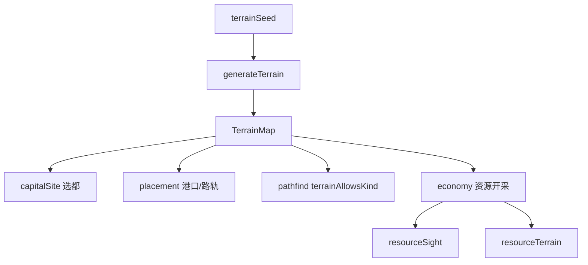

# 地形

目录：`core/shared/src/terrain/`

| 文件 | 职责 |
|------|------|
| `types.ts` | 格子/资源/矿点类型与 `cellAt` |
| `generateTerrain.ts` | 由种子程序化生成地图 |
| `capitalSite.ts` | 格点触及、首都选址约束 |
| `placement.ts` | 港口与公路/铁路地形造价、可通行段 |

服务端在快照中下发 `terrainSeed`；客户端用同一种子本地 `generateTerrain`，避免传输整张图。资源枯竭通过 `resourceTerrain` / `resourceSight` 同步。

---

## `types.ts`

| 类型 | 含义 |
|------|------|
| `GroundKind` | `ocean` \| `land` \| `mountain` |
| `ResourceKind` | `oil` \| `uranium` \| `forest` |
| `TerrainResource` | `reserve` / `reserveMax` / `depositId?` / `revealed?` |
| `TerrainCell` | `ground` + `resource` |
| `TerrainDeposit` | 油/铀整块矿点：cells + 共享储量 |
| `TerrainMap` | `seed`、宽高、行优先 `cells`、`deposits` |
| `ResourceSightCell` | 已揭示储量环（林=整格；油铀=质心） |
| `ResourceTerrainSync` | `cleared` 枯竭格 + `deposits` 当前储量 |

`cellAt(map, x, y)`：越界返回 `null`。

---

## `generateTerrain.ts`

### 种子

- `hashStringToSeed` — FNV-1a 32-bit  
- `parseTerrainSeed` — 空→undefined；数字/整数字符串→uint32；其它字符串→hash  

### `generateTerrain(options?)`

选项默认：

| 选项 | 默认 | 含义 |
|------|------|------|
| `map` | 89×59 | 尺寸 |
| `seed` | 随机 | 可复现 |
| `landRatio` | 0.58 | 陆地占比 |
| `mountainRatio` | 0.12 | 陆地中山地占比 |
| `forestRatio` | 0.154 | 非山地陆地中林地占比 |

实现要点（逻辑块）：

1. `mulberry32` PRNG + `fbm` / value noise 生成高度场类噪声  
2. 按阈值切海洋/陆地，再标山地  
3. 放置油/铀矿点（多格共享 `TerrainDeposit`）与林格资源  
4. 返回完整 `TerrainMap`  

客户端与服务端必须使用相同 `seed` 与默认比例参数，否则格子不一致。

---

## `capitalSite.ts`

### 触及几何

| 函数 | 用途 |
|------|------|
| `cellsTouchingNode` | **整数**格点周围最多 4 格（建筑/首都） |
| `cellsTouchingUnitCoord` | **0.2** 单位点：角/边/内部精确触及（寻路用；避免把海中分数坐标误判为海岸） |

### 地形标签（格点）

- `isFoothillNode` / `isCoastlineNode` / `isForestInteriorNode` 等（源码内）  
- `isValidCapitalCell` / `isValidCapitalSite`  
- `capitalSiteRejectReason` / `capitalSiteRejectMessage`  
- `capitalExclusionRejectReason` + `CAPITAL_EXCLUSION_R_DU` — 与其它首都排斥半径  

首都不可落在非法地形（如纯海、林内等，以源码 reject reason 为准）。

---

## `placement.ts`

### 港口

`isValidPortSite`：须为海岸线节点，且触及格中有陆地或山地。

### 路/轨段

`cellsTouchedBySegment`：正交段取共边两格；对角段取穿过的一格。

`classifyRoadRailSegment` → `RoadRailSegmentTerrain`：

`plain` | `foothill` | `mountain` | `coastline` | `ocean`

附加造价常量：

| 常量 | 含义 |
|------|------|
| `ROAD_RAIL_FOREST_E_PER_DU` | 50 — 穿林内部 |
| `ROAD_RAIL_TERRAIN_E_PER_DU` | 公路/铁路 × 山区/海洋单价；山脚/海岸半价 |

导出：

- `isValidRoadRailNode` / `isValidRoadRailSegment`  
- `roadRailPathRejectReason` / `clampRoadRailPath`  
- `isForestInteriorSegment`  
- `roadRailTerrainDu` / `roadRailTerrainRateEPerDu` / `roadRailTerrainSurchargeE`  

陆海军寻路借道己方完成公路/铁路时，不直接读这些附加费；附加费只影响**建造联络线**造价。

---

## 与其它模块的耦合

