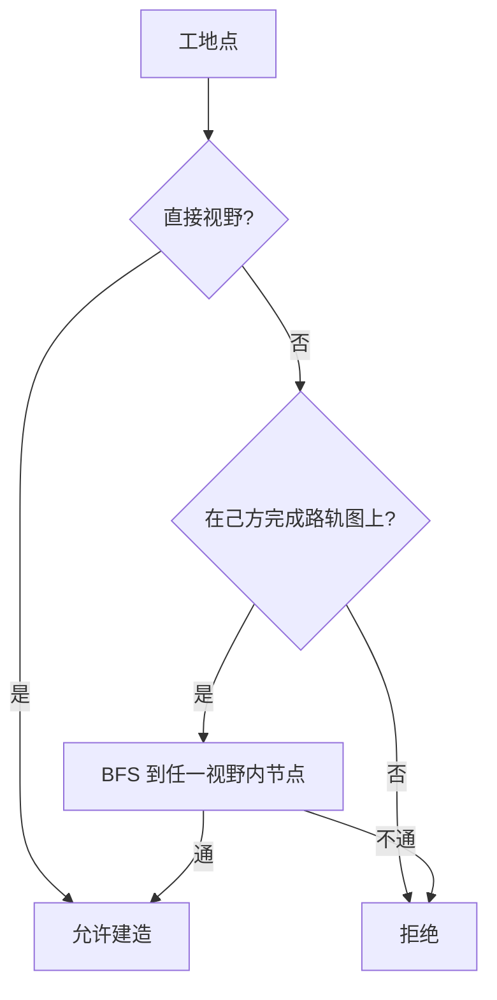

# 视野（Vision）

源文件：`core/shared/src/vision/vision.ts`

规则对应 §4.5：地图级**卫星**可见性 + 局部**直接**视野。单位过滤亦见 `units/filter.ts`（复用本模块源采集）。

---

## 直接视野半径常量

| 常量 | 值 | 对象 |
|------|-----|------|
| `DIRECT_VISION_R_BY_SIZE` | 小 3 / 中 5 / 大 8 | 一般建筑按 size |
| `DIRECT_VISION_R_RADAR` | 4 | 雷达覆盖（覆盖 size 表） |
| `DIRECT_VISION_R_CAPITAL` | 10 | 首都 |
| `DIRECT_VISION_R_INFANTRY` | 2 | 步兵 |
| `DIRECT_VISION_R_ARMOR_NAVY` | 4 | 装甲 / 海军 / 航母 |
| `DIRECT_VISION_R_AIR` | 8 | 空军（`airOnly`） |

`directVisionRadiusForBuilding(buildingId)`：首都/雷达特判，否则查 `BUILDING_BY_ID.size`。

---

## `VisionLevel` / `VisionSource`

- `VisionLevel`：`"none"` | `"satellite"` | `"direct"`  
- `VisionSource`：`{ gx, gy, radiusDu, airOnly? }`  
  - `airOnly: true`：只揭示敌方空军（及未来飞行导弹），**不**揭示建筑与陆海单位  

---

## 采集源

可选参数 `teams?: TeamRoster`：同队友军按己方计入（`isFriendly`）。

| 函数 | 条件 |
|------|------|
| `collectDirectVisionSources` | 己方/友军、`connectedIds` 连通、未污染；首都或已建成 |
| `collectUnitVisionSources` | 己方/友军野外单位；空军标 `airOnly` |
| `collectAllDirectVisionSources` | 上两者拼接 |

快照过滤：友军建筑/单位发**完整**数据（与己方相同）；敌方规则不变。房间侧 `connectedBuildingIds` 为同队已发布连通集合的并集。高级视图「敌方视野」须排除同队。

`isInDirectVision`：**忽略** `airOnly` 源（用于建筑/资源等）。  
`unitInDirectVision`：一般源可见任意单位；仅 airOnly 命中时仅 `kind === "air"` 可见。

---

## 卫星规则

### `satelliteSeesBuilding`

用门面 id `satelliteBuildingId ?? buildingId`：

| size | 规则 |
|------|------|
| small | 不可见 |
| large | 可见 |
| medium | 已建成可见；升级中保留旧 facade 时亦可见 |

### `satelliteSeesLiaison`

| kind | 规则 |
|------|------|
| fiber | 不可见 |
| railway | 可见（含在建进度可泄露，过滤时保留 ticks） |
| road | 建成后可见 |

`buildingVisionLevel` / `liaisonVisionLevel`：己方 = direct；否则先 direct 再 satellite，否则 none。

---

## 快照过滤

### `filterBuildingForViewer`

| 级别 | 内容 |
|------|------|
| none | 丢弃 |
| 己方 | 全量；在建时算 `buildPaused`（`isConstructionAllowedAt`） |
| 敌方 direct | 类型+HP+建造剩余；清空 u/storeE/ammo/investedE |
| 敌方 satellite | 门面类型；HP/进度全 0 |

### `filterLiaisonForViewer`

己方全量；敌方 direct 去 investedE；satellite 公路进度清零、铁路可保留建造 ticks。

批量：`filterBuildingsForViewer` / `filterLiaisonsForViewer`。

### `filterResourceSightForViewer`

储量环**仅**直接视野（排除 airOnly）。采样点：`resourceSightSamplePoint` — 整数格用中心 `(x+0.5,y+0.5)`，矿点质心用小数坐标原样。

### `shouldMaskUpgradeOnSatellite`

目标为小/中型时，升级过程卫星仍显示升级前门面（配合 `satelliteBuildingId`）。

---

## 建造许可与路网连通

### `buildRoadRailAdjacency`

己方**已建成**公路/铁路折线 → 无向节点邻接表（`nodeKey`）。

### `isConstructionAllowedAt`

建造可推进当且仅当：

1. 落点在直接视野内，**或**  
2. 落点在已建成路/轨图上，且存在一条路/轨路径连到某个「落在直接视野内的图节点」。

实现：从所有「视野内的邻接节点」BFS，看能否到达工地 `nodeKey`。

`constructionRejectReason`：失败时返回固定中文提示。

---

## 与单位过滤的关系

`units/filter.ts` 的 `filterUnitForViewer` 使用同一套 `collectAllDirectVisionSources` + `unitInDirectVision`。敌方无卫星单位剪影：不在直接视野内则整组省略。
